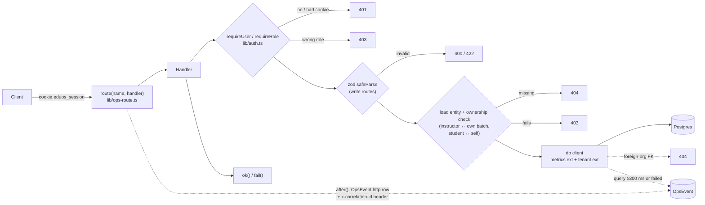
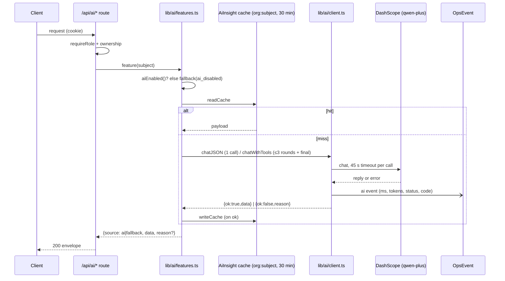

# Edu OS — API Reference

This document covers every `app/api/**/route.ts` on branch `finale-hardening`, uncommitted tree
as of 2026-10-23: **56 route files, 82 handlers** (30 GET · 26 POST · 12 PATCH · 10 DELETE ·
2 PUT, plus the two ops GETs). Every claim cites code as `file:line` or points to a **measured
fact** from the hardening session (marked *measured*). Anything else is marked *unverified*.

**Status legend:** **verified** means implemented and exercised by a script or test listed here.
**impl-unverified** means the code is present but no run in this session exercised that path.
**partial** means only part of the intended behaviour is implemented. **gap** means the
behaviour is missing or wrong.

Nothing here has been deployed. All *measured* results come from a local production build on
scratch Postgres 17 + pgvector, seeded with two institutes: `org_bq` with 258 users and
`org_akf` with 8 users. Nothing from this branch has been pushed or deployed; the session's
production baseline was taken on `main @ d7ad650`. Which commit the live
`eduos.vercel.app` build was made from is *unverified*.

---

## 1. Conventions shared by every route

### 1.1 Envelope

Every handler except logout answers with `ApiResponse<T> = { success: boolean; data?: T; error?: string }`
(`lib/api.ts:4`):

- `ok(data)` returns **200** `{ success: true, data }` (`lib/api.ts:12`).
- `fail(msg, status = 400)` returns `{ success: false, error }` (`lib/api.ts:16`).
- `handleApiError` (`lib/api.ts:20-37`) maps an `AuthError` to its own status and message, and
  records an `auth/denied` OpsEvent. Anything else becomes **500** `"Something went wrong"`,
  and only the class name and Prisma error code are recorded. Raw messages never reach the
  client.

There are no list envelopes or `meta` blocks. Each list route picks its own shape, listed per
route below.

### 1.2 Authentication

- The session is an HS256 JWT in the cookie `eduos_session`, valid for 7 days. Its flags are
  `httpOnly`, `sameSite=lax`, and `secure` when `NODE_ENV=production` (`lib/auth.ts:23-36`).
  Its claims are `userId, name, email, role, organizationId, studentId?, instructorId?`
  (`lib/auth.ts:13-21`).
  *Measured (ops-check.mjs):* the cookie carries HttpOnly, SameSite=Lax and Secure.
- In production the signing key throws if `AUTH_SECRET` is unset. Development falls back to
  `"dev-secret"` (`lib/session-secret.ts:9-17`, unit test `lib/session-secret.test.ts`). This
  closes finding **F01** in code. Whether `AUTH_SECRET` is set in Vercel is *unverified*.
- A token with no `organizationId` is treated as signed out (`lib/auth.ts:47-48`). If such a
  token reaches a scoped query, the tenant extension throws **401** (`lib/tenant.ts:38`).
- `requireUser()` returns **401** `"Not signed in"`. `requireRole(...roles)` returns **403**
  `"Forbidden"` (`lib/auth.ts:56-66`).
- `middleware.ts:53` **excludes `/api`**. Every API route must therefore gate itself. All
  handlers call `requireUser`/`requireRole`, except the 4 public handlers listed in §3.
- Roles are `STUDENT`, `INSTRUCTOR` and `MANAGEMENT`. In this API, MANAGEMENT means an
  *institute admin*. The **platform operator** is a separate allowlist: a MANAGEMENT user whose
  email is in `OPS_ADMIN_EMAILS`. That list is empty in production when unset, and defaults to
  `admin@eduos.pk` in development (`lib/platform.ts:10-16`).

### 1.3 Tenant isolation (applies to every route that uses `db`)

`db` = `rawDb.$extends(metrics).$extends(tenantExtension(rawDb))` (`lib/db.ts:36`).
The extension reads the org from the signed cookie on every query (`lib/tenant.ts:22-40`).

| Context | When | Effect |
|---|---|---|
| `system` | no request scope (seed, scripts) | unscoped |
| `anon` | no cookie or an invalid cookie | **unscoped**. Protected routes have already returned 401 by this point. |
| `org` | valid session | every query on the 24 scoped models gets `AND <org filter>` (`lib/tenant.ts:55-80,162`) |

Create operations (and the `create` half of an upsert) stamp `organizationId` on the 6 root
models. An update that tries to set a root row's `organizationId` to another org returns
**403**. Any foreign key in `data` (`courseId`, `batchId`, `studentId`, ...) is checked against
the caller's org on create, update and upsert. A foreign id from another tenant returns
**404 "Not found"**, the same answer as a missing id (`lib/tenant.ts:82-146,163-173`).

**What this means for every route below:** another tenant's id always behaves as *not found*.
That is usually the route's own 404, or a 404 `AuthError` from the extension. Routes add only
**role and ownership** checks inside one org.

Five models are global by design: `Organization`, `Skill`, `AiInsight`, `ContactSubmission` and
`OpsEvent` (`lib/tenant.ts:52-54`).

**Raw SQL bypasses the extension.** The two raw queries over tenant data scope themselves by
hand: `lib/management.ts:217-228` and `lib/rag/search.ts:35-38`. The other raw queries are in
`lib/ops-summary.ts`, read platform telemetry through `rawDb`, and are cross-tenant on purpose
(§4).

*Measured:* `scripts/tenant-isolation.mjs` passed **21/21** checks, covering cross-tenant reads
and writes plus cross-role and ownership checks inside one org.

### 1.4 Request pipeline

The order is the common one, not universal: most write routes parse the body first and then
load the entity to check ownership, while the course-editor routes call `requireCourseEditor`
before parsing (`app/api/courses/[id]/route.ts:44-46`). Read routes have no body to parse.

### 1.5 Telemetry wrapper

Every handler except the two `/api/ops/*` GETs is exported through
`route("/api/...template", handler)` (`lib/ops-route.ts:10-36`). The wrapper does three things:

- It sets the `x-correlation-id` header on the response (`lib/ops-route.ts:18`).
- After the response is sent, it records one `http` OpsEvent: method plus route template,
  status, latency, and Prisma query count and time (`lib/ops-route.ts:23-33`).
- Only the template is stored, never the concrete URL.

*Measured (ops-check.mjs):* API responses carry `x-correlation-id`, and telemetry stored
`http`, `auth` and `denied` events with template names.

Neither ops endpoint is wrapped, by choice (`app/api/ops/summary/route.ts:8-9`). They emit no
correlation header and no http telemetry.

### 1.6 Rate limits, pagination, caps

- **Only login is throttled.** The limit is 8 failures per `sha256(email|ip)` in 15 minutes,
  then **429** (`lib/auth.ts:70-84`).
  - The counter lives in `OpsEvent`, so the throttle fails open (`.catch(() => 0)`,
    `lib/auth.ts:80`) and is disabled when `OPS_TELEMETRY=off` (`lib/ops.ts:36`).
  - The IP is the first hop of `x-forwarded-for` (`app/api/auth/login/route.ts:17`). Whether
    that header can be spoofed behind Vercel is *unverified*.
  - *Measured:* 8 × 401, then 429.
- AI routes, `/api/contact`, the knowledge routes and every other route have **no rate limit**.
- Only two routes paginate with a cursor: `/api/notifications` and `/api/management/students`.
  `/api/students` uses offset paging. Most other lists use a hard `take: 500`, `take: 100`, or
  **no cap** (marked per route).
- Validation errors return **422** on most routes. These return **400** instead: routes that
  use `lib/schemas/*` (`batches`, `students`, `instructors`, `enroll`), `login`, and the
  hand-written checks in `/api/ai/copilot` (missing `batchId`, bad `kind`), `/api/ai/ask` and
  `/api/ai/schedule` (missing `question`).

### 1.7 External dependencies

Only the AI and knowledge routes call out of the process.

| Dependency | Used by | Config (names only) | Behaviour on failure |
|---|---|---|---|
| Alibaba Model Studio (DashScope), OpenAI-compatible chat. Default base URL `https://dashscope-intl.aliyuncs.com/compatible-mode/v1`, default model `qwen-plus` (`lib/ai/providers.ts:87-101`, `lib/ai/client.ts:13`) | all `/api/ai/*`, `/api/student/chat`, `/api/instructor/generate-assessment` | `LLM_API_KEY`, `LLM_BASE_URL`, `LLM_MODEL`, `LLM_PROVIDER`, `AI_ENABLED` | Never throws. Returns 200 with `source: "fallback"` and a fixed `reason` code (`lib/ai/client.ts:20-29`). |
| DashScope embeddings `text-embedding-v4`, 1536 dimensions (`lib/ai/embed.ts:3-4`) | `/api/knowledge/ingest`, `/api/knowledge/search` | `LLM_EMBED_MODEL`, `EMBEDDINGS_ENABLED` | Returns `null`. Ingest stores chunks without vectors and search falls back to text. |
| Arbitrary public URL (HTTP/S fetch) | `/api/knowledge/ingest` | none | API returns 500 `Ingest failed: fetch_failed`. The source row stores the short code, such as `fetch_failed: blocked_url` (`lib/rag/ingest.ts:36-45`). |

LLM call limits:

- Each upstream call has a 45 s timeout (`lib/ai/client.ts:15`).
- `chatJSON` makes 1 call (`lib/ai/client.ts:114-152`). `chatWithTools` makes up to 3 tool
  rounds plus 1 final call (`lib/ai/client.ts:16,165-226`), so one request can wait up to
  **about 180 s** upstream (deduced, not measured). No route exports `maxDuration`, so on
  Vercel the platform default applies (*unverified*).
- The features in `lib/ai/features.ts` cache answers in `AiInsight` for 30 minutes under the
  key `"<orgId>:<subject>"` (`lib/ai/features.ts:30-36`). This is the fix for the shared
  "institute" cache keys. `/api/student/chat` and `/api/instructor/generate-assessment` call
  the client directly and are not cached.

*Measured:* with an invalid key, `GET /api/ai/career-path` and `POST /api/ai/ask` returned
**200, `source=fallback`, `reason=provider_auth`** in 631 ms and 234 ms. Two `ai` OpsEvents
were recorded with status 401. **A real Qwen success path was not verified (no valid key).**

---

## 2. Endpoint index

R/W column: R = read, W = write. Roles: S = STUDENT, I = INSTRUCTOR, M = MANAGEMENT,
P = platform operator (M plus allowlist), — = public.

| Domain | Method & path | Roles | R/W |
|---|---|---|---|
| Auth | `POST /api/auth/login` | — | W |
| | `POST /api/auth/logout` | — | W |
| Public | `GET /api/public/courses` | — | R |
| | `POST /api/contact` | — | W |
| Ops | `GET /api/ops/health` | P | R |
| | `GET /api/ops/summary` | P | R |
| Management | `GET /api/management/overview` | M | R |
| | `GET /api/management/students` | M | R |
| Students | `GET /api/students` | M, I | R |
| | `POST /api/students` | M | W |
| | `GET /api/students/[id]` (+ `/courses` `/attendance` `/assessments` `/assignments` `/performance` `/progress`) | M, I (taught), S (self) | R |
| | `PATCH` / `DELETE /api/students/[id]` | M | W |
| | `POST /api/students/[id]/enroll` | M | W |
| | `GET /api/student/overview` | S | R |
| Instructors | `GET` / `POST /api/instructors` | M | R/W |
| | `GET` / `PATCH` / `DELETE /api/instructors/[id]` | M | R/W |
| | `GET /api/instructors/[id]/students` | M, I (self) | R |
| | `GET /api/instructor/batches` | I, M | R |
| Courses | `GET` / `POST /api/courses` | M, I | R/W |
| | `GET /api/courses/[id]` | M, I | R |
| | `PUT /api/courses/[id]` | M, I (editor) | W |
| | `DELETE /api/courses/[id]` | M | W |
| | `POST` / `PUT` / `DELETE /api/courses/[id]/modules` | M, I (editor) | W |
| | `GET /api/skills` | M, I | R |
| Batches | `GET` / `POST /api/batches` | M | R/W |
| | `GET /api/batches/[id]` | M, I (own), S (enrolled) | R |
| | `PATCH` / `DELETE /api/batches/[id]` | M | W |
| Classrooms | `GET` / `POST /api/classrooms`, `GET` / `PATCH` / `DELETE /api/classrooms/[id]` | M | R/W |
| Academics | `POST /api/assessments` | M, I (own batch) | W |
| | `GET` / `PATCH` / `DELETE /api/assessments/[id]` | M, I (own batch) | R/W |
| | `PATCH /api/assessments/[id]/grade` | M, I (own batch) | W |
| | `POST /api/assignments`, `GET` / `PATCH` / `DELETE /api/assignments/[id]` | M, I (own batch) | R/W |
| | `PATCH /api/submissions/[id]` | M, I (own batch) | W |
| | `POST /api/attendance`, `PATCH` / `DELETE /api/attendance/[id]` | M, I (own batch) | W |
| Scheduling | `GET /api/schedule` | M, I, S | R |
| | `POST /api/schedule` | M, I (own batch) | W |
| | `PATCH` / `DELETE /api/schedule/[id]` | M, I (own batch) | W |
| | `POST /api/schedule/check-conflicts` | M | R |
| | `POST /api/schedule/generate` | M | W |
| | `POST /api/schedule/move` | M | W |
| Notifications | `GET` / `POST /api/notifications` | S, I, M / M | R/W |
| | `PATCH /api/notifications/[id]/read`, `PATCH /api/notifications/read-all` | S, I, M (own) | W |
| Knowledge (RAG) | `POST /api/knowledge/ingest` | M | W |
| | `GET /api/knowledge/ingest` | M, I | R |
| | `POST /api/knowledge/search` | M, I (teaches), S (enrolled) | R |
| AI | `GET /api/ai/skill-passport`, `GET /api/ai/career-path` | S | R |
| | `POST /api/ai/copilot` | I (own batch), M | R |
| | `POST /api/ai/management`, `POST /api/ai/ask`, `POST /api/ai/schedule` | M | R (all three can **W** through `createSchedule`, see §14) |
| | `POST /api/instructor/generate-assessment` | M, I (own batch) | R (draft only) |
| | `POST /api/student/chat` | S | R |

---

## 3. Auth and public

### `POST /api/auth/login`
`app/api/auth/login/route.ts`

- **Auth:** none.
- **Request:** `{ email: string(email), password: string(min 1) }` (`:8-11`).
- **Response:** `{ home: "/student" | "/instructor" | "/management" }`, plus the
  `Set-Cookie: eduos_session=...` header (`:19-20`).
- **Errors:**
  - 400 `"Email and password are required"` on a ZodError (`:22-24`).
  - 401 `"Invalid email or password"`. Unknown email, wrong password and user with no org all
    give this same answer. A bcrypt compare always runs against a dummy hash, so the timing
    gap is closed (`lib/auth.ts:69,90-94`; **F12** timing).
  - 429 after 8 failures (§1.6).
  - **gap:** a body that is not JSON makes `req.json()` throw `SyntaxError`. That is not a
    ZodError, so the result is **500** instead of 400 (`:15,22`).
- **Tenant:** with no session cookie, the user lookup runs in the anon context and is global,
  because email is globally unique (`prisma/schema.prisma:95`). If the caller already holds a
  valid session, the lookup is scoped to that session's org (`lib/tenant.ts:22-39,157-162`),
  so signing in to another institute's account without logging out first would return 401.
  That last point is deduced from code, *not reproduced*.
- **Status:** verified (*measured*: smoke logs in all roles, ops-check covers the throttle).

### `POST /api/auth/logout`
`app/api/auth/logout/route.ts`

- **Auth:** none. Deletes the cookie.
- **Response:** **303** redirect to `/login`. Not the JSON envelope.
- **CSRF:** the route relies on `SameSite=Lax`. No token.
- **Status:** impl-unverified. None of `smoke.mjs`, `tenant-isolation.mjs` or `ops-check.mjs`
  calls it.

### `GET /api/public/courses`
`app/api/public/courses/route.ts`

- **Auth:** none.
- **Response:** `{ courses: [{ code, title, description, level, durationWeeks, _count: { modules } }] }`, ordered by code. **No cap.**
- **Tenant:** an anonymous caller is unscoped and gets **every institute's courses**. A
  signed-in caller gets only their own org's (`lib/tenant.ts:30,158`). Whether a cross-tenant
  public catalogue is intended is *unverified*.
- **Status:** verified 200 (load test, 0 errors). *Measured on production at the session
  baseline (`main`, functions in iad1, DB in Singapore):* warm 1.83–1.84 s, cold 4.26 s.
  *Measured locally:* n=95, p50 45 ms, p95 124 ms, p99 147 ms. The two environments are not
  comparable like for like.

### `POST /api/contact`
`app/api/contact/route.ts`

- **Auth:** none. **No rate limit and no bot check.** Every call inserts one
  `ContactSubmission` row.
- **Request:**
  `{ name: 1-120, email: email ≤120, phone?: ≤30 | "", message: 1-4000 }` (`:6-11`).
- **Response:** `{ received: true }`.
- **Errors:** 422 listing every zod issue.
- **Tenant:** `ContactSubmission` is global.
- **Status:** impl-unverified.

---

## 4. Ops (platform operator only)

Both endpoints call `assertPlatformAdmin(await requireRole("MANAGEMENT"))`:

- A non-MANAGEMENT user gets **403**.
- A MANAGEMENT user who is not on the allowlist gets **404 "Not found"**. The 404 is
  deliberate: it does not tell institute admins the dashboard exists (`lib/platform.ts:18-22`).

The data is **cross-tenant platform telemetry**, read through `rawDb` (`lib/ops-summary.ts:1-9`).

*Measured (ops-check.mjs):*

| Caller | Result |
|---|---|
| Platform admin | 200 |
| Institute admin (`admin@alkhidmat.pk`) | 404 |
| Instructor | 403 |
| `window=99y` | 400 |

### `GET /api/ops/health`
`app/api/ops/health/route.ts`

- **Response:**
  `{ checks: HealthCheck[], instance: { region, commit, uptimeSec }, checkedAt }`.
  - `HealthCheck = { name, state: healthy|degraded|unavailable|unknown|not_instrumented, detail, ms? }`
    (`lib/ops-summary.ts:124-125`).
  - Checks run in this order: Database (`SELECT 1`, degraded above 1000 ms), Vector search
    (pgvector extension), AI provider (success rate over the last hour), Telemetry pipeline,
    Background jobs (`lib/ops-summary.ts:128-191`).
- **Status:** verified. *Measured:* AI provider showed `unavailable: 2 of 2 calls failed in the
  last hour`.

### `GET /api/ops/summary?window=1h|24h|7d`
`app/api/ops/summary/route.ts`

- **Query:** `window`, default `24h`. Anything outside `WINDOWS` returns 400 (`:13-14`).
- **Response:** `{ window, since, generatedAt, lastEventAt, http: {total, s5xx, s4xx, errorRate, p50, p95, p99, avgQueries, avgDbMs, enoughSamples}, routes[], series[], statuses[], slowQueries[], ai[], auth[], errors[] }`
  (`lib/ops-summary.ts:88-121`).
  - The top-level `http` percentiles are `null` below 20 samples (`MIN_SAMPLES`, `:19`).
    Per-route percentiles are not gated.
  - The window check is `win in WINDOWS` (`app/api/ops/summary/route.ts:14`). An inherited
    key such as `window=constructor` passes it, and `opsSummary` would then build an invalid
    date. The likely result is a 500 rather than a 400 (deduced, *unverified*; platform
    operators only).
- **Status:** verified. *Measured:* recorded the slow query `attendance.findMany` at 334 ms.

---

## 5. Management

### `GET /api/management/overview`
`app/api/management/overview/route.ts`, backed by `lib/management.ts:260-357`.

- **Auth:** M.
- **Response:** `{ summary: {students, instructors, courses, batches, perf}, courses[], batches[], instructors[], attendance[], skills[] }`. Every perf number comes from `lib/analytics.ts`.
- **No cap:** this endpoint reads every batch in the org.
- **⚠ gap: cross-tenant cache.**
  - `managementOverview()` keeps a **process-global** `_overviewCache` with a 60 s TTL. The
    cache is **not keyed by organization** (`lib/management.ts:253-263,355`).
  - Within 60 s on the same warm instance, the second institute's admin would get the first
    institute's overview. The same function also renders `/management`
    (`app/(app)/management/page.tsx:16`).
  - `scripts/tenant-isolation.mjs` does not call this endpoint, so 21/21 does not cover it.
  - This is a deduction from code, *not reproduced*.
  - The *measured* load test is consistent with a cache: n=193, p50 25 ms, p95 116 ms,
    p99 1022 ms.
- **Status:** smoke 200 verified. Tenancy: **gap**.

### `GET /api/management/students?limit=&cursor=`
`app/api/management/students/route.ts`, backed by `lib/management.ts:174-207`.

- **Auth:** M.
- **Query:** `limit`, clamped to 1-500 (default 100). `cursor` is a `rollNo` (keyset on a
  unique column).
- **Response:** `{ students: [{id, name, rollNo, city, batches: string[], perf}], total, returned, nextCursor }`.
- **Status:** smoke 200 verified.

---

## 6. Students

### `GET /api/students?q=&batchId=&limit=&offset=`
`app/api/students/route.ts:12-36`, backed by `lib/students.ts:71-`.

- **Auth:** M or I. An instructor sees only students enrolled in batches they teach (`:26`),
  in any enrollment status.
- **gap (instructor without a profile):** the route passes `instructorId: ""` for an
  INSTRUCTOR session with no `instructorId` (`:26`), but `listStudents` only adds the batch
  filter when `instructorId` is truthy (`lib/students.ts:82`). Such a session would see
  **every student in the org**. Deduced from code, *not reproduced*; whether any seeded
  INSTRUCTOR user lacks a profile is *unverified*.
- **Query:**
  - `q` is a case-insensitive contains match on name, rollNo or city.
  - `limit` is clamped to 1-500 (default 100). `offset` is clamped to 0-100 000.
- **Response:** `{ students: StudentListRow[], total, returned }`, where
  `StudentListRow = {id, name, rollNo, city, phone, education, joinedAt, batches[], perf}`.
- **Status:** verified. *Measured:* load test n=294, p50 123 ms, p95 225 ms. Isolation is
  checked in both directions.

### `POST /api/students`
`app/api/students/route.ts:38-91`

- **Auth:** M.
- **Request:** `StudentCreate` (`lib/schemas/student.ts:18-28`):
  `{ name 2-80, email (lowercased) ≤160, password 6-200, rollNo? 3-24 (uppercased), phone 7-24, city 2-60, education 2-120, batchId? }`.
- **Behaviour:**
  - User, Student and the optional Enrollment are written in one transaction.
  - `backfillEnrollment` adds the attendance, result, submission and module-progress rows
    that the new enrollment needs (`lib/students.ts:172-`).
  - A full batch returns 400.
- **Response:** `{ id, rollNo, name, email, batchId|null }`.
- **Errors:** 400 for zod failures, a missing batch or a full batch. 409 on a duplicate email
  or rollNo.
- **⚠ gap: roll numbers in the second tenant.**
  - `nextRollNo()` looks for the highest `BQ-<year>-NNNN` **inside the caller's org**
    (`lib/students.ts:161-170`). But `rollNo` is **globally unique**
    (`prisma/schema.prisma:113`).
  - `org_akf`'s seeded rolls are `AKF-2026-*` (`prisma/seed.mjs:719`). For an Alkhidmat
    admin, the computed default is `BQ-2026-0001`, which collides with Bano Qabil's roll and
    returns **409**.
  - Deduction from code and seed, *not reproduced*. The workaround is to send `rollNo`
    explicitly.
- **Global uniques act as a cross-tenant oracle.** A 409 on `email`, `rollNo`, `employeeNo`,
  course `code` (on create) or batch `code` reveals that the value exists in *another*
  institute. A classroom `name`, and a course `code` changed through `PUT /api/courses/[id]`,
  leak the same fact as a **500**, because those paths have no P2002 handler
  (`prisma/schema.prisma:95,113,134,150,218,399`).
- **Status:** impl-unverified.

### `GET /api/students/[id]` and sub-resources
Files: `app/api/students/[id]/route.ts:12-22`, plus `courses`, `attendance`, `assessments`,
`assignments`, `performance` and `progress`, each a one-line GET.

- **Auth:** all seven call `requireStudentAccess(id)` (`lib/students.ts:28-44`):
  - 404 if the student is not visible. Another tenant's student is not visible.
  - MANAGEMENT passes.
  - A STUDENT passes only for their own id.
  - An INSTRUCTOR passes only if the student has an enrollment in one of their batches. That
    enrollment can have *any* status, including dropped ones.
- **Response:** the corresponding `lib/students.ts` read model. Every perf figure comes from
  `lib/analytics.ts`.
- **Status:** verified. Smoke returns 200 on all seven as MANAGEMENT. Tenant-isolation checks
  that a foreign tenant and a peer student are both denied. The code returns 404 and 403
  respectively; the script accepts either status. *Measured:* `/performance` n=285, p50 81 ms,
  p95 211 ms.

### `PATCH /api/students/[id]`
`app/api/students/[id]/route.ts:24-71`

- **Auth:** M.
- **Request:** `StudentUpdate`. Every field is optional, but at least one is required
  (`lib/schemas/student.ts:30-42`). A new password is bcrypt-hashed.
- **Behaviour:** the User and Student updates run in one transaction.
- **Response:** the updated student (from `getStudent`).
- **Errors:** 400, 404, and 409 on email or rollNo.
- **Status:** verified that a foreign tenant is denied (tenant-isolation).

### `DELETE /api/students/[id]`
`app/api/students/[id]/route.ts:73-98`

- **Auth:** M.
- **Behaviour:** returns **409 if any enrollment exists**. Otherwise it deletes the **User**,
  which cascades to the Student. This is a hard delete; no soft delete exists.
- **Status:** impl-unverified.

### `POST /api/students/[id]/enroll`
`app/api/students/[id]/enroll/route.ts`

- **Auth:** M.
- **Request:** `{ batchId }`.
- **Errors:** 404 student or batch. 409 already enrolled. 400 batch full. The capacity check
  is not atomic with the insert.
- **Response:** `{ id, enrolledAt, status, studentId, batchId, batchCode }`.
- **Status:** impl-unverified.

### `GET /api/student/overview`
`app/api/student/overview/route.ts`

- **Auth:** any signed-in user that has a `studentId`. Anyone else gets 403.
- **Response:** `{ student: {name, rollNo, city, joinedAt}|null, perf, courses[], upcoming[], recentResults[] }` (`lib/student-overview.ts:118-136`).
- **Status:** verified. *Measured:* n=377, p50 85 ms, p95 199 ms.

---

## 7. Instructors

### `GET /api/instructors`
`app/api/instructors/route.ts:12-44`

- **Auth:** M.
- **Response:** `{ instructors: [{id, name, email, employeeNo, specialization, bio, joinedAt, batchCount}] }`. Capped at `take: 500`.
- **Status:** smoke 200 verified.

### `POST /api/instructors`
`app/api/instructors/route.ts:47-90`

- **Auth:** M.
- **Request:** `InstructorCreate`: `{ name 2-80, email, password 6-200, employeeNo 3-24, specialization 2-120, bio 2-500 }`.
- **Behaviour:** User and Instructor are created in one transaction.
- **Errors:** 400, and 409 on email or employeeNo.
- **Status:** impl-unverified.

### `GET /api/instructors/[id]`
`app/api/instructors/[id]/route.ts:19-38`

- **Auth:** M.
- **Response:** the instructor detail plus `sessions`, `assignments`, `assessments` and
  `progress`.
- **Status:** smoke 200 verified. Tenant-isolation verified that a foreign tenant is denied
  (the code returns 404; the script accepts 403 or 404).

### `PATCH /api/instructors/[id]`
`app/api/instructors/[id]/route.ts:41-88`

- **Auth:** M.
- **Request:** `InstructorUpdate` (all fields optional, at least one required).
- **Errors:** 409 on a duplicate.
- **Status:** impl-unverified.

### `DELETE /api/instructors/[id]`
`app/api/instructors/[id]/route.ts:91-110`

- **Auth:** M.
- **Behaviour:** returns **400 if the instructor has any batch**. Otherwise it hard-deletes the
  User.
- **Status:** impl-unverified.

### `GET /api/instructors/[id]/students`
`app/api/instructors/[id]/students/route.ts`

- **Auth:** STUDENT gets 403. INSTRUCTOR gets 403 unless `id` is their own id (**F03** fixed,
  `:12-13`). MANAGEMENT passes.
- **Response:** `{ students: [{id, name, rollNo, city, batchCode, batchId, perf}], total }`.
  **No cap.**
- **Status:** verified. Tenant-isolation checks: student denied, other instructor denied,
  foreign tenant denied. *Measured:* n=194, p50 139 ms, p95 245 ms.

### `GET /api/instructor/batches`
`app/api/instructor/batches/route.ts`

- **Auth:** STUDENT gets 403. An INSTRUCTOR gets their own batches. MANAGEMENT gets every
  batch in the org (`:16`).
- **Response:** an array of `{id, code, name, schedule, status, startDate, endDate, capacity, enrolled, sessions, course, performance}`. Capped at `take: 500`. Runs one
  `batchPerformance` per batch.
- **Status:** smoke 200 verified.

---

## 8. Courses, modules, skills

### Course editor rule
`requireCourseEditor` (`lib/courses.ts:31-43`) applies to `PUT /api/courses/[id]` and to all
three module verbs:

- 404 if the course is not visible.
- MANAGEMENT passes.
- An INSTRUCTOR passes if they teach a batch of the course, **or if the course has no batches
  yet**. As a result, *any* instructor in the org can edit *any* batch-less course. This is
  documented as intended at `lib/courses.ts:18-21`.
- Fixes **F06**. *Measured:* an instructor editing `crs_DS` was denied (tenant-isolation).

### `GET /api/courses`
`app/api/courses/route.ts:31-48`

- **Auth:** M or I.
- **Response:** the course array with `_count{modules, batches}`, `skills[].skill.name` and
  `batches[]._count.enrollments`. Capped at `take: 500`.
- **Status:** impl-unverified.

### `POST /api/courses`
`app/api/courses/route.ts:50-92`

- **Auth:** M or I. **Instructors may create courses.**
- **Request:**
  `{ code 2-24 (uppercased), title 3-160, description 1-4000, level 1-40, durationWeeks 1-104, modules: [{title, description, objectives[≤20], durationHours 1-500}] (1-40), skills: [{skillId, targetLevel}] (≤20) }`.
- **Behaviour:** the course, its modules and its skill links are created in one transaction.
- **Response:** `{ id, code, title, _count: { modules } }`.
- **Errors:** 422, and 409 on a duplicate code.
- **Status:** impl-unverified.

### `GET /api/courses/[id]`
`app/api/courses/[id]/route.ts:26-37`

- **Auth:** M or I. There is **no ownership check**. Any instructor in the org reads the full
  `CourseDetail` (`lib/courses.ts:100-114`), including every batch's aggregate `perf`,
  `enrolled` count and instructor name. No per-student roster is included.
- **Status:** verified that a foreign tenant is denied (the code returns 404; the script
  accepts 403 or 404).

### `PUT /api/courses/[id]`
`app/api/courses/[id]/route.ts:40-106`

- **Auth:** course editor.
- **Request:** every field optional: `code, title, description, level, durationWeeks, modules[]`.
  When `modules[]` is present it is reconciled: existing modules missing from the list are
  **deleted**, which cascades to their `ModuleSkill`/`ModuleProgress` rows; listed modules are
  updated or created with `order = index + 1`.
- **Response:** `{ id, updated: true }`.
- **gap:** there is no P2002 handler, so changing `code` to one already used (in this or
  another institute) returns **500**, not 409.
- **Possible bug (unverified):** modules are reordered one row at a time inside the
  transaction, but `@@unique([courseId, order])` exists (`prisma/schema.prisma:182`). Swapping
  two modules' positions could raise P2002, which surfaces as a 500.

### `DELETE /api/courses/[id]`
`app/api/courses/[id]/route.ts:109-128`

- **Auth:** M.
- **Behaviour:** returns 409 if the course has any batch. Otherwise it hard-deletes, cascading
  to modules and knowledge sources.

### `POST /api/courses/[id]/modules`
`app/api/courses/[id]/modules/route.ts:24-51`

- **Auth:** course editor.
- **Request:** `{title, description, objectives[], durationHours}`. The module is appended at
  `max(order) + 1`.
- **Response:** `{ id, order, title }`.

### `PUT /api/courses/[id]/modules?moduleId=`
`app/api/courses/[id]/modules/route.ts:54-80`

- **Auth:** course editor.
- **Request:** a partial update that also accepts `order`. The module must belong to the
  course, otherwise 404.
- **Response:** `{ id, order, title }`.
- **Note:** an `order` value that clashes with another module would trip the unique index and
  return a 500 (*unverified*).

### `DELETE /api/courses/[id]/modules?moduleId=`
`app/api/courses/[id]/modules/route.ts:83-110`

- **Auth:** course editor.
- **Behaviour:** deletes the module, then renumbers the remaining modules 1..n. The renumbering
  runs outside a transaction.
- **Response:** `{ moduleId, deleted: true }`.

### `GET /api/skills`
`app/api/skills/route.ts`

- **Auth:** M or I.
- **Response:** `[{id, name, category}]`. `Skill` is a **global** taxonomy shared by all
  tenants. **No cap.**

---

## 9. Batches and classrooms

### `GET /api/batches`
`app/api/batches/route.ts:12-20`

- **Auth:** M.
- **Response:** `{ batches: BatchRow[] }` (`lib/batches.ts:4-20`). Capped at `take: 500`
  (`lib/batches.ts:48`).
- **Status:** verified for one direction: the Alkhidmat admin's list holds only `bat_AKF-01`
  (tenant-isolation).

### `POST /api/batches`
`app/api/batches/route.ts:23-58`

- **Auth:** M.
- **Request:** `BatchCreate` (`lib/schemas/batch.ts:14-24`):
  `{ code 3-24, name 3-120, courseId, instructorId, startDate, endDate (non-empty strings, not validated as dates), schedule 2-160, capacity 1-500, status UPCOMING|ACTIVE|COMPLETED }`.
  An unparseable date becomes `new Date(...)` = Invalid Date (`app/api/batches/route.ts:38-39`);
  the likely result is a 500 (deduced, *unverified*).
- **Response:** `{ id, code, name }`.
- **Errors:**
  - 400 on zod failure.
  - 409 on a duplicate code.
  - 422 if the course or instructor does not exist (P2003).
  - 404 from the tenant extension when the course or instructor belongs to another org.
    *Measured:* that request was denied with a 4xx.

### `GET /api/batches/[id]`
`app/api/batches/[id]/route.ts:12-74`

- **Auth:** any role.
  - An INSTRUCTOR must own the batch.
  - A STUDENT must have an enrollment in the batch. Any enrollment status counts.
- **Response:** `{ id, code, name, schedule, status, startDate, endDate, capacity, enrolled, course, instructor{id, name}, counts, performance, weakModules, roster[{studentId, name, rollNo, status, finalGrade, performance}] }`.
- **Note:** an enrolled STUDENT receives the **full roster, including every classmate's
  performance**. This follows from `:35-52`; whether it is intended is *unverified*.
- **Status:** verified. Instructor-not-owner and foreign tenant are both denied. *Measured:*
  n=294, p50 130 ms, p95 209 ms.

### `PATCH /api/batches/[id]`
`app/api/batches/[id]/route.ts:77-111`

- **Auth:** M.
- **Request:** `BatchUpdate` (all fields optional, at least one required).
- **Response:** `{ id, updated: true }`.
- **Errors:** 409 or 422, as for create.

### `DELETE /api/batches/[id]`
`app/api/batches/[id]/route.ts:114-130`

- **Auth:** M.
- **Behaviour:** an **unconditional hard delete**. It cascades to enrollments, sessions,
  attendance, assignments, submissions, assessments, results and schedules
  (`prisma/schema.prisma` `onDelete: Cascade`). There is no guard and no soft delete.
- **Status:** verified that a foreign tenant is denied.

### `GET /api/classrooms`
`app/api/classrooms/route.ts:14-27`

- **Auth:** M.
- **Response:** the classroom array with `_count.schedules`. Capped at `take: 500`.

### `POST /api/classrooms`
`app/api/classrooms/route.ts:29-41`

- **Auth:** M.
- **Request:** `{ name 1-80, building 1-80, capacity 1-500, hasTech=true }`.
- **gap:** `Classroom.name` is globally unique and this route has no duplicate check and no
  P2002 handler, so any name already in use, in this institute or another, returns **500**.

### `GET /api/classrooms/[id]`
`app/api/classrooms/[id]/route.ts:14-27`

- **Auth:** M.
- **Response:** the classroom with `_count.schedules`.

### `PATCH /api/classrooms/[id]`
`app/api/classrooms/[id]/route.ts:29-52`

- **Auth:** M.
- **Errors:** 409 when the name is already used in the same org. A name used only in another
  org passes this check and fails at the database: P2002, which surfaces as a 500.

### `DELETE /api/classrooms/[id]`
`app/api/classrooms/[id]/route.ts:54-73`

- **Auth:** M.
- **Errors:** 409 if the classroom has any schedule.

---

## 10. Academics (assessments, assignments, submissions, attendance)

**Shared ownership rule:** M passes. An I passes only when
`<entity>.batch.instructorId === session.instructorId`. Otherwise the route returns **403**,
with a message on writes and `"Forbidden"` on reads. Students cannot reach any route in this
section.

### `POST /api/assessments`
`app/api/assessments/route.ts`

- **Request:**
  - `{ batchId, moduleId?|null, title 1-200, type QUIZ|MIDTERM|FINAL|PROJECT|LAB, maxScore 1-1000, scheduledAt ISO datetime, questions?: [{q 1-2000, a ≤2000, marks 0-500}] (≤100, strict) }`.
  - `moduleId` must belong to the batch's course, otherwise 422.
- **Behaviour:**
  - Creates the assessment and a 0-score `AssessmentResult` for each ACTIVE enrollee in one
    transaction.
  - Notifies the batch without awaiting it (fire-and-forget).
- **Response:** the assessment row.

### `GET /api/assessments/[id]`
`app/api/assessments/[id]/route.ts:15-39`

- **Response:** the assessment with its `batch.instructorId`, `module` and `results[]`, each
  including `student{id, rollNo, user.name}`.
- **Status:** **F05** fixed at `:32-34`. impl-unverified: no script exercises it.

### `PATCH /api/assessments/[id]`
`app/api/assessments/[id]/route.ts:41-73`

- **Request:** optional `title, type, maxScore, scheduledAt, moduleId|null`.
- **gap:** unlike POST, a changed `moduleId` is **not** checked against the batch's course.
  The tenant extension only confirms the module is in the same org.

### `DELETE /api/assessments/[id]`
`app/api/assessments/[id]/route.ts:75-95`

- **Behaviour:** hard delete, cascading to results.

### `PATCH /api/assessments/[id]/grade`
`app/api/assessments/[id]/grade/route.ts`

- **Request:** `{ results: [{studentId, score int ≥0}] (1-200) }`.
- **Errors:**
  - 422 if any score exceeds `maxScore`.
  - 422 if any student has no result row. The batch update is atomic.
- **Response:** `{ assessmentId, graded }`.

### `POST /api/assignments`
`app/api/assignments/route.ts`

- **Request:** `{ batchId, moduleId?|null, title 1-200, description ≤4000, maxScore 1-1000, dueDate ISO }`. The same module check as assessments applies.
- **Behaviour:** creates `MISSING` submissions for each ACTIVE enrollee and notifies the batch.
- **Response:** the assignment row.

### `GET /api/assignments/[id]`
`app/api/assignments/[id]/route.ts:15-39`

- **Response:** the assignment with `submissions[]` and each submission's student.
- **Status:** **F05** fixed at `:32-34`. impl-unverified.

### `PATCH /api/assignments/[id]`
`app/api/assignments/[id]/route.ts:41-73`

- **gap:** a changed `moduleId` is not course-checked, the same gap as assessments.

### `DELETE /api/assignments/[id]`
`app/api/assignments/[id]/route.ts:75-95`

- **Behaviour:** hard delete.

### `PATCH /api/submissions/[id]`
`app/api/submissions/[id]/route.ts`

- **Request:** `{ score?: int ≥0 | null, status?: SUBMITTED|LATE|MISSING|GRADED }`.
- **Behaviour:** a score without a status sets the status to `GRADED`. A score above
  `maxScore` returns 422.
- **Response:** the submission row.

### `POST /api/attendance`
`app/api/attendance/route.ts`

- **Request:** `{ sessionId, records: [{studentId, status PRESENT|ABSENT|LATE|EXCUSED}] (1-200) }`.
- **Behaviour:** every student must be ACTIVE-enrolled in the session's batch, otherwise 422.
  All records are upserted in one transaction.
- **Response:** `{ sessionId, marked }`.

### `PATCH /api/attendance/[id]`
`app/api/attendance/[id]/route.ts:11-36`

- **Request:** `{ status }`.
- **Response:** the attendance row.

### `DELETE /api/attendance/[id]`
`app/api/attendance/[id]/route.ts:38-58`

- **Behaviour:** hard delete.

---

## 11. Scheduling

**Shared validation:**

- Every time field must match `TIME_RE = ^([01]\d|2[0-3]):[0-5]\d$` (`lib/scheduling/engine.ts:11`).
- Conflict detection (`lib/scheduling/engine.ts:98-`) checks instructor overlap, batch overlap,
  classroom overlap, room capacity, working hours (08:00–18:00) and instructor availability.
- **partial (F16):** none of the REST routes require `startTime < endTime`. Only the AI tool
  checks it (`lib/ai/tools.ts:336`). An inverted slot such as `10:00–09:00` inside working
  hours passes `POST /api/schedule` (*unverified at runtime*).

### `GET /api/schedule?batchId=&instructorId=`
`app/api/schedule/route.ts:18-85`

- **Auth:** S, I, M.
  - STUDENT: query parameters are ignored. Returns schedules for the student's ACTIVE
    enrollments only.
  - INSTRUCTOR: gets 403 for another instructor's `instructorId` or a batch they do not own.
    With no parameters, defaults to their own schedule (**F07** fixed, `:25-35`).
  - MANAGEMENT: filtered by `batchId` or `instructorId`, otherwise every schedule in the org.
- **Response:** a schedule array with the classroom always included. The other includes
  depend on the branch: the `batchId` filter adds the instructor name, the `instructorId`
  filter adds the batch, and the student and unfiltered paths add both (`:45-81`,
  `lib/scheduling/engine.ts:427-436`). **No cap.**
- **Status:** verified. Smoke 200 for all roles. Tenant-isolation confirmed that a student who
  passes `batchId=bat_DS-04`, a batch in their own institute that the demo student is not
  enrolled in, gets none of its rows. *Measured:* n=187, p50 64 ms, p95 132 ms. The
  instructor denial paths are impl-unverified.

### `POST /api/schedule`
`app/api/schedule/route.ts:87-145`

- **Auth:** M, or an I scheduling their **own** batch with `instructorId` equal to themselves.
- **Request:** `{ batchId, instructorId, classroomId, day MONDAY..SUNDAY, startTime, endTime }`.
- **Errors:** 404 batch or classroom not found. 409 with the conflict messages joined.
- **Behaviour:** creates the row, then notifies the batch.
- **Response:** the schedule row.

### `PATCH /api/schedule/[id]`
`app/api/schedule/[id]/route.ts:15-45`

- **Auth:** M, or an I who owns the batch.
- **Request:** `{ day?, startTime?, endTime?, classroomId? }`, then calls `moveSchedule`.
- **Errors:** 409 on conflict.
- **Response:** the updated row.

### `DELETE /api/schedule/[id]`
`app/api/schedule/[id]/route.ts:47-67`

- **Auth:** M, or an I who owns the batch.
- **Behaviour:** hard delete.

### `POST /api/schedule/check-conflicts`
`app/api/schedule/check-conflicts/route.ts`

- **Auth:** M.
- **Request:** `{ day, startTime, endTime, batchId, classroomId }`.
- **Response:** `{ hasConflicts, conflicts: [{type, message, day, startTime, endTime, entities[]}] }`.
- **Note:** a missing batch returns **400**, not 404 (`:32`).

### `POST /api/schedule/generate`
`app/api/schedule/generate/route.ts`

- **Auth:** M.
- **Request:** `{ batchIds: string[] (1-50), replace=false }`.
- **Behaviour:**
  - With `replace: true`, it first **deletes every schedule** of the listed batches. The
    delete and the regeneration are **not** in one transaction.
  - It then generates and persists the new entries.
- **Response:** `ScheduleResult` (`lib/scheduling/engine.ts:78`).

### `POST /api/schedule/move`
`app/api/schedule/move/route.ts`

- **Auth:** M.
- **Request:** `{ scheduleId, day?, startTime?, endTime?, classroomId? }`.
- **Response:** **200** `{ moved: boolean, conflicts[] }`. A conflict comes back as 200 with
  `moved: false`, unlike `PATCH /api/schedule/[id]`, which returns 409.

---

## 12. Notifications

### `GET /api/notifications?limit=&cursor=&unreadOnly=`
`app/api/notifications/route.ts:18-63`

- **Auth:** S, I, M. The caller sees **only their own** notifications (`userId = session.userId`).
- **Query:** `limit` 1-100 (default 30), `cursor` (a notification id),
  `unreadOnly` `1` or `true`.
- **Response:** `{ notifications[], unreadCount, nextCursor|null }`.

### `POST /api/notifications`
`app/api/notifications/route.ts:76-116`

- **Auth:** M. Broadcasts a notification.
- **Request:**
  `{ userIds?: string[] (1-500) | role?: STUDENT|INSTRUCTOR|MANAGEMENT, title 1-120, body 1-1000, type info|assessment|assignment|schedule|attendance|system, link?: in-app path }`.
  - `link` must pass `isInAppPath` (`lib/safe-link.ts:4-11`): it must start with `/`, must not
    start with `//`, must not contain a backslash or control characters, and is resolved
    again to catch `/.//evil.com`. This fixes **F13** and the dot-segment bypass; unit test
    `lib/safe-link.test.ts`.
- **Tenant:** recipients come from tenant-scoped `user.findMany`, so foreign ids are silently
  dropped.
- **Errors:** 422 when neither `userIds` nor `role` is given. 404 when no recipient matches.
- **Response:** `{ sent, recipients }`.

### `PATCH /api/notifications/[id]/read`
`app/api/notifications/[id]/read/route.ts`

- **Auth:** S, I, M.
- **Errors:** 404 if missing. 403 if the notification belongs to someone else.
- **Response:** the notification row.

### `PATCH /api/notifications/read-all`
`app/api/notifications/read-all/route.ts`

- **Auth:** S, I, M.
- **Response:** `{ markedRead }`.

---

## 13. Knowledge (RAG)

### `POST /api/knowledge/ingest`
`app/api/knowledge/ingest/route.ts:17-37`, backed by `lib/rag/ingest.ts`.

- **Auth:** M.
- **Request:** `{ courseId, topic 1-200, url, selector? ≤500 }`. Zod only checks that `url` is
  a URL (`:13`); a scheme other than http/https is refused at fetch time
  (`lib/rag/ingest.ts:99`).
- **Behaviour:**
  1. Finds or creates a `KnowledgeSource` by `(courseId, url)` (`lib/rag/ingest.ts:22-32`).
     This happens before the fetch, so a refused URL still leaves a `failed` source row.
  2. Fetches the page, then chunks and embeds it.
- **SSRF guard:**
  - Only `http` and `https` schemes are allowed.
  - IP literals are checked, and every hop resolves through `safeLookup` on a fresh socket.
    The address actually connected to is checked, which closes the DNS-rebinding gap.
  - Blocked: private, loopback, link-local, CGNAT, metadata and multicast ranges, all of
    NAT64 `64:ff9b::/32`, and 6to4 `2002::/16` addresses whose embedded IPv4 is itself
    blocked (`lib/rag/ip.ts:4-69`, unit test `lib/rag/ip.test.ts`).
  - Limits: at most 3 redirects, 2 MB body, 15 s timeout (`lib/rag/ingest.ts:93-94,133`).
- **Response:** `{ ok: true, sourceId, documentId, chunks }`.
- **Errors:** 404 course not found. 500 `"Ingest failed: fetch_failed|content_too_short|no_chunks"`.
- **External:** the target URL, and DashScope embeddings when enabled.
- **Status:** **F09** fixed. The guard is unit-tested; the route is impl-unverified.

### `GET /api/knowledge/ingest`
`app/api/knowledge/ingest/route.ts:39-61`

- **Auth:** M or I. An instructor sees **every course's sources in the org**, not only their
  own courses.
- **Response:** an array of `{id, topic, url, status, error, ingestedAt, course{code, title}, _count.documents}`. Capped at `take: 100`. The `error` field is reduced to a short code
  (`:57`).

### `POST /api/knowledge/search`
`app/api/knowledge/search/route.ts`

- **Auth:** M. An I must teach a batch of the course. An S must have an **ACTIVE** enrollment
  in a batch of the course. Anyone else gets 403 (`:29-37`). This fixes **F08** and the
  dropped-student bypass.
- **Request:** `{ courseId, query 1-500, k 1-20 (default 6) }`.
- **Behaviour:**
  - The vector path is raw SQL, which the tenant extension cannot scope. So
    `lib/rag/search.ts:36-38` re-checks through the scoped client that the course is visible
    before running it.
  - Text fallback otherwise.
- **Response:** `{ ok, mode: vector|text|empty, chunks: [{id, text, score, source{topic, url, courseCode}}], reason? }`.
- **Status:** impl-unverified.

---

## 14. AI

Once its auth and input checks pass, every AI route returns **200** with
`{ source: "ai" | "fallback", data, reason? }`. Auth and input failures still return
400/403/404/422 as listed per route. One route, `/api/student/chat`, puts `answer` and `used`
at the top level instead of `data`.

- A disabled AI or missing key gives `reason = "ai_disabled"`. `/api/student/chat` and
  `/api/instructor/generate-assessment` omit `reason` in that case.
- A provider failure gives one of `provider_auth`, `rate_limited`, `provider_5xx`, `timeout`,
  `provider_<n>` or `provider_error`.
- Model-specific failures give `no_tool_selected`, `empty_answer` and similar codes.

Raw provider messages never reach the client (`lib/ai/client.ts:18-29`). The model sees only
JSON contexts built from `lib/analytics.ts` (`lib/ai/client.ts:5-11`).

### `GET /api/ai/skill-passport`
`app/api/ai/skill-passport/route.ts`

- **Auth:** any user with a `studentId`. Anyone else gets 403.
- **Subject:** the caller's own student id.
- **Upstream:** `chatJSON`, one call.
- **Status:** impl-unverified.

### `GET /api/ai/career-path`
`app/api/ai/career-path/route.ts`

- **Auth:** a user with a `studentId`.
- **Upstream:** `chatJSON`.
- **Status:** fallback path verified (*measured* 631 ms, `provider_auth`). The AI path is
  unverified.

### `POST /api/ai/copilot`
`app/api/ai/copilot/route.ts`

- **Auth:** I or M. A non-owner instructor gets 403 (`:39-41`; **F04** fixed). *Measured:* an
  instructor was refused `bat_PY-13`.
- **Request:** `batchId` is required. The mode depends on the other fields:

| Body | Mode | Function | Notes |
|---|---|---|---|
| `{batchId}` | batch analysis | `copilotAnalysis` | |
| `{batchId, kind: quiz\|assessment\|revision}` | generate material | `copilotGenerate` | Any other `kind` returns 400. |
| `{batchId, question}` | Q&A | `copilotChat` | Cached per question prefix of 120 characters. |
| `{batchId, studentId}` | student analysis | `copilotStudentAnalysis` | Accepts an id or a rollNo. The student must be enrolled in that batch, otherwise 404. |

When several fields are sent, `studentId` wins, then `question`, then `kind`
(`app/api/ai/copilot/route.ts:44-66`). A missing `batchId` returns 400; an unknown batch 404.

### `POST /api/ai/management`
`app/api/ai/management/route.ts`

- **Auth:** M.
- **Request:** `{ question? }`.
- **Upstream:** usually `chatJSON`, cached as kind `management`, subject type `institute`, with
  a question-derived key (`mgmtCacheKey`) under the org prefix (`lib/ai/features.ts:1014-1037`).
- **⚠ Delegation:** a question matching `SCHEDULE_RE` (schedule, timetable, classroom, "what
  time", ...) is handed to `askSchedule` (`lib/ai/features.ts:920-927`), which runs
  `chatWithTools` over the full `TOOL_SPECS`, **including `createSchedule`**. So this route can
  also create a schedule row. Deduced from code, *not reproduced*.
- **Status:** impl-unverified.

### `POST /api/ai/ask` (Command Center)
`app/api/ai/ask/route.ts`

- **Auth:** M.
- **Request:** `{ question }`, required, otherwise 400.
- **Upstream:** `chatWithTools` over `TOOL_SPECS`.
- **⚠ Tool surface:** `TOOL_SPECS` exposes the **entire 17-tool registry**
  (`lib/ai/tools.ts:722`). That includes **`createSchedule`, a write tool**
  (`lib/ai/tools.ts:656-674`), whose times are checked at `:336`. The project `CLAUDE.md`
  still describes a "9-function allowlist" (`CLAUDE.md:49`), which no longer matches the code.
  A natural-language question can therefore create a schedule row. The role is MANAGEMENT
  only, and tools run through the tenant-scoped `db` (`lib/ai/tools.ts:1`).
- **Cache:** answers are cached for 30 minutes per question (first 200 characters,
  `lib/ai/features.ts:1064`). A repeated question inside that window returns the cached answer
  and does not run the tools again.
- **Status:** fallback verified (*measured* 234 ms, `provider_auth`). The tool path is
  unverified.

### `POST /api/ai/schedule`
`app/api/ai/schedule/route.ts`

- **Auth:** M.
- **Request:** `{ question }`, required.
- **Upstream:** `chatWithTools` over the **same full `TOOL_SPECS`**, including
  `createSchedule` (`lib/ai/features.ts:1125-1130`).
- **Status:** impl-unverified.

### `POST /api/instructor/generate-assessment`
`app/api/instructor/generate-assessment/route.ts`

- **Auth:** M, or an I who owns the batch.
- **Request:** `{ batchId, moduleId?|null, type, questionCount 1-40, difficulty easy|medium|hard|mixed, title? ≤200 }`.
- **Behaviour:** returns a **draft only**: `{ title, questions[{q, a, marks}], maxScore, message }`.
  Nothing is persisted. Saving goes through `POST /api/assessments`.
- **Errors:** 500 when the batch context fails to build.
- **Upstream:** `chatJSON`.
- **Status:** impl-unverified.

### `POST /api/student/chat`
`app/api/student/chat/route.ts`

- **Auth:** S, with a student profile; otherwise 404.
- **Request:**
  `{ message 1-2000, history: [{role: user|assistant, content (truncated to 2000)}] (≤20) }`.
  This fixes **F10**.
- **Tools:** `chatWithTools` over the 8 student tools. Every tool is bound to the session's
  `studentId`, and any other tool name returns an error object (`:91-98`).
  `searchCourseKnowledge` requires an ACTIVE enrollment in the batch
  (`lib/ai/student-tools.ts:218`).
- **Response:** `{ source, answer, used[], reason? }`. On fallback, `answer` holds a computed
  snapshot of the record.
- **Status:** impl-unverified.

---

## 15. Findings status per route

### 15.1 Hardening findings F01–F16

| ID | Route(s) | State | Evidence |
|---|---|---|---|
| F01 dev-secret fallback | all | impl (prod fails closed) | `lib/session-secret.ts:12-14`, unit test. Vercel env value *unverified*. |
| F02 cosmetic tenancy | all | **verified** | tenant extension + `orgWhere` throws (`lib/auth.ts:112-115`); tenant-isolation 21/21 |
| F03 roster read | `/api/instructors/[id]/students` | **verified** | `:12-13`; 3 isolation checks (student, other instructor, other institute) |
| F04 copilot ownership / shared cache | `/api/ai/copilot` | **verified** / impl | `:39-41` + isolation check; org-keyed cache `features.ts:34` |
| F05 assessment/assignment GET IDOR | `/api/assessments/[id]`, `/api/assignments/[id]` | impl-unverified | `:32-34` in both |
| F06 course edit | `/api/courses/[id]`, `.../modules` | **verified** (PUT course) | `lib/courses.ts:31-43`; module verbs impl-unverified |
| F07 schedule GET leak | `/api/schedule` | impl; student path **verified** | `:25-35` |
| F08 knowledge search unscoped | `/api/knowledge/search` | impl-unverified | `:29-37`, `lib/rag/search.ts:36-38` |
| F09 SSRF | `/api/knowledge/ingest` | impl, guard unit-tested | `lib/rag/ip.ts`, `ip.test.ts` |
| F10 chat history uncapped | `/api/student/chat` | impl | `:13-22` |
| F11 cookie Secure | login | **verified** | ops-check |
| F12 throttle + timing | login | **verified** (throttle) / impl (timing) | ops-check; `lib/auth.ts:69,90` |
| F13 notification link | `POST /api/notifications` | impl, unit-tested | `lib/safe-link.ts` |
| F14 myAttendance | `/api/student/chat` tool | impl-unverified | now keyed by batch id on both sides (`lib/ai/student-tools.ts:63,73`); no script runs the tool |
| F15 instructor batch page IDOR | page, not an API route | refuted | ownership check at `app/(app)/instructor/batches/[id]/page.tsx:44` |
| F16 schedule time validation | `/api/schedule*` | **partial** | format checked; `start < end` not checked (§11) |

### 15.2 New in this review (code reading only, none reproduced)

1. **Overview cache crosses tenants.** `/api/management/overview` and the `/management` page
   share a 60 s process-global cache that is not keyed by org (`lib/management.ts:253-263,355`).
   This is the most serious item here; fix it before any multi-tenant demo.
2. **Second-tenant student create fails.** `nextRollNo` is tenant-scoped with a hard-coded
   `BQ-` prefix, while `rollNo` is globally unique. `POST /api/students` without `rollNo` in
   `org_akf` returns 409.
3. **Global unique columns** give existence probes across tenants: 409 on most create paths,
   500 on classroom names and on a course `code` change through `PUT /api/courses/[id]`.
   `POST /api/classrooms` returns 500 on any duplicate name, even within one institute.
4. **AI write tool.** `/api/ai/ask` and `/api/ai/schedule` expose the write tool
   `createSchedule`, and `/api/ai/management` reaches it too by delegating schedule-like
   questions to `askSchedule`. The "9-function allowlist" in `CLAUDE.md` is stale (17 tools).
5. **Schedule times.** REST schedule routes accept `startTime ≥ endTime`.
6. **Module reassignment.** `PATCH /api/assessments/[id]` and `PATCH /api/assignments/[id]`
   skip the check that the module belongs to the batch's course.
7. **Public catalogue.** `/api/public/courses` returns every tenant's catalogue to anonymous
   callers.
8. **Login with bad JSON.** A malformed body returns 500 instead of 400.
9. **Contact form.** `/api/contact` is unauthenticated and unthrottled.
10. **Classmate data.** An enrolled student reading `GET /api/batches/[id]` gets every
    classmate's performance.
11. **Course reorder** may raise P2002 on the `(courseId, order)` unique index.
12. **AI request duration.** One AI request can wait about 180 s upstream (4 calls × 45 s),
    with no `maxDuration` set.
13. **Instructor without a profile.** `GET /api/students` drops the instructor filter when the
    session has no `instructorId`, so such a session would list every student in the org
    (`lib/students.ts:82`).
