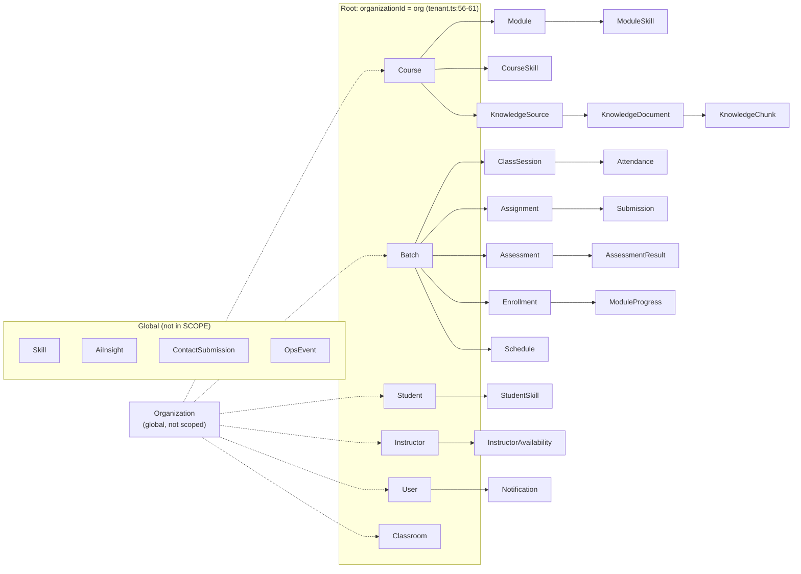
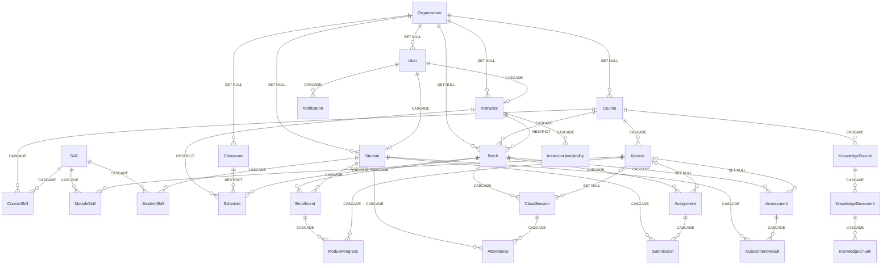

# EDUOS — Data Dictionary

2026-10-23 · branch `finale-hardening` (uncommitted) · source of truth: `prisma/schema.prisma`
(29 models, 9 enums). Tenant rules: `lib/tenant.ts`. Performance findings live in
`docs/audits/EDUOS_DATABASE_AUDIT.md`.

**All data is synthetic** (CLAUDE.md). The sensitivity labels below say how a real deployment
would have to treat each column. They do not mean any real person's data is stored.

How this was checked: every FK action and type below was read from the live scratch database
(Postgres 17.9 + pgvector 0.8.2, `localhost:54329/eduos`, pushed from this schema) with
`pg_constraint` / `pg_attribute`, not inferred from Prisma defaults. Running
`prisma migrate diff --from-url <scratch> --to-schema-datamodel prisma/schema.prisma` printed
`-- This is an empty migration.`, so the scratch DB and the schema match.

## Conventions

| Item | Rule | Evidence |
|---|---|---|
| Primary keys | `String @id @default(cuid())`, except the composite PKs on `CourseSkill` and `ModuleSkill`. The seed writes readable ids (`stu_000`, `bat_PY-12`, `org_bq`). | schema; `prisma/seed.mjs:294` |
| Timestamps | `DateTime` maps to `timestamp(3) without time zone`, written as UTC. Raw SQL must convert explicitly (see `lib/ops-summary.ts:29-31`). | `pg_attribute` on `OpsEvent.at` |
| Enums | Native Postgres enums. Listed at the end of this file. | schema:14-91 |
| CHECK constraints | **None.** Nothing in the DB enforces `score ≤ maxScore`, `capacity > 0` or `startTime < endTime`. Zod validation in the route is the only guard. | `pg_constraint` has 0 table CHECKs |
| Strings | Unbounded `text` everywhere. Length limits exist only in Zod schemas. | schema |

### Sensitivity labels

| Label | Meaning |
|---|---|
| **CRED** | Credential. Never return it from an API, never log it. |
| **PII** | Directly identifies a person: name, email, phone, free-text message. |
| **QID** | Quasi-identifier or personal attribute: roll no, employee no, city, education, bio, dates. |
| **EDU** | An educational record tied to one student: marks, attendance, progress, skills. |
| **FREE** | User-entered free text that may contain anything, PII included. |
| **OPS** | Operational metadata. Pseudonymous at most. |
| **PUB** | Catalogue or internal content with no person attached. |

### Tenant ownership

`lib/tenant.ts:55-80` (`SCOPE`) describes how each model reaches its tenant. **Root** models
carry `organizationId` and get filtered on it directly. **Via-parent** models get a relation
filter that the extension adds to every read, update and delete (`addFilter`,
`lib/tenant.ts:110-115`). Creates on root models are stamped with the caller's org, and every FK
in written data is checked to belong to the same org (`checkData`, `lib/tenant.ts:124-146`).
Models missing from `SCOPE` are **global**.

Three things this map does not show:

- **Raw SQL bypasses the extension.** There are two tenant-relevant raw queries:
  `lib/management.ts:221-234` (scoped by hand with `currentOrgId()`) and `lib/rag/search.ts:45-65`
  (pre-checked through a scoped `course.findFirst`, line 37). `lib/ops-summary.ts` uses
  `rawDb` on purpose because OpsEvent is platform-wide.
- **Context matters.** A signed-in session is scoped. "system" (no request: seed, scripts) and
  "anon" (no or invalid cookie) are **unscoped** (`lib/tenant.ts:22-40`). Login runs as anon,
  so `User.email` lookups are global.
- **In-process caches sit outside the database.** `lib/management.ts:253` caches the
  management overview with **no org in the key**. One institute's admin is served another
  institute's overview. This was reproduced on scratch (see the audit, finding D1).

## Entity-relationship overview

Edge labels are the actual `ON DELETE` actions from `pg_constraint`. `OpsEvent`, `AiInsight`
and `ContactSubmission` have no FKs.

---

## Models

Column notation: `?` = nullable. "Idx" lists every index and unique constraint Prisma creates.
"(redundant)" marks a single-column index whose column is already the leading column of a
unique or composite index. Redundant indexes cost a little write overhead, and dropping them is
optional, not urgent.

### Organization — tenant (global) · schema:20

| Field | Type | Notes | Class |
|---|---|---|---|
| id | String PK | `org_bq`, `org_akf` in the seed | PUB |
| name | String | Institute name | PUB |
| slug | String? **unique** | | PUB |
| createdAt | DateTime | default now() | OPS |

Idx: `slug` unique, plus `@@index([slug])` (redundant). Deleting an org **SETs NULL** on all six
root models. Rows with a null org are invisible to every signed-in user, because the filter is
`organizationId = <org>`, but they stay visible in system context. Retention: forever. No
delete endpoint.

### User — root · schema:93

| Field | Type | Notes | Class |
|---|---|---|---|
| id | String PK | | — |
| email | String **unique (global)** | Login identity. Looked up unscoped at login. | **PII** |
| passwordHash | String | bcrypt, cost 10 (`app/api/students/route.ts:56`) | **CRED** |
| name | String | | **PII** |
| role | Role | MANAGEMENT / INSTRUCTOR / STUDENT | QID |
| organizationId | String? | FK → Organization, SET NULL | — |
| createdAt | DateTime | | QID |

Idx: `email` unique, `organizationId`. Children: Student / Instructor 1:1 (CASCADE),
Notification (CASCADE). Deleting a User **hard-deletes** that student's or instructor's whole
record tree (see Student). Retention: until deleted through `DELETE /api/students/[id]` (only
once the student has no enrollments) or `/api/instructors/[id]` (`app/api/students/[id]/route.ts:90`,
`app/api/instructors/[id]/route.ts:105`).

### Student — root · schema:109

| Field | Type | Notes | Class |
|---|---|---|---|
| id | String PK | | — |
| userId | String **unique** | FK → User, CASCADE | — |
| rollNo | String **unique (global)** | `BQ-YYYY-NNNN`, `AKF-YYYY-NNNN` | QID |
| phone | String | | **PII** |
| city | String | | QID |
| education | String | | QID |
| joinedAt | DateTime | | QID |
| organizationId | String? | FK → Organization, SET NULL | — |

Idx: `userId` unique, `rollNo` unique, `organizationId`. Children (all CASCADE): Enrollment,
Attendance, Submission, AssessmentResult, StudentSkill. **Global uniqueness on `rollNo` collides
across tenants:** `nextRollNo()` (`lib/students.ts:161-170`) always generates the `BQ-` prefix
and reads only the caller's org. An Alkhidmat admin who leaves roll no blank therefore gets
`BQ-2026-0001`, which already belongs to Bano Qabil. The insert fails with a unique violation,
and the route turns that into a 409 "A student with that roll number already exists"
(`app/api/students/route.ts:80-86`). Reproduced in SQL, audit finding D8.

### Instructor — root · schema:130

| Field | Type | Notes | Class |
|---|---|---|---|
| id | String PK | | — |
| userId | String **unique** | FK → User, CASCADE | — |
| employeeNo | String **unique (global)** | | QID |
| specialization | String | | QID |
| bio | String | Free text | QID/FREE |
| joinedAt | DateTime | | QID |
| organizationId | String? | | — |

Idx: `userId`, `employeeNo` unique; `organizationId`. `Batch.instructorId` and
`Schedule.instructorId` are **RESTRICT**, so an instructor with batches cannot be deleted (the
route checks this first, `app/api/instructors/[id]/route.ts:102`). Availability CASCADEs.

### Course — root · schema:148

| Field | Type | Notes | Class |
|---|---|---|---|
| id | String PK | | |
| code | String **unique (global)** | e.g. `PY` | PUB |
| title, description | String | | PUB |
| level | String | Free text, not an enum | PUB |
| durationWeeks | Int | | PUB |
| organizationId | String? | | |

Idx: `code` unique, `organizationId`. At the DB level, deleting a course CASCADEs to Module,
**Batch** (and so to every enrollment, session, attendance and mark under it), CourseSkill and
KnowledgeSource. The route refuses deletion while the course has **any** batch
(`_count.batches > 0`, `app/api/courses/[id]/route.ts:119-121`). The error text says "active
batches", but the count includes every status. Through the API, the Batch cascade is never reached.

### Module — via Course · schema:166

| Field | Type | Notes |
|---|---|---|
| id | String PK | |
| courseId | String | FK CASCADE |
| order | Int | position in course |
| title, description | String | |
| objectives | String[] | Postgres `text[]` |
| durationHours | Int | |

Idx: **unique (courseId, order)**, which is non-deferrable. Deleting a module SETs NULL on
`ClassSession/Assignment/Assessment.moduleId` and CASCADEs ModuleSkill and ModuleProgress.
Class: PUB. Note: the course `PUT` rewrites `order` one row at a time
(`app/api/courses/[id]/route.ts:84-97`). That works for the UI's remove and append operations,
but an API reorder hits the unique constraint (audit finding D9).

### Skill — global taxonomy · schema:185

`id`, `name` **unique (global)**, `category`. Shared by every tenant on purpose
(`lib/tenant.ts:52-54`). Children CourseSkill, ModuleSkill, StudentSkill (all CASCADE). PUB.

### CourseSkill — via Course · schema:195

PK (courseId, skillId); `targetLevel` SkillLevel. Idx: `@@index([courseId])` (redundant with
the PK). PUB.

### ModuleSkill — via Module → Course · schema:206

PK (moduleId, skillId); `weight` Int default 1, which is the weighting in
`recomputeStudentSkills()` (`lib/analytics.ts:432`). There is no index on `skillId` alone, so
deleting a Skill scans this table (85 rows in the seed). PUB.

### Batch — root · schema:216

| Field | Type | Notes |
|---|---|---|
| id | String PK | |
| code | String **unique (global)** | `PY-12`, `AKF-01` |
| name | String | |
| courseId | String | FK CASCADE, **no index** |
| instructorId | String | FK RESTRICT, **no index** |
| startDate, endDate | DateTime | |
| schedule | String | free-text label ("Mon/Wed …") |
| capacity | Int | no DB check |
| status | BatchStatus | |
| organizationId | String? | |

Idx: `code` unique, `organizationId`. `instructorId` and `courseId` are filter columns
(`batch: { instructorId }` appears throughout `lib/instructors.ts`), but at 13 rows, and at 513
(512 of them org_bq) in the 40× test, a seq scan is the cheaper plan. See audit finding D11 for why no index was
added. Class: PUB (operational).

### Enrollment — via Batch · schema:241

`studentId` (CASCADE), `batchId` (CASCADE), `enrolledAt`, `status` EnrollmentStatus,
`finalGrade` String?. Idx: **unique (studentId, batchId)**, `studentId` (redundant), `batchId`,
`status`. Children ModuleProgress (CASCADE). Class: **EDU**. `backfillEnrollment()`
(`lib/students.ts:178-240`) creates EXCUSED attendance, score-0 results, MISSING submissions
and NOT_STARTED progress, so a late enrolment never has holes in its data.

### ClassSession — via Batch · schema:259

`batchId` (CASCADE), `moduleId?` (SET NULL), `date`, `topic`, `conducted` Bool,
`instructorPresent` Bool. Idx: **unique (batchId, date)**, `batchId` (redundant). Class: PUB/OPS
(instructor presence is a staff-performance record).

### Attendance — via ClassSession → Batch · schema:276

`sessionId` (CASCADE), `studentId` (CASCADE), `status` AttendanceStatus. Idx: **unique
(sessionId, studentId)**, `sessionId` (redundant), `studentId`. This is the largest domain table:
5,576 rows in the seed. Class: **EDU**. Tenant filter: `session.batch.organizationId`, which costs
two extra joins per query (audit finding D4).

### Assignment — via Batch · schema:289

`batchId` (CASCADE), `moduleId?` (SET NULL), `title`, `description`, `maxScore` Int, `dueDate`.
Idx: `batchId` (redundant), `(batchId, dueDate)`. PUB.

### Submission — via Assignment → Batch · schema:306

`assignmentId` (CASCADE), `studentId` (CASCADE), `score` Int?, `status` SubmissionStatus,
`submittedAt?`. Idx: **unique (assignmentId, studentId)**, `assignmentId` (redundant),
`studentId`. Class: **EDU**. A null score counts as 0 in performance
(`lib/analytics.ts:200-204`).

### Assessment — via Batch · schema:321

`batchId` (CASCADE), `moduleId?` (SET NULL), `title`, `type` AssessmentType, `maxScore`,
`scheduledAt`, `questions` Json? (generated questions). Idx: `batchId` (redundant),
`(batchId, scheduledAt)`, `(batchId, moduleId)`. PUB.

### AssessmentResult — via Assessment → Batch · schema:340

`assessmentId` (CASCADE), `studentId` (CASCADE), `score` Int. Idx: **unique (assessmentId,
studentId)**, `assessmentId` (redundant), `studentId`. Class: **EDU**.

### ModuleProgress — via Enrollment → Batch · schema:353

`enrollmentId` (CASCADE), `moduleId` (CASCADE), `status` ProgressStatus, `completedAt?`. Idx:
**unique (enrollmentId, moduleId)**, `enrollmentId` (redundant). Class: **EDU**.

### StudentSkill — via Student · schema:366

`studentId`, `skillId` (both CASCADE), `level` SkillLevel, `score` Int, `evidenceCount` Int,
`updatedAt` @updatedAt. Idx: **unique (studentId, skillId)**, `studentId` (redundant),
`skillId`. Class: **EDU**. This is the **only derived-and-stored value**. Its sole writer is
`recomputeStudentSkills()` (`lib/analytics.ts:432-468`).

### AiInsight — global, keyed per org · schema:383

| Field | Type | Notes | Class |
|---|---|---|---|
| kind, subjectType | String | e.g. `management` / `institute` | OPS |
| subjectId | String | `<orgId or "system">:<raw id or question text>`. For command-center and scheduling, the raw part is **the user's question, up to 200 chars** (`lib/ai/features.ts:34-35, 1064, 1121`). For management, it is a classification key plus a lower-cased, normalised slug of the question, up to 80 chars (`mgmtCacheKey`, `lib/ai/features.ts:559-568`) | **FREE** |
| payload | Json | AI output about students, batches or the institute | EDU |
| model | String | | OPS |
| createdAt | DateTime | | OPS |

Idx: `(kind, subjectType, subjectId)`. There is no tenant column, so the org prefix in
`subjectId` is the only separation (`lib/ai/features.ts:32-35`). Reads only consider the last
30 minutes (`CACHE_MS`, line 30), but **rows are never deleted**. Each successful model answer
after a cache miss appends one. Fallbacks are not cached (`writeCache` runs only after `res.ok`,
e.g. `lib/ai/features.ts:1030-1037`), so scratch, which only has an invalid key, holds 0 rows.

### Classroom — root · schema:397

`name` **unique (global)**, `building`, `capacity`, `hasTech` Bool default true,
`organizationId?`. Idx: `name` unique, `organizationId`. Two institutes cannot both have a "Room
101". The seed works around this by naming Alkhidmat's room "AKF Lab 1" (`prisma/seed.mjs:732`).
Schedule → Classroom is RESTRICT. PUB.

### Schedule — via Batch · schema:411

`batchId` (CASCADE), `instructorId` (RESTRICT), `classroomId` (RESTRICT), `day` DayOfWeek,
`startTime`/`endTime` **String "HH:MM"** with no DB check that start < end, `createdAt`,
`updatedAt`. Idx: `batchId`, `instructorId`, `classroomId`, `day`. Regenerating a timetable
deletes a batch's rows (`lib/scheduling/engine.ts:440`). PUB.

### InstructorAvailability — via Instructor · schema:431

`instructorId` (CASCADE), `day`, `startTime`, `endTime` (String), `available` Bool. Idx:
**unique (instructorId, day, startTime, endTime)**. 0 rows in the seed. QID.

### Notification — via User · schema:443

`userId` (CASCADE), `title`, `body`, `type` String default "info", `read` Bool, `link?`,
`createdAt`. Idx: `(userId, read, createdAt DESC)`, `(userId, createdAt DESC)`. Class:
**PII/FREE** (body text can name students). The list is paginated
(`app/api/notifications/route.ts:40-43`). Retention: forever. No pruning code.

### KnowledgeSource / KnowledgeDocument / KnowledgeChunk — via Course · schema:458-498

| Model | Fields | Idx |
|---|---|---|
| KnowledgeSource | `courseId` (CASCADE), `topic`, `url`, `selector?`, `status` String default "pending", `ingestedAt?`, `error?`, `createdAt` | `courseId` |
| KnowledgeDocument | `sourceId` (CASCADE), `url?`, `content` (full fetched page text, ≤2 MB per `lib/rag/ingest.ts:93`), `metadata` Json?, `createdAt` | `sourceId` |
| KnowledgeChunk | `documentId` (CASCADE), `text`, **`embedding Unsupported("vector(1536)")?`**, `createdAt` | `documentId` only. **No ANN (HNSW/IVFFlat) index.** |

Class: PUB (third-party web content). Re-ingesting a source deletes its old documents first
(`lib/rag/ingest.ts:55`). `embedding` is an `Unsupported` type, so Prisma Client cannot write
it. The `createMany` at `lib/rag/ingest.ts:77-83` passes it anyway and fails at runtime once
embeddings are produced (audit finding D7).

### ContactSubmission — global (public form) · schema:502

`name`, `email`, `phone?`, `message`, `createdAt`. Idx: `createdAt`. Class: **PII + FREE**,
supplied by anonymous visitors. No org, no delete path, no retention policy.

### OpsEvent — global (platform telemetry) · schema:516

| Field | Type | Notes | Class |
|---|---|---|---|
| at | DateTime | default now(), UTC wall-clock | OPS |
| kind | String | http / db / ai / auth / error | OPS |
| name | String | route template, `model.op`, `provider:model` | OPS |
| ok | Boolean | | OPS |
| status, ms, dbCount, dbMs, tokens | Int? | | OPS |
| organizationId | String? | not an FK; null on `db` events (audit finding D13) | OPS |
| subject | String? | `sha256(lower(email)+"|"+ip)[:32]`, the login-throttle key (`lib/auth.ts:74`). Unsalted, so pseudonymous rather than anonymous. | OPS |
| correlationId | String? | | OPS |
| detail | String? | ≤200 chars, redacted (`lib/ops.ts:43`) | OPS |

Idx: `(kind, at)`, `(at)`, `(kind, subject, at)`. Append-only, written after the response
(`lib/ops.ts:38-50`). **No retention.** On scratch, about 3,405 rows built up in about 10 minutes
of test traffic (08:22–08:32 UTC, mostly the 20 s load test). The total was 3,418 at 08:38. 1M synthetic rows take **311 MB** including indexes
(audit finding D6).

---

## Enums (schema:14-91)

| Enum | Values | Used by |
|---|---|---|
| Role | MANAGEMENT, INSTRUCTOR, STUDENT | User.role |
| SkillLevel | BEGINNER, INTERMEDIATE, ADVANCED, EXPERT | CourseSkill.targetLevel, StudentSkill.level. Thresholds live in `skillLevelFromScore()` (`lib/analytics.ts:419-425`) |
| AttendanceStatus | PRESENT, ABSENT, LATE, EXCUSED | Attendance. LATE counts 0.5, EXCUSED counts as present (`lib/analytics.ts:206-209`) |
| BatchStatus | UPCOMING, ACTIVE, COMPLETED | Batch |
| EnrollmentStatus | ACTIVE, COMPLETED, DROPPED | Enrollment |
| AssessmentType | QUIZ, MIDTERM, FINAL, PROJECT, LAB | Assessment |
| SubmissionStatus | SUBMITTED, LATE, MISSING, GRADED | Submission |
| ProgressStatus | NOT_STARTED, IN_PROGRESS, COMPLETED | ModuleProgress |
| DayOfWeek | MONDAY … SUNDAY | Schedule, InstructorAvailability |

## Global uniqueness vs. tenancy

Six business keys are unique **across all tenants**, while every read is scoped to one tenant:

| Column | Consequence |
|---|---|
| `User.email` | Intended: one login per email. |
| `Student.rollNo` | Auto-numbering collides across institutes (finding D8). |
| `Instructor.employeeNo`, `Course.code`, `Batch.code`, `Classroom.name` | Institute B cannot reuse a code that institute A already has. The error also leaks a little: it says "already exists" for a code the caller cannot see. Most create routes map P2002 to a 409 "… already exists" (`app/api/courses/route.ts:87-88`, `app/api/students/route.ts:80-86`). Routes without that mapping, such as `app/api/classrooms/route.ts`, return a 500 instead (`lib/api.ts:20-37`). |
| `Skill.name` | Intended: shared taxonomy. |

Changing any of these to `@@unique([organizationId, code])` is a schema change: additive
index first, then drop the old unique. That needs Basim's approval (schema is frozen,
CLAUDE.md), so it is not done here.

## PII and credential inventory

| Where | What | Exposure controls (code) |
|---|---|---|
| User.passwordHash | bcrypt hash | Not selected by the student detail read model (`lib/students.ts:254` selects user id, name, email and createdAt only). Login reads it (`lib/auth.ts:86-90`). Other read paths were not audited one by one |
| User.name / email | PII | Scoped by tenant. Email is returned by student detail and instructor reads (`lib/instructors.ts:138`) |
| Student.phone / city / education | PII/QID | Returned by `listStudents` to MANAGEMENT and INSTRUCTOR (`lib/students.ts:106-116`) |
| ContactSubmission.* | PII + free text from anonymous visitors | Write-only from the public form (`app/api/contact/route.ts:25`) |
| Notification.body, AiInsight.subjectId/payload | Free text that may name students | Per-user / per-org-key |
| OpsEvent.subject | Hashed email+IP | Platform admins only (`/management/system`) |

## Retention, as implemented

**No table has a retention job.** Rows leave only through explicit deletes or cascades:

| Data | How it leaves | Code |
|---|---|---|
| Student + all academic records | Hard delete of the User, which CASCADEs (blocked while the student has **any** enrollment, of any status) | `app/api/students/[id]/route.ts:86-90` |
| Instructor | Hard delete of the User (blocked while batches exist) | `app/api/instructors/[id]/route.ts:101-105` |
| **Batch tree** | `batch.delete` by MANAGEMENT, **with no guard**: it CASCADEs enrollments, sessions, attendance, assignments, submissions, assessments, results, schedules and module progress. The route reads the enrollment count but never checks it | `app/api/batches/[id]/route.ts:119-125` |
| Course tree | `course.delete`. Blocked while the course has any batch, so it only CASCADEs modules, CourseSkill and knowledge sources | `app/api/courses/[id]/route.ts:119-123` |
| Modules | Single delete, or removal in the course `PUT`. CASCADEs ModuleSkill and ModuleProgress, and SETs NULL on sessions, assignments and assessments | `app/api/courses/[id]/modules/route.ts:94`, `app/api/courses/[id]/route.ts:79` |
| Attendance / Assessment / Assignment rows | Single-row delete by MANAGEMENT or the owning instructor | `app/api/attendance/[id]/route.ts:53`, `assessments/[id]:90`, `assignments/[id]:90` |
| Schedules | Timetable regeneration, or a single delete | `lib/scheduling/engine.ts:440`, `app/api/schedule/[id]/route.ts:62` |
| Classrooms | Single delete, refused while schedules reference it (route check plus FK RESTRICT) | `app/api/classrooms/[id]/route.ts:64-68` |
| Knowledge documents | Re-ingest of a source | `lib/rag/ingest.ts:55` |
| OpsEvent, AiInsight, ContactSubmission | **Never.** These grow without bound. | none |
| Notification | Never pruned. Rows leave only when their User is deleted (CASCADE) | none |

A retention period for the four unbounded tables is a policy decision for Basim. House rules
forbid shipping code that deletes automatically, so this document recommends a decision
(audit finding D6). It does not add a job.
