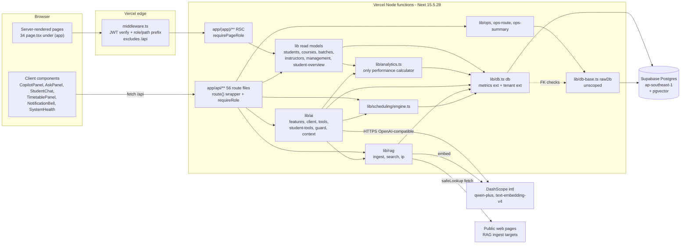
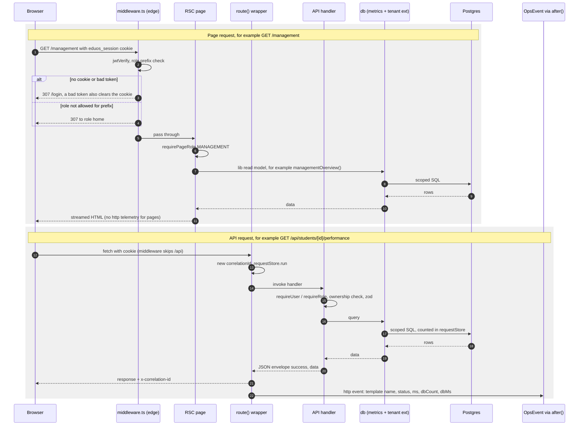
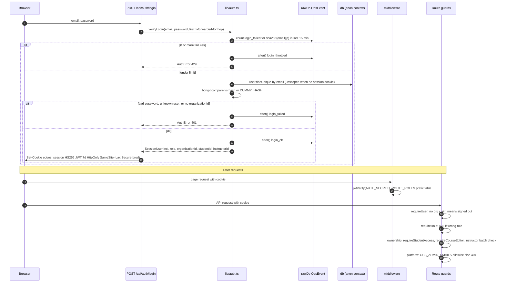
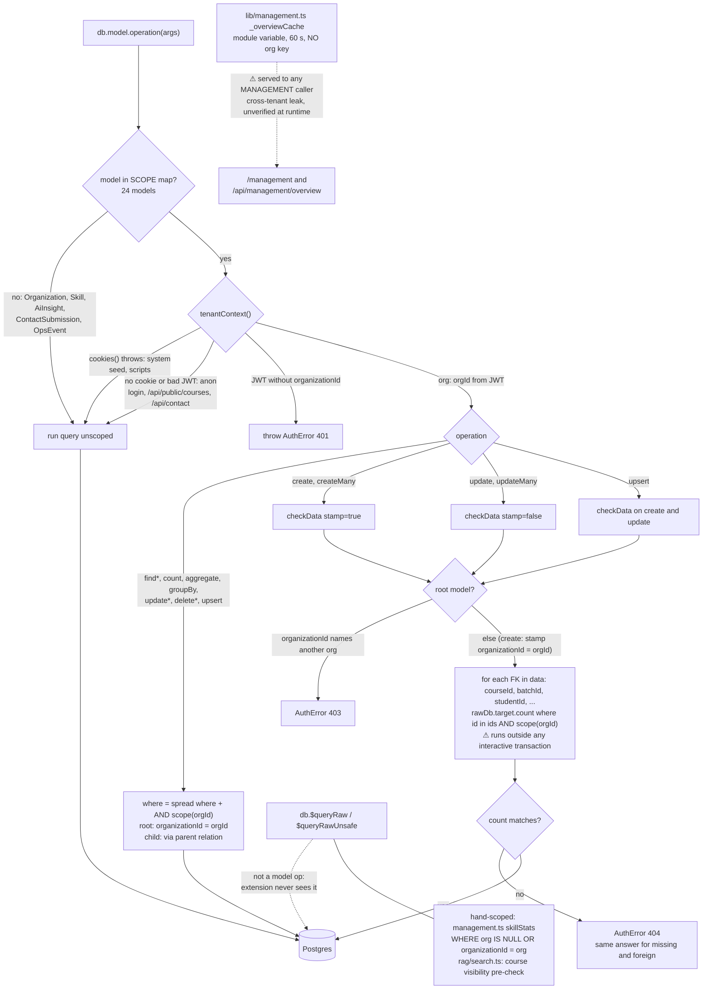
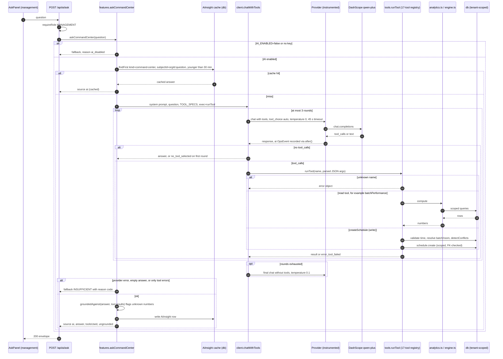
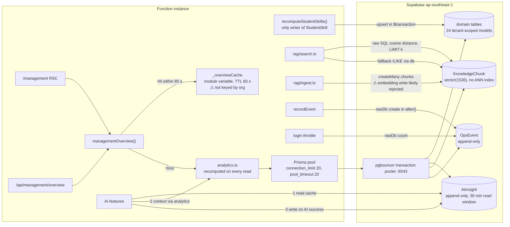
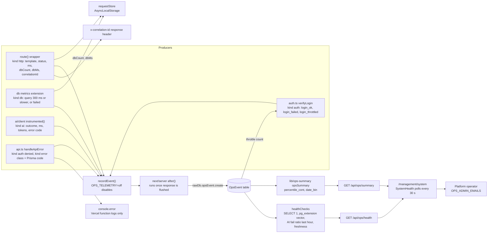
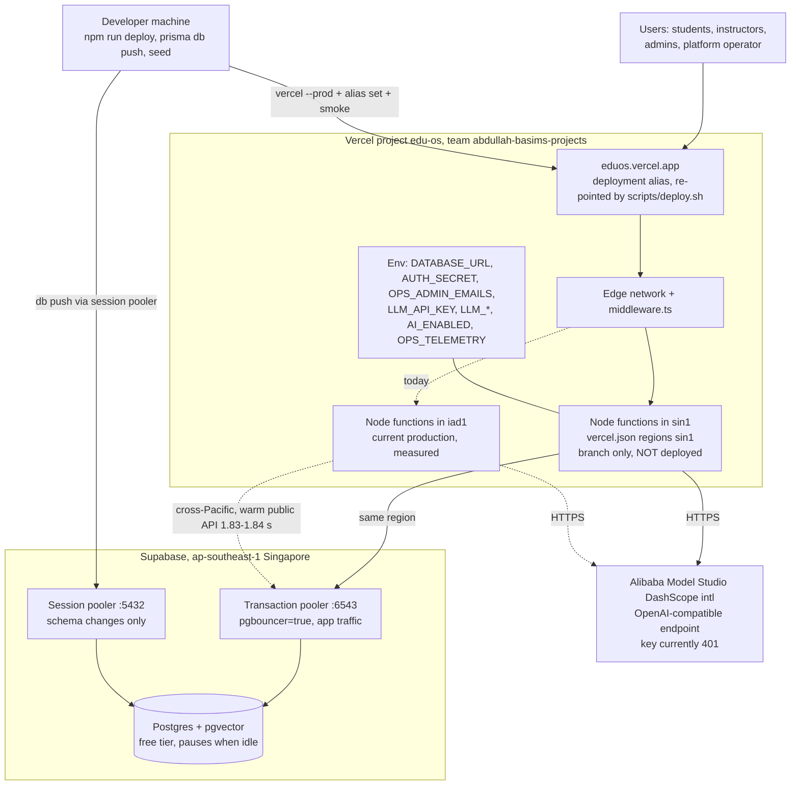

# EDUOS — Data Flow Diagrams

**Scope:** the code on branch `finale-hardening` (uncommitted), read on 2026-10-23. **Not deployed.**
Each diagram shows what the code does, not the intended design. Prose and status labels are in `docs/architecture/EDUOS_SYSTEM_OVERVIEW.md`. A dashed edge or a ⚠ marks a known gap.

---

## 1. Component architecture

There is one deployable unit: a Next.js app. Server Components read through `lib/*` directly. Client components reach the server only through `/api/*` (§5 of the overview). All database access goes through `db`, which adds the tenant filter and timing. `rawDb` is imported only by `lib/db.ts`, `lib/ops.ts`, `lib/ops-summary.ts` and `lib/auth.ts` (login throttle); the tenant extension receives it as a parameter for its foreign-key checks (`lib/db.ts:36`). The header comment at `lib/db-base.ts:3-4` omits `lib/auth.ts` and `lib/ops-summary.ts`. Only `lib/ai/client.ts` (chat) and `lib/ai/embed.ts` (through the same instrumented provider) call the LLM.

---

## 2. Request flow (page render and API call)

Pages and API routes are gated separately. Middleware covers only page paths (`middleware.ts:53`). Every signed-in page re-checks through `requireSession` / `requirePageRole` (`lib/page-auth.ts`, plus the layout at `app/(app)/layout.tsx:8`), and every non-public handler calls `requireUser` / `requireRole` (`lib/auth.ts:56-66`). Only `/api` handlers are timed, through `route()` (`lib/ops-route.ts:10-36`). Page renders are not timed, which is a known gap. The telemetry write runs in `after()`, so the insert does not delay the response (`lib/ops.ts:41-49`). `route()` does still await one extra `currentOrgId()` JWT verify before returning (`lib/ops-route.ts:22`).

---

## 3. Authentication and authorization

Authentication is local: bcrypt plus an HS256 JWT signed with `AUTH_SECRET`, which fails closed in production (`lib/session-secret.ts:9-17`). Authorization has three layers:
1. the role, checked in middleware, pages and handlers;
2. ownership inside an org, checked in routes (`lib/students.ts:28-46`, `lib/courses.ts:31-50`, `app/api/ai/copilot/route.ts:39-41`);
3. the platform-operator allowlist (`lib/platform.ts`).

Tenant scoping is not a route concern; it happens in the database client (diagram 4). Sessions are stateless and cannot be revoked. The throttle counts failures per email+IP pair, not per account. **[measured]** ops-check observed 8×401 followed by a 429.

---

## 4. Multi-tenant data access

The scope is resolved again on every query from the signed cookie (`lib/tenant.ts:22-40`). `SCOPE`, `ROOT` and `FK` are defined at `lib/tenant.ts:55-99`, and the hook itself is at `lib/tenant.ts:148-179`. For update and upsert both branches apply: the `where` filter and the data check.

Four things sit outside the extension or weaken it:
- **Raw SQL.** It is scoped by hand at the two sites that use it.
- **Nested relation writes.** No call site uses them today.
- **Interactive transactions.** The FK count uses `rawDb` (`lib/tenant.ts:142`), a separate connection, so a row created earlier in the same `$transaction` (for example the new `User` in student create, `app/api/students/route.ts:60-76`) is likely invisible and the write would get a 404. Found by code reading; unverified at runtime.
- **In-process caches.** These are the reason the global `_overviewCache` (`lib/management.ts:253-263`) is the main open isolation defect.

**[measured]** `scripts/tenant-isolation.mjs` passed 21/21, but it does not exercise the overview path.

---

## 5. AI orchestration and tool execution (Command Center)

The model never writes SQL. It can only pick from the registry at `lib/ai/tools.ts:524-720`. Tools read through `analytics.ts` or directly through the tenant-scoped `db` (for example `listStudents`, `tools.ts:429-440`).

**Exception: one tool writes.** `createSchedule` (`tools.ts:328-427`) is a write tool. Because answers are cached for 30 minutes, a repeated identical "create" question returns the cached reply without writing a row (inferred from `features.ts:1064-1066`).

Two other paths use the same loop. Student chat runs it over 8 student-bound tools (`lib/ai/student-tools.ts`), restricted by an allowlist check in `app/api/student/chat/route.ts:91-98`. The Schedule assistant (`features.ts:1110-1167`) uses the full registry.

Status of this diagram's paths:
- **[measured]** The fallback path works: `provider_auth`, 234 ms on `/api/ai/ask`.
- **Blocked** (no valid DashScope key): the successful tool-calling path, grounding on live output and cache hits.

The generation features (Skill Passport, Career Path, Copilot, Management) follow a simpler shape, `cache read → context builder → chatJSON → zod → cache write`, with no tools (`lib/ai/client.ts:114-152`). The grounding guard runs for Skill Passport, Career Path, Copilot analysis and Management, not for Copilot generate, chat or student analysis (`features.ts:172,274,337,1036`).

---

## 6. Database and cache interactions

There is no shared cache tier (no Redis). There are only two data caches: `AiInsight`, a database table keyed per org (`lib/ai/features.ts:30-70`), and the global in-process `_overviewCache` (`lib/management.ts:253`). Performance numbers are never written to a domain table (they do sit in those two caches). `StudentSkill` is the single derived value that is stored.

The embedding write is marked as likely rejected for a code reason. `KnowledgeChunk.embedding` is a Prisma `Unsupported` field (absent from the generated `KnowledgeChunkCreateManyInput`), and `lib/rag/ingest.ts:81` passes it through `createMany`. With vectors, ingest would likely throw and store no chunks; without vectors, chunks are stored with NULL embeddings and search takes the text path. This is unverified because no valid embedding key was available.

**[measured]** In the load test, management overview showed p50 25 ms against p99 1022 ms. That fits the in-process cache hitting and missing; this reading is an inference.

---

## 7. Observability data flow

Telemetry is stored in the app's own Postgres. There is no external APM, alerting or log drain. Nothing sensitive is stored: route templates instead of URLs, a hashed throttle subject instead of an email, error codes instead of messages (`lib/ops.ts:6-11`, `lib/ai/client.ts:18-29`). Only allowlisted operators can read the data (`lib/platform.ts`). Institute admins get a 404.

**[measured]** ops-check passed: correlation header present, ops endpoints return 200 / 404 / 403, and http, auth and denied events were recorded. A slow `attendance.findMany` took 334 ms.

Gaps:
- Page renders are not instrumented.
- `requestStore.orgId` is never set, so `db` events carry no organization (`lib/ops-route.ts:12` vs `lib/db.ts:27`).
- `OpsEvent` grows without bound.

---

## 8. Deployment topology

**[measured]** In production today, `x-vercel-id` shows functions executing in iad1 (`sin1::iad1`, `bom1::iad1`) while the database is in Singapore. Warm `GET /api/public/courses` took 1.83–1.84 s and cold took 4.26 s.

This branch pins functions to `sin1` (`vercel.json`). The effect on production latency is unverified until deploy. Rollout requires, in runbook order: rollback points, the `AUTH_SECRET`, `OPS_ADMIN_EMAILS` and new `LLM_API_KEY` env vars, an additive `db push` for `OpsEvent`, a seed run that backfills `organizationId`, then deploy and smoke (`docs/operations/EDUOS_DEPLOYMENT_RUNBOOK.md` steps 1–7).

Each of these is a single point of failure: the free-tier Supabase project, which paused during this session; the single DashScope key, which returns 401 today; and the manually re-pointed alias.
