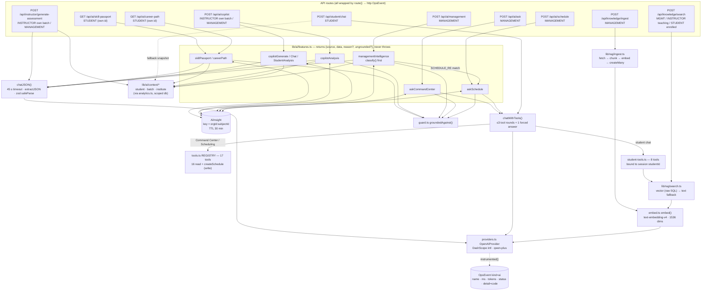

# Edu OS — AI Layer Audit

Branch `finale-hardening`, uncommitted working tree, audited 2026-10-23. Scope: `lib/ai/*`
(client, providers, features, tools, student-tools, guard, classify, embed, chunk, context/*,
prompts/*), `lib/rag/*`, and the routes that call them (`app/api/ai/*`, `app/api/student/chat`,
`app/api/knowledge/*`, `app/api/instructor/generate-assessment`).

Every claim cites `file:line` or a **measured fact** from this session's verification runs
(labelled *measured*). Anything else is labelled *unverified* or *reasoned*.

**Status legend:** **VERIFIED** = implemented and exercised by a test, script or live run ·
**IMPL-UNVERIFIED** = in code, never exercised · **PARTIAL** = covers some paths only ·
**MISSING** = not implemented · **BLOCKED** = cannot be tested until something external changes.

---

## 1. Headline

| # | Finding | Status |
|---|---|---|
| 1 | **No AI success path has run.** The configured DashScope key returns `401 invalid_api_key` (*measured*). Every AI feature serves its computed fallback. Nothing in this document about model *output quality*, latency or token cost on the success path is measured. | **BLOCKED** (needs a valid key) |
| 2 | The failure path is clean: an invalid key gives HTTP 200 with `source=fallback, reason=provider_auth`. Measured on `GET /api/ai/career-path` (631 ms) and `POST /api/ai/ask` (234 ms). Two `kind=ai` OpsEvents were recorded (`status 401`, `detail provider_auth`), and System Health reported "AI provider unavailable: 2 of 2 calls failed in the last hour" (*measured*). | **VERIFIED** |
| 3 | **RAG ingest breaks once embeddings start working.** `lib/rag/ingest.ts:81` writes `embedding` through `createMany`, but `embedding` is `Unsupported("vector(1536)")` (`prisma/schema.prisma:494`). Prisma rejects it with `PrismaClientValidationError: Unknown argument 'embedding'` (reproduced locally against an empty DB, so no rows were involved; re-confirmed by the fact-check against a non-existent local schema). Today embeddings fail with a 401, so the value is `undefined` and Prisma ignores it. With a valid key, every ingest throws *after* `deleteMany` of the old documents (`ingest.ts:55`) and after creating the new `KnowledgeDocument` (`ingest.ts:57`), leaving the source `pending` with a chunk-less document. Chunks cascade from their document (`prisma/schema.prisma:492`), so re-ingesting a source wipes its chunks. TypeScript misses this because the object comes back from `.map()`, so no excess-property check applies. | **Bug, latent** |
| 4 | **Vector search returns arbitrary chunks once the key works.** No code path stores a vector (finding 3), so every `KnowledgeChunk.embedding` is NULL. With a valid key the query embedding succeeds and `search.ts:45-65` takes the vector path. Under standard SQL semantics `ORDER BY embedding <=> $1` on NULLs gives an arbitrary order, and `Number(null)` scores them 0. The text-search fallback (`search.ts:83`) never runs, because rows were returned. | *Reasoned, not run* |
| 5 | The AI can **write**. `createSchedule` (`tools.ts:328-427`) is in `TOOL_SPECS` (`tools.ts:722`), which **both** the Command Center (`features.ts:1071`) and Scheduling (`features.ts:1128`) hand to the model. The management panel also routes any question matching `SCHEDULE_RE` to Scheduling (`features.ts:920-928`). Nothing asks for confirmation before the write, and the row records no actor. | IMPL-UNVERIFIED |
| 6 | The grounding guard runs but nobody sees its output. `ungrounded` is in the UI's `HIDE` set (`app/(app)/management/AiAnswer.tsx:25`), so it is never rendered or logged. Cache hits also drop it (`features.ts:163` and siblings). | **PARTIAL** |
| 7 | AI tools, context builders and the analytics they call all import the tenant-scoped `db` (`tools.ts:1`, `student-tools.ts:1`, `context/*.ts:1`, `analytics.ts:1`, `scheduling/engine.ts:1`). Cross-org reads through tools are therefore filtered by `lib/tenant.ts:148-178`. The one raw-SQL path, the RAG vector query, is pre-gated by a scoped `course.findFirst` (`search.ts:37-38`). | IMPL-UNVERIFIED for the AI path. The tenant extension itself passed `tenant-isolation.mjs` 21/21 (*measured*), and one of those checks is the copilot route refusing another instructor's batch (`scripts/tenant-isolation.mjs:94-95`), but no check drives a tool loop. |

---

## 2. Architecture as implemented

The student chat route calls `chatWithTools` directly (`app/api/student/chat/route.ts:87`). It
does not go through `features.ts`, so it has no cache and no grounding check.
`generate-assessment` calls `chatJSON` directly (`generate-assessment/route.ts:97`), again with
no cache and no guard.

---

## 3. Provider config and connectivity

| Item | Implementation | Status |
|---|---|---|
| Provider | `OpenAIProvider` over the `openai` SDK 4.104.0 (installed version) (`providers.ts:51-85`). Base URL defaults to `https://dashscope-intl.aliyuncs.com/compatible-mode/v1` (`providers.ts:92-93`). `LLM_PROVIDER` other than openai/openai-compatible/dashscope throws, and that is caught into `null` (`client.ts:55-62`). | IMPL-UNVERIFIED (success path) |
| Model | `LLM_MODEL` or `qwen-plus` (`client.ts:13`). Embeddings: `LLM_EMBED_MODEL` or `text-embedding-v4`, 1536 dims (`embed.ts:3-4`). Whether v4 accepts `dimensions: 1536` is *unverified*. | IMPL-UNVERIFIED |
| Kill switch | `AI_ENABLED=false` → `getProvider()` returns null → every feature falls back (`client.ts:67-68`). | VERIFIED at unit level (`client.test.ts`, "returns false when AI_ENABLED is false"). CLAUDE.md documents an `AI_ENABLED=false npm run smoke` check, but it was **not run this session**; this session measured the invalid-key path, not this switch. |
| Key handling | Read from `LLM_API_KEY` and trimmed. The provider is rebuilt when the key changes (`client.ts:67-79`). No code path logs the key. | IMPL-UNVERIFIED (confirmed by reading only) |
| **Connectivity today** | `401 invalid_api_key` from DashScope intl. The key is 117 chars, which is unusual for a Model Studio key (*measured*). The runbook states that a Beijing-region key gives 401 on the intl endpoint (`docs/operations/EDUOS_DEPLOYMENT_RUNBOOK.md:14`); whether that is the cause here is *unverified*. | **BLOCKED** |
| Error codes | `aiErrorCode()` maps errors to fixed codes: `provider_auth`, `rate_limited`, `provider_5xx`, `timeout`, `provider_<n>`, `provider_error` (`client.ts:20-29`). Raw provider messages no longer reach callers or the UI; before this change they did (`git diff lib/ai/client.ts`). | VERIFIED (`provider_auth` observed, *measured*) |

---

## 4. Timeouts, bounds, retries

| Control | Value | Where | Notes |
|---|---|---|---|
| Per-call timeout | 45 s via `AbortSignal.timeout` | `client.ts:15,130,187,220` | Applies to each `provider.chat` call. Embeddings have **no** timeout signal (`providers.ts:77-84`), so they fall back to the SDK default of 600 s per attempt (`node_modules/openai/core.js:138`). |
| Tool rounds | 3, then one forced no-tools answer | `client.ts:16,180-223` | Worst case is **4 sequential chat calls**, so up to ~180 s wall time from timeouts alone. No route exports `maxDuration`, and the Vercel platform default limit is *unverified*. |
| SDK retries | `openai` default `maxRetries = 2` (`node_modules/openai/core.js:138`), not overridden | `providers.ts:55` | Retries happen inside one 45 s signal, so they are invisible to telemetry (one event per logical call). |
| Output length | **No `max_tokens`** on any call | `providers.ts:59-68` | Completion size is set entirely by the model. |
| Tool fan-out per round | Unbounded. Every `tool_call` in a round is executed sequentially | `client.ts:200-210` | The model can request many calls in one round. |
| Malformed tool args | Parsed as `{}`, never a crash | `client.ts:201-206` | |
| Tool exceptions | Logged server-side, model sees `{error:"tool_failed"}` | `tools.ts:725-733`, `student-tools.ts:344-357` | The raw message no longer reaches the model (diff). |
| RAG fetch | 15 s, 2 MB cap, ≤3 redirects | `ingest.ts:93-94,133` | |

---

## 5. Fallbacks — "never fabricate"

Every `features.ts` export returns `Feature<T>` (`features.ts:28`). Those that build a context
catch its failure with `.catch(() => null)`; `askCommandCenter` and `askSchedule` build none.

| Feature | Fallback content | Fabrication risk in fallback |
|---|---|---|
| skillPassport (`:112-175`) | Attained skills, progression, gaps and job readiness, all straight from `buildStudentContext` | None. Every value comes from context. |
| careerPath (`:212-277`) | Best match against the static `CAREERS` table (`:195-203`) using evidenced skills. `insufficient_data` when no skills | The static table is a labelled heuristic, not data. On the AI path, non-existent courses are dropped (`:270-272`). |
| copilotAnalysis (`:290-340`) | Median split of `moduleWeakness` plus "Re-teach X" lines quoting computed averages | None |
| copilotGenerate / Chat / StudentAnalysis (`:363-492`) | Empty payload with `insufficient_data: true` and an "unavailable" message (`:365-375,410-414,455-467`) | None. It refuses rather than inventing. |
| managementIntelligence (`:922-1039`) | `fallbackFromClassification` builds rankings, comparisons, entities and reports from the institute context (`:820-918`). Unresolvable references return guidance and never call the model (`:993-1009`) | None. A model answer of a different `kind` is forced back to the classified kind (`:1034`). |
| askCommandCenter / askSchedule (`:1053-1168`) | `INSUFFICIENT` constant. With no tool on the first round the result is `no_tool_selected` (`client.ts:195`). With only error results it is `tools_returned_only_errors` (`:1077-1079`, `:1134-1136`) | None |
| student chat (`route.ts:63-115`) | Snapshot computed from `buildStudentContext` | None |
| generate-assessment (`route.ts:72-115`) | Empty question list plus message | None |

**Status: VERIFIED** for `careerPath` and `askCommandCenter` with the invalid key (*measured*,
both 200 + fallback). Smoke rendered every page, so the fallback renders did not crash
(*measured*). The other fallbacks are IMPL-UNVERIFIED as individual units. No unit test covers
any `features.ts` fallback.

---

## 6. Grounding guard

`groundedAgainst(result, context, tolerance = 0.6)` (`guard.ts:34-46`) pulls every number out of
the AI output, including numbers inside prose (`guard.ts:10-29`). It flags any number that is not
within ±0.6 of some number in the context. The integers 0–10 are ignored as noise (`guard.ts:32`).
It **flags and never edits** (`guard.ts:5-6`). Tests: 17 cases in `guard.test.ts` (10 for
`numbersIn`, 7 for `groundedAgainst`).

| Where applied | Where **not** applied |
|---|---|
| skillPassport `:172`, careerPath `:274`, copilotAnalysis `:337`, managementIntelligence `:1036`, askCommandCenter `:1085`, askSchedule `:1165` | copilotGenerate, copilotChat, copilotStudentAnalysis (`:394,434,490`); student chat (`route.ts:117`); generate-assessment (`route.ts:117`) |

Gaps (*reasoned from code*):

- **Nobody acts on the result.** `ungrounded` is dropped by the renderer (`AiAnswer.tsx:25`). It
  is not written to OpsEvent. It does not stop the answer being cached (`writeCache` runs anyway,
  `:173,275,338,1037,1086,1166`). A cache hit returns `source:"ai"` without `ungrounded`
  (`:163,259,328,1017,1066,1123`).
- **The check is lenient on large contexts.** The institute context carries several 0–100
  figures per course, batch and instructor (`context/institute.ts:134-160`), so a large share of
  that range is covered. Any invented percentage within 0.6 of any of them passes, even if it
  belongs to a different entity. The Command Center prompt asks the model not to move figures
  between entities (`prompts/command-center.ts:14-15`), but the guard cannot enforce that.
- For Command Center and Scheduling only the `answer` string is checked, against the raw tool
  results (`features.ts:1085,1165`); Scheduling's `table` and `bullets` are not checked.
- The prompts carry the rule as well: `GROUNDING_RULE` (`prompts/_shared.ts`) is "use only numbers
  in CONTEXT JSON; `insufficient_data` when missing".

---

## 7. Structured output validation

`chatJSON` (`client.ts:114-152`):

1. Appends a JSON-only instruction to the system prompt (`:87-89`).
2. `extractJSON` strips code fences and returns the first balanced `{…}` while tracking strings and
   escapes (`:92-112`). 10 `extractJSON` cases in `client.test.ts` (plus 5 `aiEnabled` cases).
3. `JSON.parse`, then `schema.safeParse`. Failures become `no_json_in_response`,
   `unparseable_json`, or `schema_mismatch: <paths>` (`:135-147`).

Every schema is zod with `.default()` on optional fields (`features.ts:74-109,179-191,281-287,342-358,400-405,440-448,496-555,1043-1047,1101-1107`).
`generate-assessment` adds `.int().min(0)` on marks (`route.ts:23-36`).

**Gaps:**

- Tool-loop answers (Command Center, Scheduling, student chat) are **free text, not
  schema-validated**. Scheduling parses an optional JSON blob out of the answer by hand
  (`features.ts:1140-1156`), and the management panel parses it again (`:931-941`).
- `CopilotChatSchema.data` is `z.record(z.unknown())` (`:403`) and `SchedulingSchema.table` is
  `z.array(z.record(z.unknown()))` (`:1104`). Both accept arbitrary model JSON, which reaches the
  client unchanged.
- No length caps on any string field. The `generate-assessment` request caps `questionCount` at 40,
  but the model's `questions` array is not capped (`route.ts:25-33`).

Status: VERIFIED for the parser (unit tests). Schema handling on real model output is
**BLOCKED** (no valid key).

---

## 8. Tool allowlist and tenancy

### 8.1 Management / scheduling registry — `lib/ai/tools.ts`

17 tools (`tools.ts:524-720`): listCourses, coursePerformance, compareCourses, batchPerformance,
rankBatches, instructorPerformance, rankInstructors, skillGapStats, instituteSummary,
listSchedules, listBatches, listClassrooms, scheduleOverview, **createSchedule**, listStudents,
studentPerformance, rankStudents. CLAUDE.md still says "9-function allowlist" (`CLAUDE.md:49`),
and so does the header comment in `tools.ts:21` ("nine typed functions"). Both are stale.

- Unknown names return an error object, never a call (`tools.ts:726-727`). There is no NL→SQL
  path.
- **Tenancy:** every tool reads through `db` (`tools.ts:1`), the client extended by
  `tenantExtension` (`lib/db.ts:36`). Tools run inside the route's request scope, so
  `tenantContext()` resolves the caller's org from the session cookie (`lib/tenant.ts:22-40`) and
  every `findMany`/`findFirst`/`count` gets an org filter (`tenant.ts:162`). Before this branch,
  tenancy was cosmetic (F02), so a tool like `listStudents` with no batch was not org-scoped
  (it was always capped at `limit`, default 50: `tools.ts:438-441`, unchanged on this branch).
  It is now limited to the caller's org.
  Status: IMPL-UNVERIFIED for the AI path. The extension is covered by `tenant-isolation.mjs`
  (21/21, *measured*), but no check calls a tool across orgs.
- Results are bounded: `clamp(limit, default)` (`tools.ts:518`), and `listStudents` defaults to 50.

### 8.2 `createSchedule` — the only write tool

`tools.ts:328-427`:

- Validates HH:MM 24h and start < end (`:326,336-338`, added on this branch). Validates the day
  against `DAYS` (`:375-378`).
- Runs `detectConflicts` against instructor, room and batch clashes, availability and capacity
  (`:400-403`, engine covered by `engine.test.ts`).
- The tenant extension checks that `batchId`, `instructorId` and `classroomId` belong to the caller's
  org before insert (`tenant.ts:85-99,124-146,163-166`).

Risks (*reasoned*):

| Risk | Detail |
|---|---|
| No human confirmation | `SCHEDULING_PROMPT` *requires* the model to call `createSchedule` on "schedule/create/add/book" (`prompts/scheduling.ts:11`). One sentence writes a row. |
| Wider exposure than intended | The Command Center gets the write tool too (`features.ts:1071`), even though its prompt never mentions writing. The management panel forwards any `SCHEDULE_RE` match (`:920`, which includes "when is", "what time", "classroom") to Scheduling. |
| Fuzzy instructor match | `contains` + `findFirst` with no `orderBy` (`tools.ts:360-362`). "Ali" could book whichever Ali-named instructor comes back first. |
| No audit actor | `Schedule` has no `createdBy` (`prisma/schema.prisma:411-429`). An AI-created row looks the same as a hand-made one. |
| Cache replays a write | `askSchedule` caches the answer for 30 min by question text (`features.ts:1121-1123,1166`). Repeating "book DS-05 Monday 08:00…" returns the cached "created" answer without writing. If the row was deleted in between, the answer is false. |
| Prompt injection → write | See §10. Instructor-authored strings (course/module titles) come back in tool results inside a management session that has the write tool. |

Status: IMPL-UNVERIFIED. No test or script runs `createSchedule` through the model, and the
success path is BLOCKED.

### 8.3 Student registry — `lib/ai/student-tools.ts`

8 tools, all closed over the session's `studentId` (`student-tools.ts:24`, `runStudentTool:344-358`).
The route takes `studentId` from `requireRole("STUDENT")` (`chat/route.ts:49-50,80,97`), never
from input. No tool accepts a student identifier.
Batch-scoped tools check for an ACTIVE enrolment (`:27-34,217-221`), so a dropped student cannot
search a course's knowledge. The route enforces a second allowlist (`chat/route.ts:92-96`).

- `myAttendance` now keys by batch id (`:53,73`). It previously keyed by code against an id map,
  so it always returned 0 (F14). Covered by `student-tools.test.ts`. **VERIFIED** (unit).
- Status for cross-student isolation: IMPL-UNVERIFIED end to end (BLOCKED on key). The binding
  is structural: the model has no parameter through which to name another student.

---

## 9. RAG (`lib/rag/*`)

| Stage | Implementation | Status |
|---|---|---|
| Ingest auth | MANAGEMENT only, zod-validated, course visible through scoped `db` (`knowledge/ingest/route.ts:19-29`) | IMPL-UNVERIFIED (confirmed by reading; no script calls ingest) |
| SSRF | Scheme allowlist plus IP-literal block (`ingest.ts:97-103`). `safeLookup` checks **the address the socket actually connects to** (`ip.ts:64-70`, `agent:false` at `ingest.ts:110`), which closes DNS rebinding. Redirects are re-checked per hop. Covered: v4 private/CGNAT/metadata, v6 ULA/link-local/mapped/NAT64/6to4 (`ip.ts:4-58`). | VERIFIED (unit) for the address classifier (`ip.test.ts`: 37 blocked + 11 allowed addresses) and for `safeLookup` rejecting `localhost`. The fetch/redirect loop in `ingest.ts` itself has no test. |
| Extraction | cheerio strips script/style/nav/etc. Optional CSS selector (`ingest.ts:153-160`) | IMPL-UNVERIFIED |
| Chunking | 3200 chars, 400 overlap, sentence-boundary cut (`chunk.ts:1-43`) | IMPL-UNVERIFIED (no test) |
| Embedding write | **Broken once embeddings work** (finding 3). Batches of 32 (`ingest.ts:70-75`) | **Bug** (Prisma validation reproduced) |
| Re-ingest | `deleteMany` old documents *before* the new chunks are written, with no transaction (`ingest.ts:55-83`) | Any failure after line 55 loses the previous content |
| Search scoping | Scoped `course.findFirst` gate before the raw vector SQL (`search.ts:35-38`). The text path goes through scoped `db` (`:89`). Route checks enrolment/teaching (`knowledge/search/route.ts:29-37`) | IMPL-UNVERIFIED (no cross-org search check) |
| Vector path | `$queryRawUnsafe` with **parameterised** `$1..$3` (`search.ts:45-65`), so not injectable | Vector path never exercised (no stored vectors, finding 4) |
| Error leak | The text-path catch returns `e.message` as `reason` (`search.ts:127`), and `/api/knowledge/search` returns the whole result (`route.ts:39-40`) | Minor. Raw Prisma text can reach the client |

---

## 10. Prompt-injection surface

The model has no direct DB access, so injection cannot cross tenants or read another student's
data. Every tool is pre-scoped (§8). What injection *can* do is distort answers and, in a
management session, trigger `createSchedule`.

| Input reaching the model | Who controls it | Bound | Worst case (*reasoned*) |
|---|---|---|---|
| Student chat `message` + `history` | Student | message ≤2000, history ≤20 × 2000 chars (`chat/route.ts:11-23`, the F10 cap) | ~42 KB per request. Forged "Assistant:" turns are folded into **one user message** (`:82-85`), so they carry no system authority. Read-only, self-scoped tools. |
| Management / Command Center / Scheduling question | MANAGEMENT | **No length cap** (`ai/ask/route.ts:12`, `ai/management/route.ts:12`, `ai/schedule/route.ts:12`) | Cost amplification. A write via `createSchedule`. |
| Copilot `question` | INSTRUCTOR (own batch) or MANAGEMENT | **No length cap** (`ai/copilot/route.ts:55-56`) | Cost. Output is not guarded. |
| RAG chunks | Whatever page MANAGEMENT ingested | 5 chunks × 900 chars (`student-tools.ts:223,238`) | Indirect injection into **student** chat only. Tools are read-only and self-scoped, so the impact is misleading answers or links. |
| DB strings in context (names, course/module titles, descriptions) | Instructors can edit their own courses and modules | Context builders select fixed fields | An instructor-planted instruction in a module title is read by a **management** tool loop that holds `createSchedule`. That can at most create an extra same-org timetable row, which is still conflict-checked. Not tested. |

There is no input/output content filter and no system-prompt delimiter around untrusted text.
That is acceptable for read-only tools. It is not acceptable for the write tool (see §13).

---

## 11. Caching (`AiInsight`)

- Key = `kind` + `subjectType` + `<orgId|system>:<subjectId>`, TTL 30 min (`features.ts:30-68`).
  The org prefix is new on this branch. Before it, "institute" answers such as `management`,
  `command-center` and `scheduling`, which share one subjectId per question, were **served across
  orgs** (the session's "AI 'institute' cache keys shared across orgs" finding). Status:
  IMPL-UNVERIFIED. No script checks cross-org cache separation, and the success path that writes
  the cache is BLOCKED.
- Cache failures never break a page (`:48-50,65-67`). Cached payloads are re-validated with the
  feature's zod schema on read (`:46-47`).
- Gaps:
  - **The prompt version is not part of the key**, so a prompt change is invisible for up to 30 min.
  - Keys truncate the question: copilot chat at 120 chars (`:422`), command center and scheduling
    at 200 (`:1064,1121`). Two questions with the same prefix share an answer. The management key
    is the classification plus an 80-char normalised slug of the question (`:559-569`).
  - **`AiInsight` is never pruned**, so rows grow forever.
  - The student chat and `generate-assessment` are uncached, so every request is a paid call.

---

## 12. Telemetry and cost

**Telemetry** (`client.ts:33-53` → `lib/ops.ts:38-50` → `OpsEvent`):

- One `kind=ai` event per provider call. Name is `chat · <model>`, `tools · <model>` or
  `embed · <model>`, plus `ok`, `ms`, `tokens` (`usage.total_tokens`, `providers.ts:73`; always
  empty for embeddings, `client.ts:51`),
  `status`, and an error code in `detail`. Prompts and answers are never stored (`client.ts:31-32`).
  Written after the response via `after()`, and it can never fail a request (`ops.ts:41-49`).
- System Health: AI is `unavailable` if every call in the past hour failed, `degraded` above 20%
  failures, `unknown` with no calls (`lib/ops-summary.ts:155-172`).
- Status: **VERIFIED** for failure events (*measured*: 2 events, 401, `provider_auth`; health
  card correct). Token counting is **BLOCKED** because no successful call has happened.
- Gaps:
  - **AI events carry no `organizationId`**. `recordEvent` fills `correlationId` from the request
    store but not `orgId` (`ops.ts:40`), so cost cannot be attributed per tenant.
  - Events carry **no feature name** (passport vs copilot vs chat) and no prompt version.
  - Only total tokens are recorded, with no prompt/completion split and no money estimate.
  - Grounding outcomes and fallback reasons are not recorded as events.

**Cost controls:**

| Control | Present? |
|---|---|
| Kill switch (`AI_ENABLED`) | Yes (`client.ts:68`) |
| 30-min response cache | Yes, for every `features.ts` function; not for student chat or `generate-assessment` (§11) |
| Bounded tool loop | Yes, ≤4 chat calls (`client.ts:16`) |
| Context size bounds | Partial. Student context is capped (`context/student.ts:31,44,81,91,93`). The institute context has one row per course, batch and instructor with no cap, so it grows linearly with each; only `topSkillGaps` is capped (`context/institute.ts:42`). The batch context lists every enrolled student (`context/batch.ts:88-89`). |
| `max_tokens` | **Missing** |
| Per-user / per-org AI rate limit | **Missing.** The only throttle in the app is login (`lib/auth.ts:76-84`). |
| Question length caps on management/copilot | **Missing** (§10) |
| Budget / spend alert | **Missing** |
| Ingest cost | Up to 2 MB per page ≈ ~750 chunks ≈ ~24 embedding calls per ingest at the nominal 2,800-char stride; up to ~1,750 chunks (~55 calls) if every cut lands on the earliest allowed sentence boundary (*reasoned*, `chunk.ts:1-2,33,39`, `ingest.ts:70-75,93`). No per-course limit. |

Data residency: student names, roll numbers and scores leave the app for Alibaba Model Studio in
the student and batch contexts (`context/student.ts:61`, `context/batch.ts:88-89`) and in
management tool results such as `listStudents`; the institute context carries instructor names. The data is 100% synthetic today (CLAUDE.md). Real records would
need a processor agreement before the key is used with them.

---

## 13. What has not been tested live

| Path | Why |
|---|---|
| Any Qwen success response (JSON features, tool loops, embeddings) | **BLOCKED**: key returns 401 (*measured*) |
| Zod handling of real model output, `schema_mismatch` rate | BLOCKED |
| Real token counts, latency, cost per feature | BLOCKED |
| Tool selection quality, 3-round sufficiency | BLOCKED |
| `createSchedule` invoked by the model | BLOCKED |
| Org-keyed cache separation | IMPL-UNVERIFIED (no check) |
| Vector RAG retrieval | Never possible yet (findings 3 and 4) |
| Embedding dimension 1536 accepted by `text-embedding-v4` | Unverified |
| Prompt-injection resistance | Untested |

---

## 14. Recommended next steps (ordered)

1. **Fix the embedding write before adding a key.** Write vectors with a parameterised
   `$executeRaw` (`UPDATE "KnowledgeChunk" SET embedding = $1::vector WHERE id = $2`) after
   `createMany`. Scope it by hand, since raw SQL bypasses the extension (CLAUDE.md rule 3). Wrap
   delete + create in one `$transaction` so a failed re-ingest keeps the old content. In
   `search.ts:59`, add `AND kc.embedding IS NOT NULL` so un-embedded chunks fall through to text
   search. Add one test that asserts no `embedding` key reaches Prisma.
2. **Get a valid Singapore-region Model Studio key** and set it in Vercel (runbook line 14). Then
   prove the success path with one script: each feature returns `source:"ai"`, zod passes, an
   `ai` OpsEvent has `tokens > 0`, and Health shows healthy. Record p50/p95 latency and tokens per
   feature. That turns §13 from BLOCKED into measured.
3. **Gate the write tool.**
   - Remove `createSchedule` from the Command Center tool list.
   - In Scheduling, have the model *propose* the session (dry-run conflict check) and require an
     explicit confirm call from the UI before `db.schedule.create`.
   - Use exact instructor match, or return candidates on ambiguity.
   - Do not cache answers whose `toolsUsed` contains `createSchedule`.
4. **Add `max_tokens`** per call (e.g. 1200 JSON, 800 tool answers) and a per-user AI rate limit.
   The login throttle's OpsEvent-count pattern in `lib/auth.ts` can be reused. Cap
   management/copilot question length (e.g. 1000 chars; student chat already caps its message at
   2000, `chat/route.ts:12`).
5. **Make the guard count:**
   - Render a "N figures not found in data" badge when `ungrounded.length > 0`.
   - Record it as an OpsEvent detail.
   - Skip `writeCache` when ungrounded.
   - Apply it to copilotChat and student chat (context = tool results).
6. **Telemetry attribution:** pass `organizationId` (from `requestStore`) and a feature name into
   `instrumented()`. Add the prompt version to the cache key.
7. **Housekeeping:**
   - Prune `AiInsight` older than 1 day (a cron or delete-on-write).
   - Stop returning `e.message` from `search.ts:127`.
   - Update CLAUDE.md "9-function allowlist" → 17 tools incl. 1 write.
   - Add a tenant-isolation check that hits `/api/ai/ask` as both orgs with the same question, once
     a key exists.
