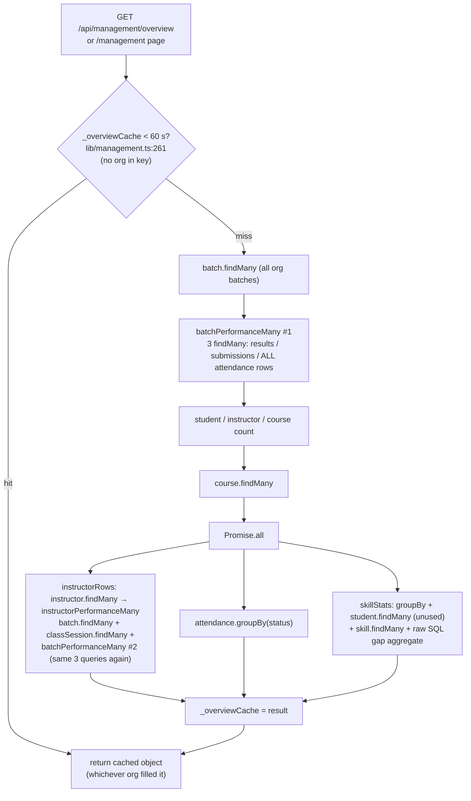

# EDUOS — Database Audit

2026-10-23 · branch `finale-hardening` (uncommitted). Companion docs:
`docs/architecture/EDUOS_DATA_DICTIONARY.md` (schema, tenancy, PII) and
`docs/audits/EDUOS_PERFORMANCE_REPORT.md` (request-level numbers).

**Nothing here touched production.** Every measurement comes from this Mac (i7-9750H) against:

- `eduos`: scratch Postgres 17.9 + pgvector 0.8.2 on `localhost:54329`, holding the standard seed
  (org_bq: 240 students / 12 batches; org_akf: 6 / 1; 5,576 attendance rows).
- `eduos_scale`: a `pg_dump` copy of `eduos` that I created for this audit, with a synthetic
  **40× scale-up of org_bq**: +500 batches × 20 sessions × 20 students, giving 205,576
  attendance, 30,912 results, 30,900 submissions and 1,003,411 OpsEvent rows. Generated by SQL
  `generate_series`. The seed and app code were not involved.
- A local production server on `:3200` (started by another agent, pointed at `eduos`), used
  read-only for the D1 reproduction.

Localhost has sub-millisecond DB round trips. Production (Supabase pooler, ap-southeast-1)
pays a network round trip per query, so **query count matters more in production than these
numbers show**. No production latency is claimed here.

**Schema change made: none.** No index met the bar of "EXPLAIN shows a better plan that the
current one lacks" (D11). `prisma/schema.prisma` is frozen to Basim anyway (CLAUDE.md).
`npx tsc --noEmit` passed and `npx vitest run` returned 11 files, 141/141 passed, after this
audit.

## Summary

| # | Sev | Finding | Status |
|---|---|---|---|
| D1 | **Critical** | Management overview cache is process-global, not per-org: each institute's admin can see the other's dashboard | **Confirmed both directions** on scratch. Open |
| D2 | High | `batchPerformanceMany` ships every raw row to JS. Prisma materialization, not SQL, is the 334 ms "slow query" | **Root-caused**. Fix prototyped and shown equivalent (0 diffs on 13 and 513 batches). Not applied |
| D3 | High | Overview computes all-batch performance **twice** per cache miss, plus a dead query | Confirmed by code + telemetry `dbCount=18`. Open |
| D4 | Info | Tenant relation filters do **not** cause pathological seq scans. Prisma emits a redundant join | Verified by EXPLAIN at 1× and 40× |
| D5 | High | N+1: batch detail issues ~64 queries/request (3 per student), unbounded `Promise.all` against a pool of 20 | Confirmed by telemetry (64.5 avg) + harness. Open |
| D6 | Medium | `OpsEvent` / `AiInsight` / `Notification` / `ContactSubmission` grow forever. 1M OpsEvent = 311 MB | Measured at 40×. Policy decision open |
| D7 | High (latent) | RAG embedding write is rejected by Prisma (`Unknown argument 'embedding'`). The vector path can never hold data, and Prisma would drop any HNSW index on the next push | **Confirmed** (client + `migrate diff`). Masked today because embeddings return null |
| D8 | Medium | Global unique business keys under per-tenant reads: Alkhidmat auto roll numbers collide with Bano Qabil's | Confirmed in SQL (rolled back). Open |
| D9 | Low | Reordering modules over the API violates `@@unique([courseId, order])` | Confirmed in SQL (rolled back). The UI only removes or appends, so it is unaffected |
| D10 | Medium | Pool `connection_limit=20` / `pool_timeout=20s` per instance, no statement timeout | Code-verified. Production URL params and Supabase role settings **unverified** |
| D11 | Info | Index review: no new index justified. 11 redundant single-column indexes | EXPLAIN at 1× and 40× |
| D12 | Low | Every Prisma op re-reads the cookie and re-verifies the JWT for tenant scoping | Code-verified. Cost **unmeasured** |
| D13 | Low | Slow-query telemetry never records `organizationId`. Page renders have no correlation id | Verified in scratch `OpsEvent` |
| D14 | Medium | Unbounded reads on growing tables (instructor sessions/assignments, student attendance, schedules) | Code + 40× timings |

## The management overview, as implemented



18 Prisma model operations per miss: `OpsEvent.dbCount = 18` on all 8 cache-miss requests
recorded. The raw SQL is not counted, because the metrics extension only wraps `$allModels`
(`lib/db.ts:7-33`).

---

## D1 — Overview cache leaks across tenants (Critical)

- **Problem.** `let _overviewCache` (`lib/management.ts:253`) is one module-level slot with a
  60 s TTL. `managementOverview()` returns it without checking who is asking
  (`lib/management.ts:261-263`). The first admin to miss the cache fills it with their org's
  data, and every admin served by that server instance in the next 60 s receives it.
- **Code path.** `app/(app)/management/page.tsx:16` and
  `app/api/management/overview/route.ts:11` → `managementOverview()`.
- **Evidence (reproduced, scratch `:3200`).** I logged in as both admins and called
  `/api/management/overview` back to back:

  ```
  bq   → {"students":240,"instructors":15,"courses":8,"batches":12}  batches PY-12, PY-13, WD-10
  akf  → {"students":240,"instructors":15,"courses":8,"batches":12}  batches PY-12, PY-13, WD-10   ← Alkhidmat sees Bano Qabil
  (once the slot expired, reverse order)
  akf  → {"students":6,"instructors":1,"courses":1,"batches":1}      batches AKF-01
  bq   → {"students":6,"instructors":1,"courses":1,"batches":1}      batches AKF-01                ← Bano Qabil sees Alkhidmat
  ```

  Scratch `OpsEvent` corroborates this independently. At 08:32:32 UTC, both admins' requests ran
  0 queries in 1 ms, so both were served the slot the org_bq load test had filled. At 08:33:19,
  org_akf missed (18 queries), and org_bq's request 7 ms later ran 0 queries in 1 ms. At 08:38:07
  the order was reversed (org_bq missed, org_akf was then served from cache).

  `scripts/tenant-isolation.mjs` does not call this endpoint, which is why its 21/21 PASS missed
  this. `docs/audits/EDUOS_PERFORMANCE_REPORT.md` (P3) independently reports the same leak.
- **Performance side effect.** The load test's overview `p50 25 ms` is mostly cache hits. Its
  `p99 1022 ms` is the miss path. Telemetry has 8 load-test misses at **750–1010 ms**, each with
  18 queries and `dbMs` (the sum across parallel queries) of 1,027–1,765 ms. They arrive four at a
  time (08:29:34–35 and 08:31:56–57): with concurrency 10, every request that finds the slot empty
  recomputes it, because there is no single-flight. Two further misses (24 ms for org_akf, 419 ms
  for org_bq) come from the D1 reproduction.
- **Fix.** Key the cache by org, e.g. a `Map<orgId, {at, data}>` keyed on
  `await currentOrgId() ?? "system"`, the same pattern `lib/ai/features.ts:34-35` uses. A
  smaller alternative: delete the cache once D2 and D3 land. On the seed, the prototype puts the
  three aggregate queries at about 5 ms (D2).
- **Verification.** Add the two-admin back-to-back assertion above to
  `scripts/tenant-isolation.mjs`, and require `summary.students` to differ (240 vs 6).
- **Trade-off.** A per-org Map grows with the tenant count, which is fine. The cache is
  per-instance on Vercel, so hit rates are lower in production than locally. Writes still
  serve up to 60 s of stale data, because `invalidateOverviewCache()` (line 256) is never
  called anywhere (`grep` finds no caller).

## D2 — The "slow `attendance.findMany`" is row shipping, not SQL (High)

- **Problem.** `batchPerformanceMany` (`lib/analytics.ts:237-279`), and in the same way
  `studentOverallPerformanceMany` (150-186) and `studentBatchPerformanceMany` (98-144), fetch
  **every** attendance, result and submission row and reduce them in JS. Postgres finishes in
  milliseconds. The remaining wall time is spent outside Postgres execution: transfer, Prisma's
  query engine and turning thousands of rows into JS objects. How it splits between those was not
  measured. A relation select adds a second query (`… WHERE ClassSession.id IN (…222 params…)`).
- **Evidence: telemetry.** All 17 `kind='db'` events on scratch are `attendance.findMany`
  (303–440 ms, p50 369). They come in pairs and correlate 1:1 with
  `GET /api/management/overview` cache misses: two per miss, one from each
  `batchPerformanceMany` call (D3).
- **Evidence: EXPLAIN (ANALYZE, BUFFERS)** of the exact SQL Prisma emits, captured with
  `log: query`, with the tenant filter added the way `lib/tenant.ts:162` adds it:

  | | rows → JS | Postgres `Execution Time` | Prisma wall (solo, warm) |
  |---|---|---|---|
  | seed, org_bq attendance | 5,540 | **4.4 ms** (+0.13 ms relation query) | **166–178 ms** (fact-check re-run: 178–196 ms) |
  | 40×, org_bq attendance | 205,540 | 329 ms (+4 ms) | **8,338 ms** |
  | 40×, assessmentResult | 30,900 | 133 ms | 1,064 ms |
  | 40×, studentOverallPerformanceMany (50 students) | 43,243 | 55 ms | 320 ms |

  Seed plan excerpt: `Nested Loop … rows=5540` → `Index Scan using "Attendance_sessionId_idx"
  … loops=240`, `Buffers: shared hit=1246`, `Execution Time: 4.957 ms`. Indexes are used, and
  96–97% of the wall time sits outside Postgres. Under the load test's concurrency of 10 this
  inflates to the 303–440 ms that telemetry recorded.
- **Fix (prototyped, not applied).** Aggregate in SQL, so one row per `(batch, status)`
  reaches JS:

  ```sql
  SELECT cs."batchId", a.status::text, count(*)::int
  FROM "Attendance" a JOIN "ClassSession" cs ON cs.id = a."sessionId"
  JOIN "Batch" b ON b.id = cs."batchId"
  WHERE b."organizationId" = ${org} AND cs."batchId" = ANY(${batchIds})
  GROUP BY 1, 2;
  -- results:     SUM(score), SUM(maxScore), COUNT(*) GROUP BY Assessment.batchId
  -- submissions: SUM(COALESCE(score,0)), SUM(maxScore), COUNT(*) GROUP BY Assignment.batchId
  ```

  | | rows → JS | Prisma `$queryRaw` wall (3 runs) |
  |---|---|---|
  | seed: current 3 × findMany | 7,340 | 176, 167, 169 ms |
  | seed: 3 × GROUP BY | 70 | **5, 5, 5 ms** |
  | 40×: current | 267,340 | 8,582, 8,717, 8,175 ms |
  | 40×: 3 × GROUP BY | 3,070 | **116, 110, 116 ms** |

- **Verification done.** I recomputed `Perf` (same `pct`/`round1`/`combine`/LATE = 0.5 rules as
  `lib/analytics.ts:24-47, 192-213`) from both shapes for every batch: **0 differences across 13
  batches (seed) and 513 batches (40×)**. Integer sums are exact, so this is not a rounding
  coincidence. To verify before shipping: a vitest asserting equality on the seed, plus
  `npm run check` and `scripts/smoke.mjs`.
- **Trade-off.** Raw SQL **bypasses the tenant extension** (CLAUDE.md rule 3), so the org filter
  must be written by hand with `currentOrgId()`, exactly as `lib/management.ts:217-228` does,
  and covered by the tenant-isolation script. The SQL must stay inside `lib/analytics.ts` to
  keep the one-formula rule. Prisma `groupBy` cannot group by a relation column, and grouping
  by `sessionId` still returned 39,848 rows / 638 ms at 40×, so it is not a substitute.

## D3 — Overview does the expensive part twice, plus a dead query (High)

- **Problem.** `managementOverview()` calls `batchPerformanceMany(allBatches)`
  (`lib/management.ts:281`). It then calls `instructorRows()` (349) →
  `instructorPerformanceMany` → `batchPerformanceMany(allBatchIds)` again
  (`lib/analytics.ts:349`), over the same batches. `skillStats()` fetches
  `db.student.findMany({ select: { id: true } })` (`lib/management.ts:213`) and never reads it.
- **Evidence.** The code above, plus `dbCount = 18` on every cache miss. The paired
  `attendance.findMany` slow events per correlation id (D2) are the two calls.
- **Fix.** Let `instructorPerformanceMany` accept a precomputed `perfMap` (or have the overview
  derive instructor rows from `allBatches` + `perfMap`), and delete the unused query. That
  takes 4 of the 18 operations away, and removes the costliest pair.
- **Verification.** Overview `dbCount` drops to 14 or fewer in `OpsEvent`, and the response
  JSON is byte-identical before and after on the seed.
- **Trade-off.** A slightly wider function signature in `analytics.ts`.

## D4 — Tenant relation filters and seq scans (Info)

- **Question.** Does `attendance → session → batch.organizationId` (`lib/tenant.ts:73`) force seq
  scans?
- **Evidence.** It does not, in any harmful way.
  - Small tenant inside a big table (org_akf at 40×, 1 of 513 batches):
    `Index Scan using "Batch_organizationId_idx"` → `Bitmap Index Scan on
    "ClassSession_batchId_idx"` → `Index Scan using "Attendance_sessionId_idx"`,
    **Execution Time 0.442 ms**.
  - Per-student / per-batch queries at 40×: 0.18–0.25 ms (requireStudentAccess count, student ×
    batch attendance).
  - Org-wide queries seq-scan `Attendance` and `ClassSession` because they read every row of
    the org (205,540 of 205,576). For that, a seq scan + hash join is the optimal plan, and an
    index would not help.
- **Side note.** Prisma renders the user's `session: {batchId}` and the extension's
  `session: {batch: {organizationId}}` as **two separate LEFT JOINs to `ClassSession`** (`j0`,
  `j1`). That adds 240 extra PK lookups on the seed (`Index Scan using "ClassSession_pkey" …
  loops=240`). On the seed the planner misestimates (`rows=1`, actual 240). At 40× the estimate
  is accurate (205,427 vs 205,540). Harmless today.
- **Fix.** None needed. Denormalizing `organizationId` onto Attendance and other high-volume
  children would remove the joins, but costs a backfill plus write-time stamping. Not
  justified by these numbers.

## D5 — N+1 per-row performance calls (High)

- **Problem.** Several screens call the single-row analytics functions once per row inside
  `Promise.all`, at 3 queries each:

  | Site | Fan-out |
  |---|---|
  | `app/api/batches/[id]/route.ts:43-49` | `studentBatchPerformance` × every enrolled student, **unbounded** |
  | `app/(app)/instructor/batches/[id]/page.tsx:51-53` | same, unbounded |
  | `app/(app)/instructor/copilot/page.tsx:53-54` | same, unbounded |
  | `app/(app)/instructor/page.tsx:67` / `:82-87` | `batchPerformance` × batch (unbounded) / `studentBatchPerformance` × enrollment (`mapLimit` 4) |
  | `app/(app)/instructor/batches/page.tsx:29`, `app/api/instructor/batches/route.ts:39` | `batchPerformance` × batch |
  | `app/(app)/student/courses/page.tsx:20` | `studentBatchPerformance` × enrollment |

- **Evidence: telemetry.** `GET /api/batches/[id]` averaged **64.5 queries per request**, with a
  `dbMs` p50 of 3,437 ms summed across parallel queries (484 requests). The next highest route
  with real volume is `GET /api/student/overview` at 8.0 (634 requests). `GET /api/ai/career-path`
  shows 13.0, but on a single request. For PY-12's 20 students, that is 60 roster queries plus 4
  (`batchPerformance` and `moduleWeakness`) arriving at once at a pool capped at 20
  (`lib/db-base.ts:11-13`).
- **Evidence: harness** (same queries + tenant filter, `connection_limit=20`, PY-12):

  | | queries/request | solo wall | 10 concurrent requests |
  |---|---|---|---|
  | per-row (current) | 60 | 24–33 ms | 241 ms |
  | `studentBatchPerformanceMany` | 3 | 13–17 ms | 54 ms |

  In production every one of those 60 queries also pays the pooler round trip (not measured
  here).
- **Fix.** Use the batched functions that already exist: `studentBatchPerformanceMany`
  (`lib/analytics.ts:98`) and `batchPerformanceMany` (237). The pattern is already in use at
  `lib/instructors.ts:258`.
- **Verification.** `dbCount` for `GET /api/batches/[id]` drops from about 64 to about 8 in
  `OpsEvent`, the load-test p95 for "batch detail" drops, and smoke stays green.
- **Trade-off.** None worth naming. Same numbers, fewer queries.

## D6 — Unbounded append-only tables (Medium)

- **Problem.** Nothing ever deletes `OpsEvent`, `AiInsight` (one row per successful AI answer
  after a cache miss, `lib/ai/features.ts:53-66`) or `ContactSubmission`. `Notification` rows
  are never pruned and leave only when their User is deleted. See the retention table in the data
  dictionary.
- **Evidence.** Scratch collected **about 3,405 OpsEvent rows in ~10 minutes** (08:22–08:32 UTC)
  of test traffic, including the 20 s load test (1,919 requests). At 40× (1,003,411 rows):
  - Table + indexes = **311 MB** (`pg_total_relation_size`). The plan this project is on, and so
    its database size limit, is **unverified**. If it is a free-tier project, 311 MB would be a
    large share of the quota. The "paused project" outage seen at session start points the same
    way, but that link is an **unverified** inference.
  - 24 h dashboard query: `Index Scan using "OpsEvent_at_idx"`, 52,561 rows, **49.8 ms**.
  - 7-day "routes" query: 348,789 rows, `Sort Method: external merge Disk: 10312kB`, **691.7 ms**.
  - Login throttle count: `Index Scan using "OpsEvent_kind_subject_at_idx"`, **0.128 ms**. The
    indexes match the queries.
  - `OpsEvent_kind_at_idx` was scanned once in the scratch stats. The planner prefers
    `(at)`, because `kind='http'` is about 57% of rows.
- **Fix (Basim's decision; house rules forbid shipping auto-delete code).** Pick retention
  windows, for example OpsEvent 14 days, AiInsight 7 days, Notification read + 90 days, and
  ContactSubmission per privacy policy. Run them as a reviewed, manual or scheduled `DELETE …
  WHERE at < now() - interval '…'` through the session pooler. Or cap the dashboard at 24 h.
- **Verification.** `pg_total_relation_size('"OpsEvent"')` stays flat week over week, and the
  dashboard's 7-day query stays under 200 ms.
- **Trade-off.** Losing history vs. size and query time. Sampling successful `http` events
  is the gentler middle ground.

## D7 — The vector (RAG) path cannot store vectors (High, latent)

- **Problem 1: writes are rejected.** `KnowledgeChunk.embedding` is
  `Unsupported("vector(1536)")` (schema:494). Prisma Client exposes no input for Unsupported
  fields, but `lib/rag/ingest.ts:77-83` passes `embedding` to `createMany`. TypeScript does not
  catch it, because the object is built inside `.map()`. Running that call against the scratch
  DB with Prisma 6.19.3 gave:
  `PrismaClientValidationError … Unknown argument 'embedding'`. The code is unchanged from
  `main` (`git show main:lib/rag/ingest.ts`, line 75).
- **Problem 2: data loss on re-ingest.** Ingest deletes the source's old documents first
  (`lib/rag/ingest.ts:55`) and is not transactional. Once embeddings work, a re-ingest deletes
  the old chunks, creates the document and then throws, leaving a document with **zero
  chunks**.
- **Why it is invisible today.** `embed()` returns `null` on any provider failure
  (`lib/ai/embed.ts:14-26`), and the DashScope key returns 401 (session fact), so `embedding`
  is `undefined` and text chunks are written. Search falls back to `ILIKE` text mode
  (`lib/rag/search.ts:83-106`). The vector branch has therefore **never run with data:
  implemented, unverified**.
- **Problem 3: no ANN index, and Prisma removes one.** No HNSW/IVFFlat index exists. Prisma 6
  cannot declare one (it has no `hnsw` index type). After I created
  `CREATE INDEX … USING hnsw (embedding vector_cosine_ops)` on `eduos_scale`,
  `prisma migrate diff --from-url … --to-schema-datamodel prisma/schema.prisma` printed
  `DROP INDEX "kc_embedding_hnsw";`. **The next `npm run db:push` would silently drop a
  hand-made vector index.**
- **Fix.** Write chunks first, then set embeddings with a scoped raw
  `UPDATE "KnowledgeChunk" SET embedding = $1::vector WHERE id = $2`, or one `INSERT … SELECT
  unnest(...)`. Wrap delete + create in one `$transaction`. Add an ANN index only when a course
  holds more than roughly 10k chunks. The scratch DB has 0. Without an index, the per-course
  `ORDER BY embedding <=> $1 LIMIT k` is an exact scan, which stays fast at small sizes and is
  exact, not approximate. If an index is added, re-create it after every `db push` (or move to
  `prisma migrate` with a raw SQL migration).
- **Verification.** Ingest one page with a valid key on scratch, check
  `SELECT count(*) FROM "KnowledgeChunk" WHERE embedding IS NOT NULL` > 0, and confirm
  `searchKnowledge` returns `mode: "vector"`.
- **Trade-off.** Raw SQL for the vector column means scoping by hand (the existing
  `course.findFirst` gate at `lib/rag/search.ts:37` is the model to follow).

## D8 — Global unique keys vs. per-tenant reads (Medium)

- **Problem.** `Student.rollNo`, `Instructor.employeeNo`, `Course.code`, `Batch.code` and
  `Classroom.name` are unique **globally** (schema:113,134,150,218,399), while every read is
  scoped to one org. `nextRollNo()` (`lib/students.ts:161-170`) hard-codes the `BQ-` prefix and
  sees only the caller's rows.
- **Evidence (SQL on `eduos_scale`, inside `BEGIN … ROLLBACK`).** The `nextRollNo` lookup
  scoped to org_akf finds no `BQ-2026-%` rows, so it yields `BQ-2026-0001`. Inserting that
  for org_akf gives `ERROR: duplicate key value violates unique constraint
  "Student_rollNo_key"`. Through the API, Alkhidmat's "add student" with a blank roll number
  gets a 409 "A student with that roll number already exists" for a number that does not exist
  in its institute (`app/api/students/route.ts:55, 80-86`). Not exercised over HTTP, so I did
  not write to the shared scratch server.
- **Fix.** Short term: derive the prefix from the org (`Organization.slug`). Proper fix:
  `@@unique([organizationId, rollNo])` and the same for the other four keys. That is an
  additive unique index first, then drop the global one, which is a schema change for Basim.
- **Trade-off.** Tenant-scoped uniques allow duplicate codes across institutes, which is the
  point. Any cross-tenant tooling must then key on id, not code.

## D9 — Module reorder hits `@@unique([courseId, order])` (Low)

- **Problem.** `PUT /api/courses/[id]` rewrites `order = i + 1` one row at a time
  (`app/api/courses/[id]/route.ts:84-97`). The unique constraint is checked per statement and
  is not deferrable.
- **Evidence.** `UPDATE "Module" SET "order" = 1 WHERE id = 'mod_PY_2'` (rolled back) →
  `duplicate key value violates unique constraint "Module_courseId_order_key"`. Removing and
  appending, which are all the edit form does (`app/(app)/courses/[id]/CourseEditForm.tsx:159`),
  stay safe because freed slots get reused in ascending order. A reordered list sent to the
  API fails.
- **Fix.** Inside the transaction, first shift every existing order by a large offset
  (`UPDATE … SET "order" = "order" + 1000 WHERE "courseId" = $1`), then write the final orders.
- **Verification.** A vitest or API test that PUTs `[m2, m1, m3]` and reads back the orders.

## D10 — Connection pool and timeouts (Medium; production values unverified)

- **What the code does.** `lib/db-base.ts:7-18` adds `connection_limit=20` and
  `pool_timeout=20` (seconds) **unless** the URL already sets them. The production
  `DATABASE_URL` is the Supabase transaction pooler `:6543` with `pgbouncer=true`
  (CLAUDE.md, runbook). Its query string could not be read, because `.env` is off-limits, so
  the effective production values are **unverified**.
- **Peak concurrency per request (from code).** Batch detail ≈ 64 queries at once for a 20-student batch (D5). An overview
  miss peaks at no more than about 8 (upper bound from the D3 diagram: 4 + 1 + 3 in the parallel phase). One Vercel instance at limit 20 already queues
  inside batch detail. N warm instances × 20 is the pressure on Supavisor. Supavisor's pool
  size for this compute tier is **unverified**. CLAUDE.md records that the session pooler
  "caps at 15 clients and 500s the management pages under fan-out".
- **`pool_timeout=20s`.** A request waits up to 20 s for a connection before P2024. If that is
  longer than the function's max duration (**unverified** for this project), the failure shows
  up as a platform timeout rather than a clean error.
- **Statement timeout.** None set by the app (`grep statement_timeout` finds nothing outside
  docs). Scratch shows `statement_timeout = 0`. The setting on Supabase's `postgres` role is
  **unverified**.
- **pgbouncer transaction mode.** `pgbouncer=true` turns off Prisma's prepared statements. The
  interactive transactions (`app/api/students/route.ts:60`, `app/api/courses/[id]/route.ts`)
  hold one server connection for their duration, which transaction mode supports.
- **Fix.** (1) Land D5 and D3 first, since they remove most of the fan-out. (2) Then set
  `connection_limit` explicitly in the production URL (around 5) and `pool_timeout` below the
  function timeout (around 10 s), so overload fails fast and visibly. (3) Set a role-level
  `statement_timeout` (around 10–15 s) via the session pooler, ideally on a dedicated app role,
  so `db push` and seed are not affected.
- **Verification.** Run `SHOW statement_timeout` as the app role, then load-test against a
  preview with `OpsEvent` watching for `P2024` in `detail`.
- **Trade-off.** A lower limit means more queueing per instance but fewer pooler slots
  hoarded. Too low a statement timeout kills legitimate org-wide reports. D2 keeps those in
  the ~100 ms range even at 40×.

## D11 — Index review (Info): no index added

No `@@index` was added, for these reasons:

| Candidate | Evidence | Verdict |
|---|---|---|
| `Batch(instructorId)`, `Batch(courseId)` | 13 rows (seed) / 513 (40×, 512 of them org_bq). The planner seq-scans 4–14 pages. `requireStudentAccess` count = 0.18 ms at 40× | Not justified. Revisit past ~10k batches |
| Attendance/Submission/AssessmentResult composite `(studentId, …)` | Per-student plans already use `*_studentId_idx` or the unique `(…, studentId)` index. 0.25 ms at 40× | Not justified |
| Anything for the D2 org-wide reads | They read ~100% of the org's rows, so seq scan + hash join is optimal | An index cannot help. Aggregate instead (D2) |
| `KnowledgeChunk.embedding` HNSW | 0 chunks, and Prisma cannot declare it (D7) | Not now |
| `AiInsight(kind, subjectType, subjectId, createdAt)` | 0 rows on scratch | Not justified yet |
| Trigram index for student `ILIKE` search (`lib/students.ts:87-95`) | 246 students | Not justified |

**Redundant indexes** (each column is already the leading column of a unique or composite
index): `Organization(slug)`, `CourseSkill(courseId)`, `Enrollment(studentId)`,
`ClassSession(batchId)`, `Attendance(sessionId)`, `Assignment(batchId)`,
`Submission(assignmentId)`, `Assessment(batchId)`, `AssessmentResult(assessmentId)`,
`ModuleProgress(enrollmentId)`, `StudentSkill(studentId)`. They cost a little write
amplification and are harmless. They were **not** dropped: house rule, and no measured cost.

**Production rollout rule for any future index.** Apply it with `prisma db push` through the
**session pooler `:5432`**, because `db push` hangs on `:6543` (CLAUDE.md). `db push` issues a
plain `CREATE INDEX`, which blocks writes on that table while it builds. At today's sizes that
is milliseconds. For a large table, run `CREATE INDEX CONCURRENTLY "<Model>_<cols>_idx" …`
by hand first, using Prisma's naming, so the following `db push` finds nothing to do. Confirm
with `prisma migrate diff --from-url <prod session URL> --to-schema-datamodel
prisma/schema.prisma` showing only the intended statements. The one schema change this branch
**does** need in production is additive: the `OpsEvent` table + 3 indexes. `migrate diff`
main → branch shows only `CREATE TABLE "OpsEvent"` + 3 `CREATE INDEX`, plus the seed backfill
of `organizationId`. Both are covered in `docs/operations/EDUOS_DEPLOYMENT_RUNBOOK.md`.

## D12 — Tenant context recomputed per query (Low)

`tenantExtension` calls `tenantContext()` → `cookies()` + `jwtVerify()` on **every** Prisma
operation on a scoped model (`lib/tenant.ts:153-158`, `22-40`). An overview miss verifies the
same JWT roughly 20 times: once for each of the 17 operations on scoped models (`skill.findMany` is unscoped), plus `currentOrgId()` in `skillStats` and in `route()`, plus the route's own auth check. Writes add one `count()` per FK target (`checkData`, 139-145). The CPU cost
is **unmeasured**. HMAC-SHA256 verification is cheap, but it runs on every query. A possible
fix is memoizing per request (React `cache()` around `tenantContext`, or caching the result in
the `requestStore` from `lib/ops.ts:31`). Verify with a microbenchmark before bothering.

## D13 — Telemetry gaps that affect DB diagnosis (Low)

- `db` slow-query events never carry `organizationId`. The scratch counts are 0 of 17 for db
  events and 3,127 of 3,299 for http. The cause: `route()` creates the store without `orgId`
  (`lib/ops-route.ts:12`), while `lib/db.ts:27` reads `store?.orgId`. Fix: resolve the org into
  the store before running the handler.
- Page renders are not wrapped by `route()`, so their slow queries have no correlation id. The
  first slow event on scratch (08:28:27, 334 ms) has an empty `correlationId`.

## D14 — Unbounded reads on growing tables (Medium)

These have no `take`, so they grow with history:

| Function | Grows with | 40× evidence |
|---|---|---|
| `getInstructorSessions` (`lib/instructors.ts:274-300`), which includes every attendance row of every session | sessions × students | 680 sessions: SQL 0.6–7 ms, **Prisma wall 294 ms** |
| `getInstructorAssignments` / `getInstructorAssessments` (303-360), which include all submissions/results | assignments × students | not timed |
| `studentAttendance` (`lib/students.ts:346-389`) | a student's whole history | ~20 rows/batch, fine |
| `schedule.findMany` in the engine (`lib/scheduling/engine.ts:215-225, 355-358`) | org timetable | 32 rows, fine |
| `skillStats` / `attendanceDistribution` (`lib/management.ts:210-251`) | whole org | 108 ms / 76 ms at 40× |

The fix is the same as D2: aggregate in SQL (`groupBy` on `status`, or `_count` relation
counts) instead of including child rows, and paginate session lists. The trade-off is more
specialised queries in place of one generic `include`.

---

## Could not verify

- Production: pool params in the real `DATABASE_URL`, the Supabase plan and DB size, the
  Supavisor pool size, the role `statement_timeout`, the function max duration, and the
  production `KnowledgeChunk` row count. No production access, by rule.
- Real-network latency of the D2/D5 fixes. Measured on localhost only.
- End-to-end overview latency at 40×. Per-query timings only. I did not start a second
  server, to avoid writing into the shared `.next`.
- The CPU cost of D12.

## Reproduce

- 40× data: create `eduos_scale` (`pg_dump eduos | psql eduos_scale`), then run the
  `generate_series` inserts summarized at the top. The scratch DB `eduos_scale` and its
  `kc_embedding_hnsw` index are left in place for re-runs. Basim decides whether to drop them.
- Plans: run any Prisma call with `log: [{ emit: "event", level: "query" }]`, then
  `EXPLAIN (ANALYZE, BUFFERS) <captured SQL>` with the captured params, on scratch only.
- D1: log in as `admin@eduos.pk` and `admin@alkhidmat.pk` against a local build, then
  `GET /api/management/overview` with each cookie, back to back.
