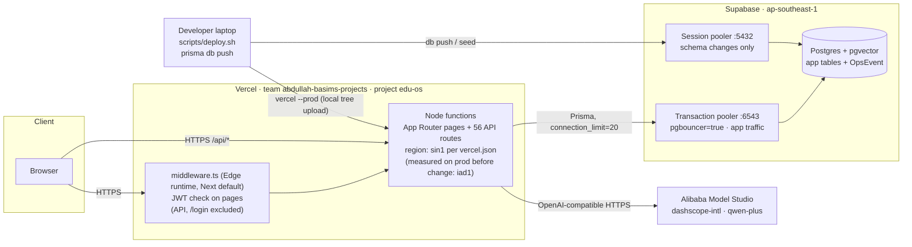
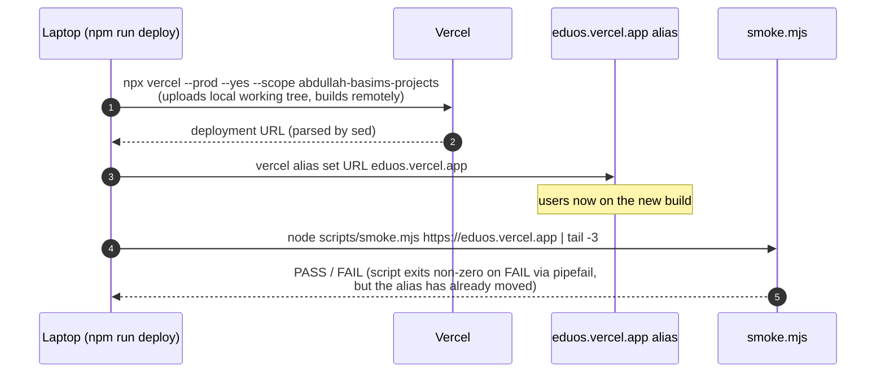

# EDUOS — Infrastructure Audit

Branch `finale-hardening` (uncommitted working tree), audited 2026-10-23. Baseline: `main @ d7ad650`.

**Evidence rules.** Every claim cites code (`file:line`) or a measurement from this session
(marked **[measured]**). Anything else is marked **[unverified]**. Status vocabulary:

| Status | Meaning |
|---|---|
| **verified** | Implemented and exercised in this session |
| **implemented-unverified** | Code exists, not exercised against the real target |
| **partial** | Some of it exists |
| **missing** | Does not exist |
| **blocked** | Could not be checked from this environment |

Nothing on this branch has been deployed. Production (`eduos.vercel.app`) and its database were
not touched by this audit.

---

## 1. Topology as built

Sources: `vercel.json` (regions `["sin1"]`), `middleware.ts:52-54` (matcher excludes `api`),
`lib/db-base.ts:11-16` (`connection_limit=20`, `pool_timeout=20` defaults), `CLAUDE.md:16-21`
(pooler modes, region), `docs/operations/EDUOS_DEPLOYMENT_RUNBOOK.md:15-16` (LLM endpoint and model defaults; code default in `lib/ai/providers.ts:92-93`),
`scripts/deploy.sh:16,27`. 56 `route.ts` files under `app/api` **[measured: `find`]**.

---

## 2. Findings at a glance

| # | Area | Status | Severity | One line |
|---|---|---|---|---|
| I-01 | Region | implemented-unverified | High | Functions ran in iad1 against a Singapore DB **[measured]**; `vercel.json` pins sin1, effect not yet measured on prod |
| I-02 | Availability | missing | High | Supabase project paused this week; whole app 500s while paused **[measured]**; no keep-warm, no external uptime probe |
| I-03 | Backups | missing | High | No backup beyond Supabase's platform default; restore never rehearsed (runbook:101-102) |
| I-04 | Migrations | missing | High | `prisma db push`, no `prisma/migrations/` history **[measured: `ls prisma`]** |
| I-05 | CI/CD | missing | High | No `.github/` **[measured]**; deploys are laptop CLI uploads; no test gate |
| I-06 | Environments | missing | High | No staging; local scripts default to the env file, which CLAUDE.md says holds production credentials |
| I-07 | Deploy script | partial | Medium | Smoke runs *after* the alias moves; a failing build is already live (`scripts/deploy.sh:27-31`) |
| I-08 | Deploy hygiene | implemented-unverified | Medium | No `.vercelignore` **[measured]**; whether `.env` is uploaded with CLI deploys is unverified |
| I-09 | Secrets | partial | Medium | Fail-closed `AUTH_SECRET` now (`lib/session-secret.ts:12-14`); prod value presence blocked; LLM key invalid **[measured]** |
| I-10 | Telemetry kill switch | implemented, side effect | Medium | `OPS_TELEMETRY=off` (a runbook rollback step) also disables login throttling |
| I-11 | TLS / headers | implemented-unverified on prod | Low | HSTS, CSP, XFO set in `next.config.ts:19-26`; verified on local prod build by `ops-check.mjs` **[measured]** |
| I-12 | DB exposure | blocked | Medium | Postgres reachable over the public pooler with password auth; RLS / Data API posture unverified |
| I-13 | Function limits | implemented-unverified | Low | No `maxDuration` anywhere **[measured: grep]**; AI tool loop worst case is 4 × 45 s |
| I-14 | Dependencies | partial | Low | `npm audit fix` → Next 15.5.28; 1 high left in `prisma` devDependency (deepmerge-ts), accepted **[measured]** |
| I-15 | Cost / quotas | blocked | Medium | Plan tiers of Vercel and Supabase not readable here; `OpsEvent` grows unbounded |

---

## 3. Hosting and region

**What exists.** Vercel project `edu-os` (`EDUOS_DEPLOYMENT_RUNBOOK.md:3`) under scope
`abdullah-basims-projects` (`scripts/deploy.sh:12`). Next.js 15 App Router; no route or page sets
`runtime` **[measured: grep]**, so routes and pages use the Node runtime and `middleware.ts` uses
Next's default Edge runtime (`lib/session-secret.ts:1` is written to be edge-safe for it).
`vercel.json:3` adds `"regions": ["sin1"]`.

**What was measured.** On production, `x-vercel-id` showed `sin1::iad1` / `bom1::iad1`: the
edge PoP was near the user but the function executed in **iad1 (Washington)** while the database
is in **ap-southeast-1 (Singapore)**. Warm `GET /api/public/courses` took **1.83–1.84 s**, cold
**4.26 s** **[measured]**. The same endpoint on the local production build with a local DB had
p50 45 ms / p95 124 ms under load **[measured]** — a different machine, database and network, so
not a like-for-like comparison. It suggests, but does not prove, that most of the production time
is spent outside the handler's own compute **[inference, unverified]**.

**Assessment.** Every Prisma query from iad1 crosses the Pacific. A page that runs N sequential
queries pays roughly N round trips of trans-Pacific latency. Pinning functions to sin1 is the
correct fix and is a one-line change, but **its effect on production has not been measured**
(nothing is deployed). The System Health dashboard reports the serving region from
`VERCEL_REGION` (`app/api/ops/health/route.ts:16`), so the first post-deploy check is to open it
and read `sin1` (runbook step 6).

**Status:** implemented-unverified.

---

## 4. Database connectivity and pooler modes

| Use | Endpoint | Why | Source |
|---|---|---|---|
| App runtime | Transaction pooler `:6543`, `pgbouncer=true` | Session mode caps at 15 clients and 500'd management pages under fan-out | `CLAUDE.md:18-20` |
| Schema changes | Session pooler `:5432`, no `pgbouncer=true` | `prisma db push` hangs on the transaction pooler | `CLAUDE.md:16-17` |
| Per-instance pool | `connection_limit=20`, `pool_timeout=20` unless the URL sets them | Overrides Prisma's default pool size (`num_cpus*2+1`); the rationale is not written in code **[unverified]** | `lib/db-base.ts:11-16` |

**Gaps.**
- `prisma/schema.prisma:9-12` declares only `url`. There is **no `directUrl`**, so every
  schema operation depends on a human remembering to override `DATABASE_URL` with the session
  pooler. Prisma 6 supports `directUrl` for exactly this split; adding it removes the footgun.
- 20 connections per warm instance × N concurrent instances against the Supabase pooler's client
  limit is not measured. The pooler's limit for this project's plan is **[unverified]**.
- `lib/db-base.ts:26` caches the client on `globalThis` only outside production. In production
  each module instance makes one client — normal for serverless, noted for completeness.

**Status:** implemented (pooler split documented and used); `directUrl` missing.

---

## 5. Environment separation

**What exists:** one production environment and developer laptops. There is **no staging or
preview database** documented anywhere in the repo.

- `package.json` `db:seed` and `check` run `node --env-file=.env` (`package.json:10-11`).
  `CLAUDE.md:18` says the production Supabase ref and credentials live in `.env`. So the
  **default target of `npm run db:seed` and `npm run check` is production** unless
  `DATABASE_URL` is exported first. Node gives an already-set environment variable precedence over
  `--env-file`, which is why the runbook's scratch-DB recipe (`EDUOS_DEPLOYMENT_RUNBOOK.md`,
  "Scratch database") works — but forgetting the `export` silently writes to production.
  (Contents of the env files were not read, per audit rules — **[unverified]** that `.env`
  currently points at production; CLAUDE.md says it does.)
- `.env.local` also exists **[measured: `ls`]**; Next.js loads it with higher priority than `.env`
  in dev. Which database it names is **[unverified]**.
- Vercel **Preview** deployments: whether `DATABASE_URL` is set for the Preview environment (and
  so whether previews talk to production data) is **[unverified]** — check Vercel → Settings →
  Environment Variables.
- This session's verification used a **scratch Postgres 17 + pgvector** on localhost with two
  seeded institutes (org_bq 258 users, org_akf 8 users) **[measured]**. That recipe is the de-facto
  staging and is documented in the runbook; it is not automated.

**Status:** missing (staging). **Recommendation:** a second Supabase project (or Supabase branch)
as staging, wired to Vercel Preview; make `db:seed`/`check` refuse to run against a host that is
not explicitly allowlisted.

---

## 6. Secret management

| Secret (name only) | Where it lives | Code behaviour when absent | Source |
|---|---|---|---|
| `AUTH_SECRET` | Vercel env + local env file | **Production throws** on first use; dev falls back to `"dev-secret"` | `lib/session-secret.ts:9-16` |
| `DATABASE_URL` | Vercel env + local env file | Client constructed with `undefined` URL → queries fail | `lib/db-base.ts:7-9` |
| `LLM_API_KEY` | Vercel env + local env file | AI features return `source: "fallback"` | `lib/ai/client.ts:67-79` |
| `OPS_ADMIN_EMAILS` | Vercel env | Production: nobody can open System Health (fails closed) | `lib/platform.ts:10-13` |

- `.gitignore` ignores `.env` and `.env*` **[measured]**. Whether any env file was ever committed
  in history was **blocked**: the local safety hook refused a `git log` that named the path. Run
  `gitleaks git` on the repo to close this.
- **F01 (dev-secret fallback)** was real on `main`. It is now fail-closed. Whether `AUTH_SECRET`
  is actually set in Vercel production — and therefore whether F01 was ever exploitable live —
  **could not be tested** (sandbox blocked forging a token against prod) **[measured: blocked]**.
  Runbook step 2 makes confirming it a precondition of the rollout.
- The LLM key tested this session returns **401 invalid_api_key** from DashScope intl and is 117
  characters, unusual for a Model Studio key **[measured]**. Whether it is the same value that is
  configured in Vercel production is **[unverified]**; if it is, AI serves fallbacks in production
  today.
- There is no secret manager, no rotation schedule, and no record of when secrets were last
  rotated **[missing]**. Vercel's encrypted env store is the only store.
- `scripts/deploy.sh:16` deploys the **local working tree**. No `.vercelignore` exists
  **[measured: `ls -a`]**. Whether Vercel's CLI default ignore list excludes `.env` (as opposed to
  `.env.local`) is **[unverified]**; if it does not, the local env file is uploaded into the build
  container on every deploy, and any variable present there but missing in Vercel would be picked
  up by `next build`. Adding a `.vercelignore` with `.env*` removes the question.

**Status:** partial.

---

## 7. TLS and transport

- **Edge TLS:** terminated by Vercel for `*.vercel.app` **[unverified: platform behaviour]**.
- **Headers** (`next.config.ts:6-34`): CSP with `frame-ancestors 'none'`, `object-src 'none'`,
  `connect-src 'self'`; `Strict-Transport-Security: max-age=31536000; includeSubDomains`;
  `X-Frame-Options: DENY`; `nosniff`; `Referrer-Policy`; `Permissions-Policy`;
  `poweredByHeader: false`. `script-src` keeps `'unsafe-inline'` in production
  (`next.config.ts:4-8`) — the comment names nonce-based CSP as the upgrade path.
- **Session cookie:** `HttpOnly`, `SameSite=Lax`, `Secure` in production (`lib/auth.ts:29-35`).
  F11 (cookie lacked Secure) is fixed. `scripts/ops-check.mjs:31-44` asserted HttpOnly, Lax,
  Secure, CSP (`frame-ancestors`, `object-src`), XFO, nosniff, HSTS, Referrer-Policy and no
  `X-Powered-By` against the local production build — **PASS [measured]**.
- **DB TLS:** whether `DATABASE_URL` carries `sslmode=require` is **[unverified]** (env file not
  read). Supabase poolers accept TLS; enforcing it in the URL is the safe default.
- **LLM TLS:** HTTPS endpoint by default (runbook env table).

**Status:** implemented; production headers implemented-unverified (not deployed).

---

## 8. Database exposure

- The database is reachable from the public internet through the Supabase pooler hostname on
  `:6543` and `:5432`, protected by password auth (CLAUDE.md:16-21). No IP allowlist / network
  restriction is configured in the repo **[unverified on Supabase side]**.
- The app does not use `supabase-js` or the Supabase Data API (`package.json` dependencies).
  Prisma does not enable RLS on the tables it creates in `public`, so they are **RLS off unless
  someone enabled it by hand** (live state **[unverified]**). If the project's anon key is ever exposed,
  PostgREST could serve those tables (depends on Data API and grants, **[unverified]**). The anon key is not used by this codebase, so exposure is
  low, but Supabase's security advisor will flag it **[unverified: advisors not run, prod
  untouched]**.
- Which Postgres role the app connects as (superuser `postgres` vs a scoped role) is
  **[unverified]**. Tenant isolation is enforced in the application layer by `lib/tenant.ts`
  (Prisma extension) — not by the database. `scripts/tenant-isolation.mjs` **PASS 21/21
  [measured]** on scratch; raw SQL paths (`lib/management.ts` skillStats, `lib/rag/search.ts`
  vector path) were found bypassing scoping during the session **[measured: finding]** and are now
  scoped by hand (`lib/management.ts:217-228` filters by `currentOrgId()`; `lib/rag/search.ts:35-38`
  confirms course ownership through the scoped client before the raw query).

**Status:** blocked (Supabase settings not inspectable without touching prod).

---

## 9. Backups and restore

- **What exists:** whatever the Supabase plan provides by default. No `pg_dump` job, no
  off-site copy, no point-in-time recovery configured in the repo (`docs/operations/
  EDUOS_DEPLOYMENT_RUNBOOK.md:101-102`).
- **Restore has never been rehearsed** (same source).
- The plan tier is **[unverified]**. The project pausing after inactivity (§11) is the free-tier
  behaviour, which suggests Free; on Free, self-serve backup download/restore is limited
  **[unverified — check the Supabase dashboard → Database → Backups]**.
- Mitigation that exists: the dataset is **100% synthetic and deterministic** (`CLAUDE.md`
  "Commands": seed is mulberry32 fixed-seed, idempotent, ~17 s). A total loss of seeded data is
  recoverable by `db push` + `db:seed`. What is **not** recoverable that way: rows created by real
  use after seeding (grades, attendance edits, knowledge ingests, contact submissions, `OpsEvent`).
- The runbook's rollout step 1 adds a manual `pg_dump --data-only` before the schema change.

**Status:** missing. **Recommendation:** a nightly `pg_dump` from a scheduled job to object
storage, plus one timed restore into the scratch recipe, recorded with its duration.

---

## 10. Schema migrations

- **Mechanism:** `prisma db push` (`package.json` `db:push`; `CLAUDE.md:16-17`). `prisma/` holds
  only `schema.prisma` and `seed.mjs` **[measured]** — there is **no migration history**. Git log
  contains a commit literally titled `db push` (`fc10b94`, 2026-09-07) **[measured]**.
- **Consequences:**
  1. Production schema state is not reproducible from git; the only record is the live DB.
  2. `db push` can propose destructive changes (column drops/type changes) and applies them when
     run with `--accept-data-loss`; there is no review artefact.
  3. pgvector `embedding Unsupported("vector(1536)")?` (`prisma/schema.prisma:494`) and the
     `vector` extension are created outside Prisma's control; `db push` will not create the
     extension (the scratch recipe creates it by hand).
- **This branch's change is additive:** one new model `OpsEvent` with three indexes
  (`prisma/schema.prisma:516-535`; `git diff main -- prisma/schema.prisma` shows +24 lines, 0
  removals **[measured]**). The runbook gates it on `prisma migrate diff --from-url <prod>
  --to-schema-datamodel` showing only `CREATE TABLE "OpsEvent"` + indexes (runbook step 3).
- **Recommendation:** baseline now — `prisma migrate diff --from-empty --to-schema-datamodel` →
  `migrations/0_init`, `prisma migrate resolve --applied 0_init` on prod — then use
  `migrate deploy`. Add `directUrl` (§4) at the same time.

**Status:** missing (migration history); this branch's change is additive and gated.

---

## 11. Availability — the free-tier pause

**What happened [measured].** At session start the live site was **down**: Prisma reported
`Can't reach database server` on the `:6543` pooler because the Supabase project was **paused**.
After restore, the first production smoke run was **29 ok / 1 fail in 447 s**; the second run
passed.

- Every page that reads data returns 500 while paused (runbook:97-98). That includes the public
  homepage `/`, which middleware lets through without a session (`middleware.ts:25`) but which
  itself queries `db.course` (`app/page.tsx:25`). `/login` and `/api/*` are outside the middleware
  matcher (`middleware.ts:53`).
- There is **no external uptime probe**, **no alerting**, and **no keep-warm** **[missing]**. The
  pause was discovered by a human. The in-app System Health dashboard cannot report this: it reads
  the same database and only renders when someone opens it (see the monitoring doc).
- The 447 s first smoke run includes cold starts from iad1 after a resume; it is not a
  steady-state number.

**Status:** missing. **Recommendation:** (a) move Supabase to a paid tier for the finale window,
or (b) a scheduled job that hits a DB-reading endpoint daily, plus (c) an external probe on
`/api/public/courses` that alerts on non-200.

---

## 12. CI/CD, deploy and rollback

- **CI:** none. No `.github/` directory **[measured]**; tests (`vitest`, `tsc`, `smoke`,
  `tenant-isolation`, `check`) run only when a human runs them. Commit `223560e` mentions
  Dependabot alerts, so GitHub-side scanning exists for repo `The-Logic-Lounge/EduOS`
  **[unverified beyond the commit message]**.
- **Deploy (`scripts/deploy.sh`).** Two real gotchas it solves (header comment lines 2-9):
  `--scope` is mandatory, and `eduos.vercel.app` is a **deployment alias**, not a project domain,
  so it must be re-pointed on every deploy. Weaknesses:
  1. Deploys the **local working tree**, committed or not — nothing ties a deployment to a git
     sha, so live and git can diverge (`scripts/deploy.sh:16`).
  2. No local `tsc`/`vitest`/`next build` gate before upload.
  3. Smoke runs **after** `alias set` (`scripts/deploy.sh:27-31`). With `set -o pipefail`
     (`:10`) the script does exit non-zero on a smoke failure, but production is already serving
     the bad build and the script does not roll back.
  4. Whether the Vercel project is also git-connected (auto-deploy on push) is **[unverified]**.
- **Rollback:** `npx vercel promote <previous-url>` **plus** `vercel alias set <previous-url>
  eduos.vercel.app` (runbook:85) — the second step is required precisely because of the
  deployment-alias quirk. Never rehearsed **[unverified]**. Code rollback point: a `git bundle`
  per runbook step 1. Data rollback: restore a dump into scratch and fix forward (runbook:86).

**Status:** CI missing; deploy partial; rollback documented, unrehearsed.

**Recommendation (smallest useful CI):** one GitHub Actions job on PRs: `npm ci`, `tsc --noEmit`,
`vitest run`, `next build`, then a Postgres+pgvector service container running `db push`, seed,
`check`, `smoke`, `tenant-isolation`. Change `deploy.sh` to deploy without `--prod`, smoke the
preview URL, then alias — so a failing build never takes traffic.

---

## 13. Serverless execution limits

- No route sets `maxDuration` **[measured: grep]**; the platform default for the plan applies
  **[unverified]**.
- `lib/ai/client.ts:15-16`: each LLM call has a 45 s timeout and the tool loop allows 3 rounds
  plus a final answer call (`:180-221`) — **worst case ≈ 180 s** of upstream waiting in one
  request. If the plan's function limit is lower, the platform kills the function before the
  code's own fallback path runs, and the user sees a 504 instead of `source: "fallback"`.
  The fallback path was verified only for **fast** failures (401 in 631 ms / 234 ms **[measured]**),
  not for timeouts.
- Embedding calls pass **no** `signal` (`lib/ai/providers.ts:77-82`, called from
  `lib/ai/embed.ts:19`), so they are bounded only by the OpenAI SDK's own default timeout and
  retries (SDK defaults, **[unverified]** for the installed version). They run only when
  embeddings are enabled (RAG ingest and vector search).
- Telemetry writes run in `after()` (`lib/ops.ts:46`), which extends the invocation past the
  response — small, but billed duration **[unverified magnitude]**.

---

## 14. Cost and quotas

All plan details are **[unverified]** — billing dashboards were not accessible from this session.

| Resource | Driver in this codebase | Risk |
|---|---|---|
| Vercel functions | 56 API routes + RSC pages; `after()` telemetry adds tail time | Plan limits unverified |
| Supabase DB size | `OpsEvent` grows without bound by policy (runbook:103). Scratch measurement: **3,399 rows = 1,224 kB incl. primary key + 3 secondary indexes ≈ 368 B/row [measured in this audit]**; re-measured at fact-check time: 3,418 rows = 1,232 kB ≈ 369 B/row. Arithmetic, not a forecast: 1 M events ≈ 370 MB | The only table with unbounded growth by design. The plan's storage cap is **[unverified]** (Supabase Free is commonly 500 MB). Prune by hand |
| Supabase egress / pooler | Every wrapped API request (54 of 56 routes) writes ≥1 `OpsEvent` row; dashboard polls 2 endpoints / 30 s per visible tab | Write amplification ≈ +1 insert per request |
| DashScope | qwen-plus per call; tokens recorded per call when the provider returns usage (`lib/ai/providers.ts:73`) | No spend cap in code; key currently invalid |
| Free-tier pause | Supabase inactivity pause | Already happened (§11) |

---

## 15. Dependency posture

- **Baseline [measured]:** `npm audit --omit=dev` → 1 critical (next: SSG/ISR cache poisoning,
  image-optimizer SVG RCE, server-actions DoS) + 5 high (sharp/librsvg, source-map-js, …).
- **After [measured]:** `npm audit fix` → Next **15.5.28**; remaining: `deepmerge-ts` high via the
  `prisma` CLI **devDependency**, fix requires Prisma 7 (major) — **accepted**, not in the runtime
  bundle. `package.json` still declares ranges (`"next": "^15.1.6"`); the lockfile pins the fixed
  version.

---

## 16. Verification run in this session (all scratch / local, never prod)

| Check | Result |
|---|---|
| `tsc --noEmit` | clean **[measured]** |
| `vitest` | 11 files, 141/141 **[measured]** (baseline 6 files, 80/80) |
| `next build` | OK on Next 15.5.28 **[measured]** |
| `scripts/smoke.mjs` vs local production build | PASS, 31.25 s **[measured]** |
| `scripts/tenant-isolation.mjs` | PASS 21/21 **[measured]** |
| `scripts/ops-check.mjs` | PASS **[measured]** |
| `npm run check` (12 invariants) | PASS **[measured]** |
| `scripts/load-test.mjs` (c=10, 20.1 s, local) | 1,919 req, 95.6 req/s, 0 errors, p50 94 / p95 207 / p99 274 ms **[measured]** |

---

## 17. Priority order

1. **Before the next demo:** keep Supabase un-paused (paid tier or daily warm hit) and add an
   external probe. (I-02)
2. **Rollout of this branch** exactly per `EDUOS_DEPLOYMENT_RUNBOOK.md`, including confirming
   `AUTH_SECRET` and measuring the sin1 latency change. (I-01, I-09)
3. Add `.vercelignore` (`.env*`) and move smoke before alias in `deploy.sh`. (I-07, I-08)
4. Baseline Prisma migrations and add `directUrl`. (I-04)
5. One CI job + a staging DB. (I-05, I-06)
6. Nightly dump + one rehearsed restore. (I-03)

## 18. Could not verify

- Whether `AUTH_SECRET` is set in Vercel production (sandbox blocked the forged-token test).
- Supabase plan tier, backup availability, network restrictions, DB role, RLS advisors.
- Vercel plan tier, function duration limit, git integration, Preview env vars.
- Which database `.env` / `.env.local` point at (files not read by rule).
- Git history for committed env files (safety hook blocked the command).
- Production effect of `regions: ["sin1"]`.
- Real Qwen success path (no valid key).
