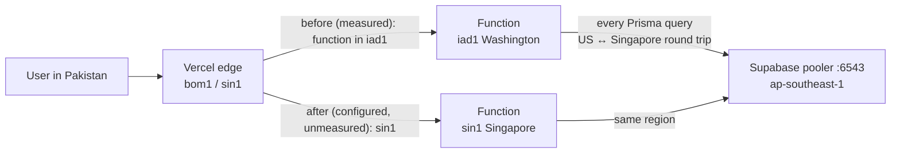

# EDUOS — Performance Report (`finale-hardening`)

2026-10-23. Baseline: `docs/audits/EDUOS_PERFORMANCE_BASELINE.md`. Load test detail:
`docs/testing/EDUOS_LOAD_TEST_REPORT.md`.

**Update 2026-10-23: deployed.** Production numbers are in the post-deploy table below. The original note follows:
**Nothing on this branch is deployed.** Every "after" number was measured on this Mac against a
local production build and a scratch Postgres on localhost. No production number has changed yet,
and none is claimed.

## Summary

| # | Item | Status |
|---|---|---|
| P1 | Functions ran in iad1, DB in Singapore → ~1.8 s warm API calls | **Fix implemented, effect unmeasured** (`vercel.json` `regions: ["sin1"]`) |
| P2 | Supabase free tier pauses → full outage | **Open.** Operational, no code fix. Documented in the runbook |
| P3 | Management overview cache is not tenant-keyed: a cross-tenant data leak, and it inflates load-test numbers | **Open. Confirmed on scratch this session** |
| P4 | `attendance.findMany` at 334 ms | **Open.** Observed by telemetry, not yet profiled |
| P5 | Batch detail / instructor roster p95 ≈ 210–250 ms locally | **Open.** Measured, not profiled |
| P6 | Telemetry and tenant-scoping overhead per request | **Implemented, overhead unmeasured** |
| P7 | AI provider failures are fast and degrade cleanly | **Verified (failure path only)** |

## Request path, before and after the region pin



## P1. Region mismatch

- **Evidence (baseline, measured):** `x-vercel-id` `sin1::iad1` / `bom1::iad1`. Warm
  `GET /api/public/courses` took 1.83–1.84 s, cold 4.26 s. The DB is in ap-southeast-1.
- **Change:** `vercel.json` sets `"regions": ["sin1"]`. No per-route `preferredRegion` overrides
  exist (`grep preferredRegion app/api` finds none).
- **Expected effect:** fewer cross-Pacific round trips per query. The size of the improvement is
  **unverified** until the table below is filled in.
- **Verify region without a deploy diff:** System Health exposes `instance.region` from
  `VERCEL_REGION` (`app/api/ops/health/route.ts:16`).

### Post-deploy measurement — measured 2026-10-23 (deployment `edu-4kfl753pn`, commit `5f7c266`)

| Metric | Before (measured, iad1) | After (sin1) | Command |
|---|---|---|---|
| `x-vercel-id` function region | `iad1` | **`sin1`** (`bom1::sin1::…`); `vercel inspect` lists every λ in [sin1] | A |
| `GET /api/public/courses` cold | 4.26 s | not measured (deployment was warm when sampled) | B (first line after ≥15 min idle) |
| `GET /api/public/courses` warm (median of 5) | 1.83–1.84 s | **179 ms** (192, 178, 189, 179, 179) | B (lines 2–6) |
| `instance.region` in `/api/ops/health` | n/a (route is new) | **`sin1`** | C |
| Smoke total wall time | 447 s (first run, cold after restore); **380.7 s** like-for-like re-run of the old iad1 deployment on 10-23 | **48.5 s** (56/56 PASS) — **7.8× faster** than the like-for-like run | D |
| `/api/*` http p50 / p95 over 1 h (OpsEvent) | n/a (no telemetry on `main`) | **p50 79 ms · p95 276 ms · p99 430 ms** (n=45, 0 × 5xx, 0 slow queries) | E |

All five commands are **read-only on application data**, except that logins and API calls write
`OpsEvent` telemetry. Run them only after the runbook's rollout steps, and with Basim's go-ahead.

```bash
SITE=https://eduos.vercel.app

# A — which region executed the function (want ...::sin1::...)
curl -s -o /dev/null -D - "$SITE/api/public/courses" | grep -i '^x-vercel-id'

# B — latency, first call then 5 warm calls
for i in 1 2 3 4 5 6; do
  curl -s -o /dev/null -w "%{http_code} %{time_total}s\n" "$SITE/api/public/courses"
done

# C and E — log in as the platform admin, read health and the 1 h summary
JAR="$(mktemp)"
curl -s -c "$JAR" -o /dev/null -H 'content-type: application/json' \
  -d '{"email":"admin@eduos.pk","password":"password"}' "$SITE/api/auth/login"
curl -s -b "$JAR" "$SITE/api/ops/health" | jq '.data.instance'
curl -s -b "$JAR" "$SITE/api/ops/summary?window=1h" | jq '.data.http, .data.routes[:8]'

# D — full render smoke, timed
time node scripts/smoke.mjs "$SITE"
```

C and E need `OPS_ADMIN_EMAILS=admin@eduos.pk` set in Vercel (runbook step 2). Otherwise they
return 404 by design: in production an unset list means nobody (`lib/platform.ts:11`, `:20`).

## P2. Paused database = outage

Measured at session start: Prisma `Can't reach database server`, site down until restored by hand.
Not a code problem. Mitigations (warm before demos, paid tier, or a scheduled keep-alive) are
decisions, not changes made here. A keep-alive would itself write telemetry rows.

## P3. Overview cache: wrong across tenants, and it flatters latency

- **Code:** `lib/management.ts:253-263`: `let _overviewCache` with a 60 s TTL and **no
  organization in the key**. `managementOverview()` serves both `/api/management/overview` and
  the `/management` dashboard page (`app/(app)/management/page.tsx:16`).
- **Confirmed on the scratch server (2026-10-23):** `admin@eduos.pk` then `admin@alkhidmat.pk`
  called `/api/management/overview`. Both received `students: 240, batches: 12`, with batch codes
  PY-12/PY-13/WD-10. Alkhidmat has 6 students and 1 batch. Reproduced independently during
  fact-checking the same day: Alkhidmat admin overview `240 / 12 / PY-12, PY-13, WD-10`, while
  `/api/students` in the same session returned 6 rows.
- **Why the tests missed it:** `scripts/tenant-isolation.mjs` never calls this route. The
  queries under it are correctly scoped (`lib/tenant.ts:157`), so the leak lives only in the cache.
- **Effect on performance numbers:** overview p50 9–25 ms is mostly cache hits. The p99 of
  864–1022 ms is the likely cache-miss cost (attribution **unverified**).
- **Fix (not in this doc's scope):** key the cache by `currentOrgId()` (`lib/tenant.ts:43`), or
  drop it. Re-measure the uncached cost afterwards. Runbook step 6 ("confirm 6 students" as the
  Alkhidmat admin) can show 240 if the Bano Qabil admin loaded the dashboard in the previous 60 s
  on the same instance.

## P4–P5. Slowest work observed locally

| Source | Observation |
|---|---|
| Telemetry slow-query log (≥300 ms, `lib/ops.ts:34`, `lib/db.ts:26-27`) | `attendance.findMany` **334 ms** |
| Load test run 1 (c=10) p95 | instructor roster 245 ms · students list 225 ms · student performance 211 ms · batch detail 209 ms |
| Load test run 2 (c=5) p95 | batch detail 220 ms · instructor roster 217 ms · students list 136 ms |

Batch detail and instructor roster barely improve at half the concurrency (p95 209→220 and
245→217 ms), unlike the other endpoints. Inference, **unverified**: their cost is per-request
query work, not queueing. Next step is `EXPLAIN ANALYZE` on the attendance queries behind them,
against scratch.

Locally, each query costs about zero network time. In production every sequential query also
pays the function↔DB round trip, so these endpoints will be the slowest there too. Exact numbers
are **unverified**.

## P6. Overhead added by this branch (not measured)

There is no local load test of `main`, so there is **no before/after comparison** for these:

- **Tenant scoping:** every operation on a tenant-scoped model calls `tenantContext()`, which reads
  the cookie and runs `jwtVerify` (`lib/tenant.ts:22-40`, called at `:157`; unscoped models return
  early at `:156`). Child models are filtered through a parent relation (`lib/tenant.ts:49-80`),
  which adds a relation filter to the SQL. Creates and updates that set a foreign key run an extra
  `count` per target model to confirm it is in the same org (`lib/tenant.ts:124-146`). `route()`
  verifies the JWT once more per API request for telemetry (`lib/ops-route.ts:22`).
- **Telemetry:** one `OpsEvent` insert per API request, after the response flushes
  (`lib/ops.ts:46`, via `route()` at `lib/ops-route.ts:23`), plus slow/failed queries
  (`lib/db.ts:26-27`), AI calls and auth events. Every query also pays the metrics extension's
  timer (`lib/db.ts:7-33`). Kill switch:
  `OPS_TELEMETRY=off`. Its latency impact on Vercel is **unverified**. `after()` keeps the function
  alive after the response, so it can affect billed duration (**unverified**).
- **Next 15.5.25 → 15.5.28** (security fix from `npm audit fix`). Bundle sizes after the
  upgrade were not recorded.

## P7. AI failure path

Measured locally with the invalid key: `GET /api/ai/career-path` returned 200 fallback in
**631 ms**, `POST /api/ai/ask` in **234 ms**. Both recorded `provider_auth`, and health flipped the
AI provider to unavailable. Success-path latency for Qwen (`qwen-plus`) is **blocked** until a
valid DashScope key exists. (`qwen-plus` is the default model, overridable by `LLM_MODEL`,
`lib/ai/client.ts:13`.)

## Local after-state, for reference (scratch, not production)

| Check | Result |
|---|---|
| `tsc --noEmit` | clean |
| vitest | 11 files, 141/141 |
| `next build` | OK (Next 15.5.28) |
| `npm audit` | `next` critical resolved. Remaining: `deepmerge-ts` high via the `prisma` CLI devDependency (needs Prisma 7, accepted) |
| `scripts/smoke.mjs` | PASS, 31.25 s. **Derived:** 26.5 s of that is fixed 500 ms pauses, so about 4.7 s of request time across 60 requests |
| Load test c=10 / 20 s | 95.6 req/s, 0 errors, p50 94 / p95 207 / p99 274 ms |
| Load test c=5 / 15 s | 82.7 req/s, 0 errors, p50 37 / p95 149 / p99 245 ms |

The 31 s local and 447 s production smoke runs are **not** a like-for-like comparison: different
machine, network, region and code.

## Not measured anywhere

Core Web Vitals in a browser, page render times (telemetry covers `/api` only, per the runbook),
write-path latency under load, AI success latency, behaviour at real institute data volumes.
