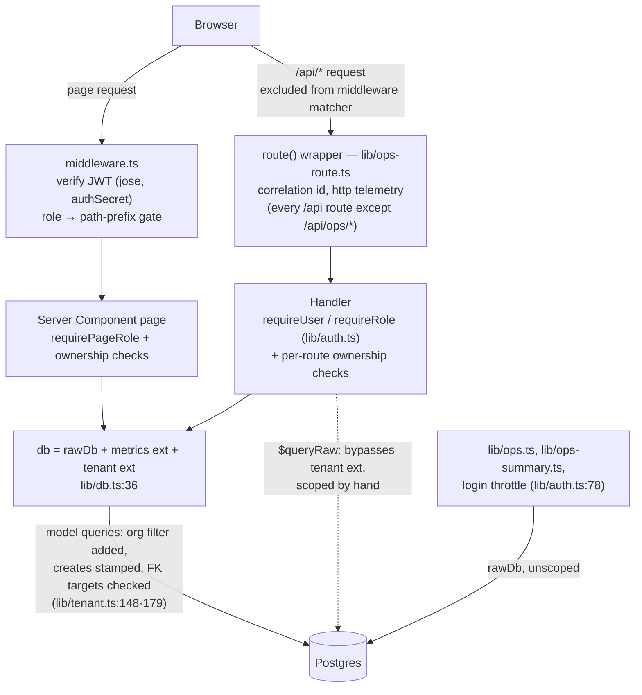

# EDUOS — Security Audit (current code, branch `finale-hardening`)

**Scope:** the uncommitted working tree of `finale-hardening` as of 2026-10-23 ~13:35 PKT, on
top of `main` @ `d7ad650`. This is a review of the code, aligned to the OWASP Top 10 (2021). It
is not a penetration test of production. **Nothing on this branch is deployed.** Production
still runs `main` (see `EDUOS_INITIAL_AUDIT.md`).

**Test environment for every "verified" claim:** a local production build (`next build && next
start`) against scratch Postgres 17 + pgvector, seeded with two institutes: `org_bq` (Bano Qabil:
258 users, 240 students, 12 batches) and `org_akf` (Alkhidmat: 8 users, 6 students, 1 batch).
The recorded results on this build:

- `tsc` clean
- vitest **11 files, 141/141**
- `scripts/tenant-isolation.mjs` **PASS 21/21**
- `scripts/ops-check.mjs` **PASS**
- `scripts/smoke.mjs` **PASS**
- `npm run check` (12 invariants) **PASS**

**Status vocabulary:**

| Status | Meaning |
|---|---|
| **Verified** | Implemented, and a named test or command exercised it |
| **Impl-unverified** | Code present, but nothing has exercised it yet |
| **Partial** | Fixed for some paths, open for others |
| **Open** | Not addressed |
| **Accepted** | Known, and deliberately left as is |

---

## 1. Request path (as implemented)

The tenant context comes from the signed cookie (`lib/tenant.ts:22-40`):

| Context | When | Scope |
|---|---|---|
| `system` | Outside a request (seed, scripts) | Unscoped |
| `anon` | No valid session | Unscoped (see S-12) |
| `org` | Signed-in user | Every query filtered to that org |

A valid token that carries no org throws 401 (`lib/tenant.ts:38`).

---

## 2. Findings

Severity reflects the current code, not the original report.

### A07 Identification & Authentication Failures

| ID | Sev | Finding & evidence | Status |
|---|---|---|---|
| S-01 | — (was Critical, F01) | **JWT secret fails closed.** `authSecret()` throws in production when `AUTH_SECRET` is unset (`lib/session-secret.ts:9-17`). `lib/auth.ts:11`, `middleware.ts:32` and `lib/tenant.ts:33` all use it, so no path falls back to `"dev-secret"`. **Residual:** there is no minimum length or entropy check, and whether `AUTH_SECRET` is set in Vercel is unverified (runbook step 2 checks it). | **Verified** by `lib/session-secret.test.ts` (3 cases: throws in prod, uses the env value, allows the dev fallback only outside prod) |
| S-02 | — (was Medium, F11) | **Cookie flags.** `httpOnly`, `sameSite: "lax"`, `secure` in production, 7-day `maxAge` (`lib/auth.ts:29-35`). | **Verified** by `scripts/ops-check.mjs:31-33` (HttpOnly, SameSite=Lax, Secure) |
| S-03 | **Medium** | **No session revocation.** The JWT is HS256 with a 7-day expiry (`lib/auth.ts:24-28`). Logout only deletes the cookie (`lib/auth.ts:38-40`). A stolen token stays valid for up to 7 days. Role and org are baked into the token, so a demotion or removal does not take effect until expiry. There is no server-side session list, rotation or `jti` deny-list. **Remediation:** short expiry plus refresh, or a `tokenVersion` column on `User` checked in `getSessionUser`. | **Open** |
| S-04 | **Medium** | **Login throttle.** 8 failures per 15 min per `sha256(email\|ip)` returns 429 (`lib/auth.ts:70-84`, `app/api/auth/login/route.ts:17`). **Residuals:** (a) the key includes the email, so password-spraying many accounts from one IP, and attempts on one account from many IPs, are not throttled; (b) count-then-record is not atomic, because failures are written later via `after()` (`lib/ops.ts:46`), so a concurrent burst can exceed 8 (unverified); (c) the throttle **fails open** on a telemetry read error (`lib/auth.ts:80`, by design); (d) **`OPS_TELEMETRY=off` silently disables the throttle**: `recordEvent` returns early (`lib/ops.ts:36-39`), no `login_failed` rows are written, and the count stays 0. The runbook lists `OPS_TELEMETRY=off` as a rollback lever, so pulling it turns the throttle off; (e) the IP comes from the first `x-forwarded-for` hop, which is trustworthy only where the platform sets it. On Vercel it is assumed to be platform-set (unverified). | **Partial.** Basic path **verified** by `ops-check.mjs:72-74` (8×401 then 429, other accounts unaffected). (a)–(e) open |
| S-05 | — (was Medium, F12) | **User-enumeration timing.** Unknown emails are compared against `DUMMY_HASH` (`lib/auth.ts:69,90`), which uses the same cost (10) as seeded hashes (`prisma/seed.mjs:311`). An email with no org gets the same 401 (`lib/auth.ts:91`). | **Impl-unverified.** Timing equality was not measured |
| S-06 | **High** (in any real deployment) | **Public demo credentials.** Every seeded account uses the password `password` (`prisma/seed.mjs:311`), which is published in `CLAUDE.md`. `admin@eduos.pk` is MANAGEMENT for `org_bq`, and runbook step 2 sets `OPS_ADMIN_EMAILS=admin@eduos.pk`. So once the runbook is applied in production, **anyone can sign in as an institute admin, edit demo data, and open cross-tenant System Health telemetry** (route templates, counts and org ids; no PII by design, `lib/ops.ts:6-11`). | **Accepted for the hackathon demo.** Must change before any real data, and the operator email should not be a public demo login |

### A01 Broken Access Control: tenant isolation

| ID | Sev | Finding & evidence | Status |
|---|---|---|---|
| S-07 | — (was Critical, F02) | **Tenant isolation lives in the DB client.** `db` is extended by `tenantExtension` (`lib/db.ts:36`, `lib/tenant.ts:148-179`): • Every where-operation on 24 models gets the org filter added (`lib/tenant.ts:55-80,162`). • Creates on root models are stamped with the org (`:127-131`). • Every written foreign key must resolve inside the org, and a miss returns **404, never 403**, so other orgs' ids are not confirmed (`:139-145`). An explicit foreign `organizationId` on a root-model write is a 403 (`:129`). • `orgWhere()` now throws instead of returning `{}` (`lib/auth.ts:112-115`). • Pre-tenancy cookies are treated as signed out (`lib/auth.ts:48`). | **Verified** by `scripts/tenant-isolation.mjs:52-83`. Checks: the Alkhidmat admin gets 403/404 on 6 Bano Qabil read paths; lists hold only own-org ids; cross-org PATCH student and DELETE batch are denied (403/404); POST batch on another org's course is refused, but that check accepts any 4xx (`tenant-isolation.mjs:72`), so a validation error would also pass it; the management page for a foreign student renders 404 with no data; the reverse direction is denied too |
| S-08 | — (was High) | **Raw SQL bypasses the extension, so each raw path is scoped by hand.** • `lib/management.ts` `skillStats` adds `b."organizationId" = ${org}` (diff at `lib/management.ts:217-234`). • The RAG vector query first proves the course is visible through the scoped client (`lib/rag/search.ts:37-38`). • `lib/ops-summary.ts` uses `rawDb` but is reachable only by platform operators (`app/api/ops/*/route.ts:12`). | **Partial.** The fixes are code-reviewed, but no test asserts cross-org results on these raw paths. **Open:** nothing stops a future `$queryRaw` from skipping scoping. Remediation: a lint/grep gate in CI |
| S-09 | — (was High) | **AI insight cache keyed per org.** `AiInsight` has no tenant column, so the org is prefixed into every cache key (`lib/ai/features.ts:34-36,40,55`). | **Impl-unverified.** No test reads a cached insight across orgs |
| S-10 | **Low** | **Write-path checks cover top-level scalar FKs only** (`lib/tenant.ts:85-99,132`). A nested `connect: { id }` or `connectOrCreate` into another org would not be checked. `grep` finds **no** `connect:` / `connectOrCreate` in `app/` or `lib/` today, so the gap is latent. One nested `create` exists (`app/api/courses/route.ts:66`, modules under a new course); its rows carry no foreign key into another tenant. Relation `include`s are not separately filtered either; they rely on parent scoping plus the FK write checks. | **Open (latent).** Remediation: reject nested relation writes in the extension, or extend `checkData` to walk them |
| S-11 | **Low** | **The `anon` context is unscoped by design** (`lib/tenant.ts:30,35`). Safety depends on every protected route calling `requireUser()` first. One consequence: `GET /api/public/courses` (`app/api/public/courses/route.ts:7-17`) lists **every institute's** courses to anonymous callers, but scopes them for a signed-in caller. Whether a cross-institute public catalogue is intended is unverified. | **Open (informational)** |

### A01 Broken Access Control: role and ownership inside one institute

| ID | Orig. | Fix (current code) | Status |
|---|---|---|---|
| S-12 | F03 | **Roster.** STUDENT → 403. An INSTRUCTOR may read only their own roster. Unknown id → 404 (`app/api/instructors/[id]/students/route.ts:12-16`). | **Verified** by `tenant-isolation.mjs:86-89` |
| S-13 | F04 | **Copilot.** The batch must belong to the instructor (`app/api/ai/copilot/route.ts:39-41`). The student must be enrolled in that batch, in any enrollment status (`:44-51`). The name-substring match was removed (`lib/ai/features.ts:474`). | **Verified** (batch check) by `tenant-isolation.mjs:94-95`. Enrollment check **impl-unverified** |
| S-14 | F05 | **Assessment and assignment GET.** An instructor must own the batch (`app/api/assessments/[id]/route.ts:32-34`, `app/api/assignments/[id]/route.ts:32-34`). PATCH and DELETE already checked this (`:57,:86` in both). | **Impl-unverified.** No automated test |
| S-15 | F06 | **Course and module edits** go through `requireCourseEditor()` (`lib/courses.ts:31-43`): MANAGEMENT, or an INSTRUCTOR teaching a batch of the course. Applied in `app/api/courses/[id]/route.ts` (PUT) and `.../modules/route.ts` (POST/PUT/DELETE). The edit page 404s for non-editors (`app/(app)/courses/[id]/edit/page.tsx`). **Residual (Low, by design):** an instructor may edit any course in their org that has **no batches yet**, because instructors can create courses. | **Verified** by `tenant-isolation.mjs:92-93` |
| S-16 | course page | **Per-batch read models** take the viewer and filter through `courseBatchScope()` (`lib/courses.ts:47-50`), used by `app/(app)/courses/[id]/page.tsx`. | **Verified** by `lib/courses.test.ts` (3 cases) |
| S-17 | F07 | **Schedule GET.** An instructor is pinned to their own `instructorId`, and a foreign `batchId` → 403 (`app/api/schedule/route.ts:25-38`). A student with no profile gets `[]`. POST: an instructor may schedule only their own batch (`:97,:106`). The timetable page no longer matches every row when `instructorId` is undefined (`app/(app)/instructor/timetable/page.tsx`). | **Partial.** The student path is **verified** by `tenant-isolation.mjs:96-97`; the instructor path is **impl-unverified** |
| S-18 | F08 | **Knowledge search.** A STUDENT must hold an `ACTIVE` enrollment in a batch of the course; an INSTRUCTOR must teach one (`app/api/knowledge/search/route.ts:29-37`). | **Impl-unverified** |
| S-19 | — | **Student access.** A foreign or unknown student → 404 before the role logic runs (`lib/students.ts:30-31`). | **Verified** by `tenant-isolation.mjs:80-81,98-99` |
| S-20 | — | **System Health is reachable only by platform operators.** It requires MANAGEMENT plus `OPS_ADMIN_EMAILS`: a MANAGEMENT user not on the list gets 404, any other role gets 403 from `requireRole` first (`lib/platform.ts:10-21`, `app/(app)/management/system/page.tsx:14`, `app/api/ops/*/route.ts:12`). An unset list in production means nobody gets in. | **Verified** by `ops-check.mjs:53-66` (measured: 200 for the operator, 404 for the institute admin, 403 for the instructor, nav hidden). The script itself accepts 403 or 404 for both refusals (`:57`) |

### A03 Injection and input validation

| ID | Sev | Finding & evidence | Status |
|---|---|---|---|
| S-21 | — | **SQL injection.** Prisma model queries throughout. The raw queries use tagged templates (`lib/management.ts`, `lib/ops-summary.ts`) or positional parameters (`lib/rag/search.ts:45-64`, `$queryRawUnsafe` with `$1..$3`). No string-built SQL was found in `app/` or `lib/` (the maintenance scripts in `scripts/` use `$queryRawUnsafe` with constant SQL). | Code review |
| S-22 | **Low** | **Validation.** Routes validate with zod. Times use `TIME_RE` (`lib/scheduling/engine.ts:11`) in all four schedule routes (`app/api/schedule/route.ts:14-15`, `[id]/route.ts:10-11`, `move/route.ts:10-11`, `check-conflicts/route.ts:10-11`), and the AI `createSchedule` checks format and `start < end` with its own copy of the regex (`lib/ai/tools.ts:326,336`). Chat is capped at 20 history items × 2000 chars plus a 2000-char message (`app/api/student/chat/route.ts:11-23`). **Open:** REST `POST /api/schedule` validates the time format but not that `startTime < endTime` (`app/api/schedule/route.ts:14-15`), and whether the engine rejects an inverted slot is unverified. | `TIME_RE` **verified** by `lib/scheduling/engine.test.ts:124-126`; ordering **open** |
| S-23 | — | **XSS.** No `dangerouslySetInnerHTML` or `innerHTML` anywhere in `app/`, `lib/` or `components/` (grep). React escapes all rendered text, AI output included. Notification links pass `isInAppPath()` (`lib/safe-link.ts:4-11`) on write (`app/api/notifications/route.ts:73`) **and** on render (`components/app/NotificationBell.tsx:194`), which blocks `javascript:`, `//host`, backslash, control-character and dot-segment bypasses (F13). | **Verified** by `lib/safe-link.test.ts` (3 cases) |

### A10 Server-Side Request Forgery (RAG ingest, MANAGEMENT-only)

| ID | Sev | Finding & evidence | Status |
|---|---|---|---|
| S-24 | — (was Medium, F09) | **Ingest SSRF guard.** Only `http`/`https` are accepted, and IP literals are checked up front (`lib/rag/ingest.ts:97-103`). Hostnames are checked **at connect time** by `safeLookup` on every resolved address, with `agent: false` so every hop opens a fresh socket. That closes the DNS-rebinding gap (`lib/rag/ip.ts:64-70`, `ingest.ts:105-116`). Redirects are capped at 3 and each one is re-validated (`ingest.ts:136-144`). Bodies are capped at 2 MB (`:93,118-130`), with a 15 s timeout (`:133`). Only short error codes are stored or returned (`:42`, `app/api/knowledge/ingest/route.ts:57`). The blocklist covers private, loopback, link-local and metadata (169.254/16, Alibaba 100.100.100.200 via CGNAT), multicast/reserved, IPv4-mapped/compat/translated, NAT64 (`64:ff9b::/96`, `64:ff9b:1::/48`), 6to4, ULA and site-local (`lib/rag/ip.ts:4-58`). **Residual (Info):** Teredo `2001::/32` is not decoded, and the TEST-NET ranges are not listed (non-routable). | **Verified (unit)** by `lib/rag/ip.test.ts` (37 blocked and 11 allowed address cases, plus a `safeLookup` suite). **Not verified end-to-end** against a live rebinding DNS server |

### A05 Security Misconfiguration

| ID | Sev | Finding & evidence | Status |
|---|---|---|---|
| S-25 | **Medium → Low once verified** | **Security headers.** At the start of this audit `next.config.ts` set **no** headers. It now applies the following to `/:path*` (`next.config.ts:6-33`): • **CSP:** `default-src 'self'`, `frame-ancestors 'none'`, `object-src 'none'`, `base-uri 'self'`, `form-action 'self'` • **HSTS:** 1 year, includeSubDomains, no preload • `nosniff`, `X-Frame-Options DENY`, `Referrer-Policy`, `Permissions-Policy` • `poweredByHeader: false` **Residual:** `script-src` keeps `'unsafe-inline'` (Next hydration), so the CSP is weak against injected inline script. A nonce-based CSP via middleware is the upgrade, as noted in the file. | **Impl-unverified.** The headers were added after the recorded `ops-check` PASS. `scripts/ops-check.mjs:35-44` now asserts them, but no run with those assertions is recorded |
| S-26 | — | **CORS.** No `Access-Control-*` header is emitted anywhere (grep). Browsers therefore refuse cross-origin reads of the API. | Code review |
| S-27 | **Low** | **CSRF posture.** No CSRF token and no `Origin` check. Protection rests on `SameSite=Lax`: browsers do not send the cookie on cross-site POST/PUT/PATCH/DELETE, every data-changing API route is non-GET, and logout is POST (`app/api/auth/logout/route.ts:12`). Exception: the GET AI routes (`/api/ai/career-path`, `/api/ai/skill-passport`) write `AiInsight` cache rows and can spend an LLM call (`lib/ai/features.ts:173,275`), and Lax cookies are sent on top-level cross-site GET navigations. `*.vercel.app` is on the Public Suffix List, so other Vercel apps count as cross-site. **Residual risks:** (a) **login CSRF**: `/api/auth/login` parses the body with `req.json()` whatever the `Content-Type` (`app/api/auth/login/route.ts:15`), so a cross-site `text/plain` form could plausibly sign a victim into an attacker's account (unverified); (b) a custom domain that shares a registrable domain with less-trusted subdomains would count as same-site. **Remediation:** in middleware, reject non-GET `/api` requests whose `Origin` is not the site origin, and require `Content-Type: application/json`. | **Open** |
| S-28 | — | **Error handling.** 500s return the generic "Something went wrong" and record only the class name and Prisma code (`lib/api.ts:26-36`). AI provider failures map to fixed codes (`lib/ai/client.ts` `aiErrorCode`). Tool errors are redacted to `tool_failed` (`lib/ai/student-tools.ts:356`; `lib/ai/tools.ts:732`). | Code review. The AI failure path is **verified**: an invalid key gave 200 with `source=fallback reason=provider_auth` |

### A06 Vulnerable and Outdated Components

| ID | Sev | Finding & evidence | Status |
|---|---|---|---|
| S-29 | — (was Critical) | **`next` 15.5.25 → 15.5.28** via `npm audit fix` (`npm ls next` shows 15.5.28). This clears the critical and the `sharp`/`source-map-js` highs. | **Verified** by `npm audit` |
| S-30 | **Low** | **`deepmerge-ts` <8 (high, GHSA-ggr8-5vv4-36mx).** The path is `@prisma/config` → `prisma` (the CLI). `prisma` is a devDependency (`package.json:35`) but also an optional peer dependency of `@prisma/client` (`npm ls`), which is why `npm audit --omit=dev` still lists **3 high** (re-run during this audit and again by the fact-check). The session assessed the fix as needing a Prisma 7 major and accepted it. npm also prints "fix available via `npm audit fix`", which was **not** attempted; whether it resolves without a major bump is unverified. Runtime exposure is believed CLI-only (unverified). | **Accepted** |

### Secrets handling

| ID | Sev | Finding & evidence | Status |
|---|---|---|---|
| S-31 | — | **Secrets stay out of the tree and out of telemetry.** `.env*` is git-ignored (`.gitignore:9`, confirmed with `git check-ignore`). The runbook lists env var **names** only. `OpsEvent` stores hashed throttle keys, never raw emails (`lib/auth.ts:74`, `lib/ops.ts:52`), and never prompts, passwords or tokens (`prisma/schema.prisma` OpsEvent comment). No secret scanner (gitleaks/trufflehog) was run on history. | Code review. History scan **not run** |

### AI / LLM surface (OWASP LLM Top 10)

| ID | Sev | Finding & evidence | Status |
|---|---|---|---|
| S-32 | — | **No NL→SQL.** The Command Center (`askCommandCenter`, `lib/ai/features.ts:1053`) and the scheduling assistant (`askSchedule`, `:1110`) call an allowlisted tool set (`lib/ai/tools.ts`) and are MANAGEMENT-only (`app/api/ai/ask/route.ts:10`, `app/api/ai/schedule/route.ts:10`). Student chat tools are bound to the session's `studentId` on the server (`app/api/student/chat/route.ts:80,97`; `lib/ai/student-tools.ts:344-349`), so a prompt cannot redirect them to another student. Tool rounds are capped at 3 (`lib/ai/client.ts:16`). | Code review |
| S-33 | **Medium** | **Indirect prompt injection via RAG.** Ingested third-party web pages become chunks that `searchCourseKnowledge` hands to the student assistant (`lib/ai/student-tools.ts:212-223`). Injected text can steer answers. The data reach is bounded (tools are read-only and session-bound), so the impact is misleading answers, not exfiltration. There is no content sanitisation or "untrusted content" delimiting. | **Open** |
| S-34 | **Low** | **Excessive agency.** `createSchedule` is a **write** tool the management model can call without a human confirmation step (`lib/ai/tools.ts:328,658`). It now validates times (F16), and conflicts are checked before persisting (`lib/ai/tools.ts:400-402`). | **Open.** Remediation: return a proposal and require a confirm click |
| S-35 | **Low** | **Forged chat history.** The client may send `assistant`-role history (`app/api/student/chat/route.ts:16`), which lets a student jailbreak their own assistant. This is bounded by S-32. | **Accepted** |
| S-36 | **Medium** | **No rate limit on AI endpoints** (or on any endpoint except login). Any signed-in user can drive unbounded paid LLM calls, and `POST /api/contact` (public, `app/api/contact/route.ts:6-10`) has length limits but no throttle or honeypot. | **Open** |
| S-37 | — | **Real-provider path.** The fallback path is verified. The **successful Qwen path is unverified**: there was no valid DashScope key (401 `invalid_api_key`). | **Blocked** on a valid key |

---

## 3. Open items, ranked

| # | Item | Sev | Next step |
|---|---|---|---|
| 1 | S-06 public demo password + operator account | High (real use) | Accepted for the demo. Rotate the operator email and passwords before any real data |
| 2 | S-36 no rate limit beyond login (AI cost, contact spam) | Medium | Reuse the `OpsEvent` count pattern from `verifyLogin` per user for `/api/ai/*` |
| 3 | S-03 no JWT revocation, 7-day tokens | Medium | `tokenVersion` on `User`, checked in `getSessionUser` |
| 4 | S-04 throttle gaps, especially **`OPS_TELEMETRY=off` disables it** | Medium | Keep throttle writes independent of the telemetry switch; add a per-IP key |
| 5 | S-33 indirect prompt injection via RAG | Medium | Delimit retrieved chunks as untrusted data in the prompt |
| 6 | S-25 headers unverified, CSP `'unsafe-inline'` | Medium→Low | Run `ops-check.mjs` against the build; nonce CSP later |
| 7 | S-27 login CSRF / no Origin check | Low | Origin + content-type check in middleware for non-GET `/api` |
| 8 | S-08 / S-10 raw SQL and nested writes outside automatic scoping | Low | CI grep gate for `$queryRaw`; reject nested `connect` in `lib/tenant.ts` |
| 9 | S-14 / S-17 / S-18 ownership fixes without automated tests | Low | Add three cases to `scripts/tenant-isolation.mjs` |
| 10 | S-30 `deepmerge-ts` via Prisma CLI | Low | Re-try `npm audit fix` on a branch, or wait for Prisma 7 |

## 4. Not verified in this audit

- Any behaviour in **production**: nothing is deployed, and the prod DB has no `OpsEvent` table or org backfill yet.
- Whether `AUTH_SECRET` and `OPS_ADMIN_EMAILS` are set in Vercel.
- Header presence at runtime (S-25), login-CSRF feasibility (S-27), throttle atomicity (S-04b), and `x-forwarded-for` trust on Vercel (S-04e).
- The real LLM success path (S-37).
- An end-to-end SSRF test against a rebinding DNS server (S-24).
- A git-history secret scan (S-31).
