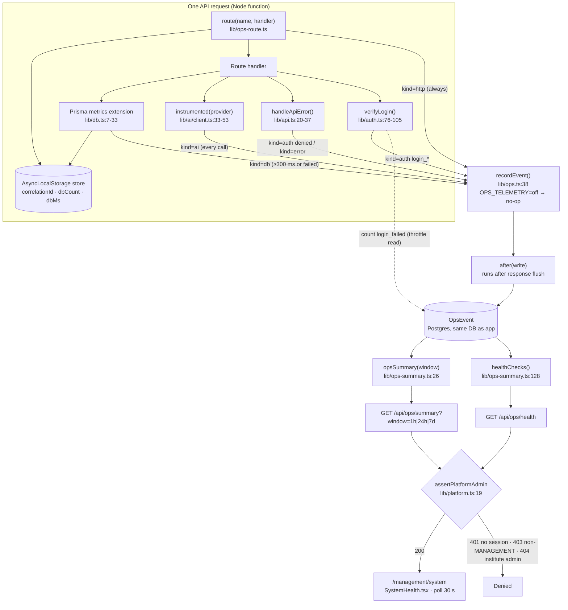
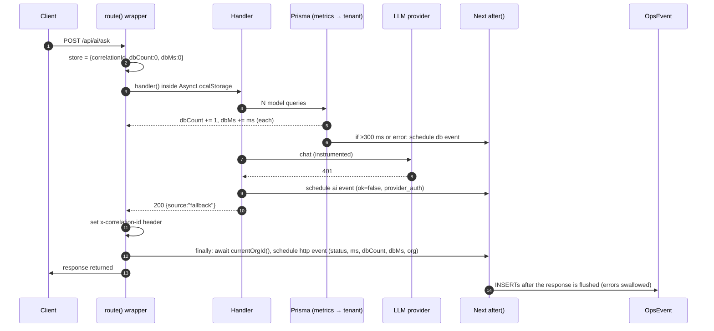

# EDUOS — Monitoring Architecture

Branch `finale-hardening` (uncommitted), documented 2026-10-23. **Not deployed**: everything
below was exercised on a local production build against a scratch Postgres 17 + pgvector
database, never on `eduos.vercel.app`.

Evidence: `file:line` citations are to the working tree; **[measured]** = observed in this
session; **[unverified]** = not checked.

---

## 1. Design in one paragraph

All telemetry is rows in one append-only Postgres table, `OpsEvent`
(`prisma/schema.prisma:516-535`), in the same database as the app. Five producers write to it —
the API route wrapper, a Prisma query extension, the LLM client, the error handler and the login
path — through one function, `recordEvent()` (`lib/ops.ts:38-50`), which defers the insert with
Next.js `after()` so it runs once the response has been sent and can never fail a request. One
read model (`lib/ops-summary.ts`) aggregates those rows with SQL percentiles, and two
platform-admin-only endpoints feed a dashboard at `/management/system` that polls every 30 s.
There is no external collector, no metrics backend and no alerting.

---

## 2. Components

### 2.1 `lib/ops.ts` — the sink
- `OpsKind = "http" | "db" | "ai" | "auth" | "error"` (`:13`).
- `requestStore` is an `AsyncLocalStorage<{ correlationId, dbCount, dbMs, orgId? }>` (`:31-32`).
- `SLOW_QUERY_MS = 300` (`:34`).
- `recordEvent()` (`:38-50`): returns immediately when `OPS_TELEMETRY === "off"` (`:36`); fills
  `correlationId` from the store when absent; truncates `detail` to 200 chars (`:43`); swallows
  insert errors (`:44`). It calls `after(write)`; outside a request scope `after` throws and the
  write is fired without being awaited (`:45-49`).
- Writes go through `rawDb` (`lib/db-base.ts`), which has **no metrics and no tenant scope** — so
  telemetry inserts never recurse into the metrics extension and are never filtered by org.
- `hashKey()` (`:52`) is SHA-256, first 32 hex chars, used for the login throttle subject.

### 2.2 `lib/ops-route.ts` — per-request HTTP metric
- `route(name, handler)` (`:10-36`) creates a fresh store with a `randomUUID()` correlation id,
  runs the handler inside it, sets `x-correlation-id` on the response (`:18`), and in `finally`
  records one `kind=http` event: `name = "<METHOD> <route template>"`, `status`, wall-clock `ms`,
  `dbCount`, `dbMs`, `organizationId` (from `currentOrgId()`, errors → null), `correlationId`.
- An uncaught exception records `status = 500` (initial value `:14`) and rethrows.
- **Coverage [measured]:** 54 of 56 `app/api/**/route.ts` files use `route("…")`. The two that
  don't are `app/api/ops/summary` and `app/api/ops/health`, deliberately, so dashboard polling
  doesn't dominate the traffic it reports (`app/api/ops/summary/route.ts:8-9`).

### 2.3 `lib/db.ts` — query metrics extension
- A `$allModels.$allOperations` Prisma extension (`:7-33`) times every model query. If a request
  store exists it increments `dbCount` and adds to `dbMs` (`:21-25`). If the query failed or took
  ≥ 300 ms it records `kind=db`, `name = "<model>.<operation>"` (`:26-28`).
- Order: `rawDb.$extends(metrics).$extends(tenantExtension(rawDb))` (`:36`). Assuming Prisma runs
  the later-applied query extension first (tenant wraps metrics), the timed query is the
  tenant-scoped one **[unverified: Prisma extension ordering not tested]**. The tenant extension's
  own ownership checks go through `rawDb` (`lib/tenant.ts:124-142`) and are not timed or counted.
- **Not covered:** `$queryRaw` / `$queryRawUnsafe` / `$executeRaw` (not `$allModels`
  operations) — including the raw SQL in `lib/management.ts` skillStats (`db.$queryRaw`, `:221`)
  and `lib/rag/search.ts` vector search (`db.$queryRawUnsafe`, `:45`), which go through `db`, not
  `rawDb` **[unverified whether Prisma 6 routes raw queries through `$allModels`; per the
  extension API it does not]** — and every `rawDb` call (telemetry, health checks, throttle).
- `dbMs` is the **sum** of query durations. Queries run under `Promise.all` overlap, so `dbMs`
  can exceed the request's wall-clock `ms`. It measures DB work, not DB-bound wall time.
- `RequestStore.orgId` is declared (`lib/ops.ts:31`) and read here (`:27`) but **never assigned**
  anywhere [measured: grep] — `kind=db` events always have `organizationId = null`. Harmless
  today (the dashboard is platform-wide), but it is dead plumbing.

### 2.4 `lib/ai/client.ts` — LLM call instrumentation
- `instrumented(provider)` (`:33-53`) wraps `chat` and `embed`. Every upstream call records
  `kind=ai` with `name = "chat · <model>" | "tools · <model>" | "embed · <model>"`, `ok`, `ms`,
  `tokens` (from `res.usage.total_tokens`, `lib/ai/providers.ts:73`; embeds record none),
  and on failure `status` and `detail = aiErrorCode(e)` (`:42-45`).
- `aiErrorCode()` (`:20-29`) maps failures to a fixed vocabulary: `provider_auth`,
  `rate_limited`, `provider_5xx`, `timeout`, `provider_<status>`, `provider_error`. Raw provider
  messages never leave the file. Prompts and answers are never recorded (`:31-32`).
- A tool-calling request makes 1–4 upstream calls (`:180-221`); each is a separate event.
- **Verified [measured]:** with the invalid key, `GET /api/ai/career-path` and `POST /api/ai/ask`
  returned 200 with `source=fallback reason=provider_auth` (631 ms / 234 ms); two `kind=ai`
  events with status 401 / detail `provider_auth` were stored; the health check read
  "unavailable: 2 of 2 calls failed in the last hour". **The success path (tokens, p50/p95 of
  real Qwen calls) is not verified** — no valid key.

### 2.5 `lib/api.ts` — denials and server errors
- `handleApiError()` (`:20-37`): an `AuthError` (401/403/404/429 thrown by authorization)
  records `kind=auth name=denied status=<code>` (`:23`) — the message is not stored. Anything else
  records `kind=error`, `name = <constructor name>`, `detail = <Prisma error code>` if present,
  never the message (`:27-35`), then returns a generic 500.
- Cross-tenant access surfaces here as 404 denials (tenant extension → `AuthError`), which is
  what the "Access denied" tile counts.

### 2.6 `lib/auth.ts` — login events and throttle
- `verifyLogin()` (`:76-105`) records `login_ok` (with `organizationId`), `login_failed`
  (status 401) and `login_throttled` (status 429). Failed/throttled events carry
  `subject = hashKey(email|ip)` (`:74`), never the raw email.
- The **throttle reads telemetry**: it counts `login_failed` rows for that subject in the last
  15 min (`:78-80`) and refuses at ≥ 8 (`:70-71, 81-83`). Fails open on a telemetry read error
  (`:80`). `ops-check.mjs` observed 8 × 401 then 429 **[measured]**.
- Unknown emails cost one bcrypt compare against a dummy hash (`:69, 90`) — the F12 timing leak fix.
- Client IP is the first `x-forwarded-for` hop (`app/api/auth/login/route.ts:17`). Whether
  Vercel overwrites a client-supplied `x-forwarded-for` is **[unverified]**; if it does not,
  rotating the header resets the throttle key.

### 2.7 `lib/ops-summary.ts` — read model
- `opsSummary(window)` (`:26-122`) runs **9 queries in parallel** over `rawDb` with
  `percentile_cont` for p50/p95/p99 and `date_bin` buckets. Windows: `1h` → 5-min buckets,
  `24h` → 1-hour, `7d` → 6-hour (`:11-15`). The bucket interval is interpolated with
  `Prisma.raw` but only from that fixed table (`:32`); the window key is validated against it by
  the route (`app/api/ops/summary/route.ts:14`).
- `MIN_SAMPLES = 20` (`:19`): global p50/p95/p99 are returned as `null` below 20 http events.
  **Per-route p50/p95 and per-bucket p95 are not gated** (`:44-57`) — a route with one call can
  top "Slowest endpoints".
- Timestamps: `OpsEvent.at` is `timestamp` without zone; the raw queries pass the window start as
  an explicit UTC wall-clock (`:29-31`).
- `statuses` and `http.s4xx` are computed and returned but **not rendered** by the dashboard
  [measured: grep of `SystemHealth.tsx`].
- `healthChecks()` (`:128-188`) — see §3, rows H1-H6.

### 2.8 `app/api/ops/*` — endpoints
| Endpoint | Gate | Wrapped by `route()` | Returns |
|---|---|---|---|
| `GET /api/ops/summary?window=` | `requireRole("MANAGEMENT")` → `assertPlatformAdmin` | No (by design) | `opsSummary()` |
| `GET /api/ops/health` | same | No | `healthChecks()` + instance `{region, commit, uptimeSec}` |

Both `force-dynamic`. Denials still go through `handleApiError` and are recorded as `denied`.
**[measured]** `ops-check.mjs`: 200 for platform admin, 404 for institute admin, 403 for instructor.

### 2.9 `lib/platform.ts` — access policy
- Platform operator = `role === "MANAGEMENT"` **and** email in `OPS_ADMIN_EMAILS` (`:15-16`).
  An institute admin is not an operator.
- Fails closed: in production an unset `OPS_ADMIN_EMAILS` means nobody; in development it
  defaults to `admin@eduos.pk` (`:11`).
- Non-operators get **404, not 403**, so the dashboard's existence isn't advertised (`:18-21`).
  The page does the same with `notFound()` (`app/(app)/management/system/page.tsx:14`), and the
  nav item is only shown to operators (`app/(app)/layout.tsx:9`, `lib/nav.ts:37`).
  **[measured]** dashboard 404 for institute admin; nav hides it.
- Rationale: `OpsEvent` is not tenant-scoped (`lib/ops-summary.ts:7-8`), so it shows
  cross-institute data and must sit above the tenant boundary.

### 2.10 Dashboard — `app/(app)/management/system`
- `page.tsx` server-gates, then renders the client component `SystemHealth.tsx`.
- Polls `/api/ops/summary?window=<w>` and `/api/ops/health` together every **30 s**
  (`SystemHealth.tsx:12, 60, 74-78`), **only while the tab is visible** (`:76`), plus a manual
  Refresh button. On error it keeps the last good data and shows a "Stale · <error>" badge
  (`:65-67, 105`).
- Window selector `1h / 24h / 7d`, default `24h` (`:50`).
- Rendered and screenshotted at 1440 px and 390 px; nav double-active, chart bars, grid hole,
  cell wrapping and mobile horizontal overflow were fixed **[measured]**.

---

## 3. Metric catalogue

Legend — **Type:** *real* = directly measured value; *derived* = computed from real rows;
*estimated* = a proxy for something not measured; *unavailable* = not collected.
**Retention** for every OpsEvent-backed metric is **unbounded**: no TTL, no cron, no code path
deletes rows, by policy (`docs/operations/EDUOS_DEPLOYMENT_RUNBOOK.md:103`). Window queries only
read the last 1h/24h/7d, so older rows are kept but never shown. **Refresh** for every dashboard
metric is the 30 s visible-tab poll; collection itself is per event.

### 3.1 Component health strip (`/api/ops/health`, computed live per poll)

| # | Metric | Source | Collection | Type | Notes / limits |
|---|---|---|---|---|---|
| H1 | Database state + round-trip ms | `SELECT 1` via `rawDb` (`ops-summary.ts:131-135`) | Live query each poll | real | `degraded` if > 1000 ms. If it fails, H2-H4 are reported `unknown` (`:136-143`) |
| H2 | Vector search (pgvector) | `pg_extension` lookup (`:146-153`) | Live query | real | Presence of the extension only — not query latency or index health |
| H3 | AI provider state | Count of `kind=ai` ok vs failed, last 1 h (`:155-172`) | OpsEvent count | derived | `unavailable` if AI disabled/no key, or 100 % failed; `degraded` if > 20 % failed; `unknown` with 0 calls. Reflects **past user traffic**, never probes the provider (no billable call) |
| H4 | Telemetry pipeline | Age of newest OpsEvent (`:174-184`) | OpsEvent `findFirst` | derived | **Always "healthy" if any row exists** — no staleness threshold, so "last event 3 days ago" still reads healthy. Only `OPS_TELEMETRY=off` (`unavailable`, `:174-175`) or an empty table (`unknown`) reads otherwise |
| H5 | Background jobs | Static (`:190-194`) | — | unavailable | Reports `not_instrumented`: there is no job runner |
| H6 | Serving instance: region | `VERCEL_REGION` env (`app/api/ops/health/route.ts:16`) | Env read | real | `"local"` off Vercel. The check for the sin1 move |
| H7 | Serving instance: commit | `VERCEL_GIT_COMMIT_SHA` (`:17`) | Env read | real | Shown as "local" when unset; whether CLI deploys populate it is **[unverified]** |
| H8 | Serving instance: "warm Ns" | Module load time of that function instance (`:8, 18`) | In-memory | estimated | Age of **one** instance, not service uptime; a proxy for cold starts, not a count |
| H9 | Telemetry last event | `summary.lastEventAt` (`ops-summary.ts:83, 93`) | OpsEvent | derived | Rendered as "telemetry Ns ago" |

### 3.2 API performance (`kind = 'http'`, one row per wrapped API request)

| # | Metric | Source | Collection | Type | Cardinality control | Notes |
|---|---|---|---|---|---|---|
| A1 | Requests | `count(*)` (`ops-summary.ts:36`) | `route()` finally | real | — | Excludes `/api/ops/*` and all page renders |
| A2 | Error rate | `s5xx / total` (`:98`) | derived from `status` | derived | — | 5xx only; 4xx counted (`s4xx`) but not shown |
| A3 | p50 / p95 / p99 latency | `percentile_cont` over `ms` (`:39-41`) | `performance.now()` around handler | derived | — | `null` below 20 samples. Server handler time only — excludes network, TLS, edge, cold-start init before the handler |
| A4 | DB queries per request | `avg(dbCount)` (`:42`) | Prisma extension counter | derived | — | Model queries only (raw SQL not counted) |
| A5 | DB ms per request | `avg(dbMs)` (`:42`) | Prisma extension sum | derived | — | Sum of query times; can exceed wall time under parallelism |
| A6 | Traffic & p95 series | `date_bin` buckets (`:52-57`) | same rows | derived | Buckets fixed per window | Per-bucket p95 not sample-gated |
| A7 | Slowest endpoints (top 12 by p95) | `GROUP BY name` (`:44-51`) | same rows | derived | `name` = `METHOD` + **route template literal** passed in code (54 files) — bounded, never contains ids (`ops-route.ts:7-8`) **[measured: route names are templates]** | Per-route p95 not sample-gated |
| A8 | Status distribution | `GROUP BY status` (`:58-60`) | same rows | derived | Integer HTTP codes | Computed, **not rendered** |

### 3.3 Database (`kind = 'db'`)

| # | Metric | Source | Collection | Type | Cardinality control | Notes |
|---|---|---|---|---|---|---|
| D1 | Slow & failed queries (top 10 by count): count, avg ms, max ms, failed | `ops-summary.ts:61-65` | Extension, only if ≥ 300 ms or error (`db.ts:26`) | real (per event), derived (agg) | `name = <model>.<operation>` — finite set from the schema × Prisma ops | **Sampled by threshold**: no DB p50/p95 is possible from this. Observed on scratch: `attendance.findMany` 334 ms **[measured]**. Includes queries from page renders (no correlation id, no org) |
| D2 | DB reachable | H1 | — | real | — | — |
| — | Connections, pool saturation, locks, CPU, disk, replication | — | — | **unavailable** | — | Supabase's own dashboard only |

### 3.4 AI provider (`kind = 'ai'`)

| # | Metric | Source | Collection | Type | Cardinality control | Notes |
|---|---|---|---|---|---|---|
| I1 | Calls, succeeded, success % | `ops-summary.ts:66-73` | `instrumented()` per upstream call | real / derived | `name` = `chat` / `tools` / `embed` + ` · <model>` — bounded by configured models (env) | A tool-calling request = 1-4 events |
| I2 | p50 / p95 per call type | same | `performance.now()` | derived | — | Not sample-gated. Includes 45 s timeouts when they happen |
| I3 | Tokens | `sum(tokens)` | `usage.total_tokens` (`providers.ts:73`) | real when reported | — | Embeds record none. **Never exercised** (no valid key) |
| I4 | Last call / last OK | `max(at)`, `max(at) FILTER (WHERE ok)` | same | derived | — | — |
| I5 | Failure reason | `detail` (shown in Recent errors) | `aiErrorCode()` | real | Fixed code vocabulary (`client.ts:20-29`) | `provider_<status>` bounded by HTTP codes |
| — | Spend in currency | — | — | **unavailable** | — | Tokens only; no price table in code |

### 3.5 Sign-ins and access control (`kind = 'auth'`)

| # | Metric | Source | Type | Cardinality control | Notes |
|---|---|---|---|---|---|
| S1 | Sign-ins (`login_ok`) | `lib/auth.ts:95` | real | 4 fixed names | — |
| S2 | Failed sign-ins (`login_failed`) | `lib/auth.ts:92` | real | `subject` hash is per email+IP (high cardinality) but **never grouped**, only used by the throttle's indexed count (`@@index([kind, subject, at])`) | Warning tone above 20 |
| S3 | Throttled (`login_throttled`) | `lib/auth.ts:82` | real | — | 8 failures / 15 min / email+IP |
| S4 | Access denied (`denied`) | `lib/api.ts:23` | real | Grouped by `status` (401/403/404/429) | Includes cross-institute 404s |

### 3.6 Errors

| # | Metric | Source | Type | Cardinality control | Notes |
|---|---|---|---|---|---|
| E1 | Recent errors (latest 25) | `kind=error` ∪ `http status≥500` ∪ `db !ok` ∪ `ai !ok` (`ops-summary.ts:77-82`) | real | `name` = error class name; `detail` ≤ 200 chars, Prisma code or AI code only | Shows `correlationId`, matching the `x-correlation-id` response header **[measured: header present]** |

### 3.7 Fields that are stored but never aggregated

`organizationId` (http, auth `login_ok`), `correlationId` (unique per request), `subject`.
None appears in a `GROUP BY`, so their cardinality does not affect dashboard queries.

---

## 4. Request lifecycle (what one call writes)

---

## 5. Cost of the instrumentation

- **Writes:** at least 1 INSERT per wrapped API request, plus 1 per slow/failed query, per AI
  call, per denial/error, per login. Executed in `after()`, so not on the response's critical
  path, but on the same pooler and database.
- **Storage [measured in this audit, scratch DB]:** 3,399 rows (http 3,286 · auth 94 · db 17 ·
  ai 2) occupy 1,224 kB including the primary key and three secondary indexes ≈ **368 B/row**.
  Re-measured at fact-check time (`pg_total_relation_size`, same scratch DB): 3,418 rows, 1,232 kB
  ≈ 369 B/row. Unbounded growth is the
  accepted trade (§6).
- **Dashboard reads:** each 30 s poll runs 9 aggregate queries (summary) + up to 5 (health).
  `[kind, at]` and `[at]` indexes serve the window filters. Query cost at large table sizes is
  **[unverified]** — not load-tested beyond the 3.4 k-row scratch table.
- **Load test with telemetry on [measured]:** 1,919 requests in 20.1 s (95.6 req/s), 0 errors,
  p50 94 / p95 207 / p99 274 ms at concurrency 10 on the local build. No telemetry-off control run
  was made, so the telemetry overhead itself is **not isolated**.
- **Kill switch:** `OPS_TELEMETRY=off` (`lib/ops.ts:36`). ⚠ It also disables the **login
  throttle**, because the throttle counts `login_failed` rows that `recordEvent` no longer writes
  (`lib/auth.ts:78-83`). The runbook lists it as a latency rollback (runbook:87) without that
  caveat.

---

## 6. Limitations (honest list)

1. **Page renders are not timed.** Only `/api/*` handlers are wrapped. Server Component pages —
   most of what a user actually loads — produce no `http` event. Their slow/failed Prisma queries
   are still recorded (the extension is global) but without a correlation id or org. A crashed RSC
   that still returns 200 is only caught by `scripts/smoke.mjs`.
2. **No client-side metrics.** No Web Vitals, no browser errors.
3. **`after()` semantics on serverless.** On Vercel `after()` keeps the invocation alive until
   the callback settles **[unverified on prod — not deployed]**. If the instance is frozen or
   killed first, events are lost silently (`.then(() => undefined, () => undefined)`,
   `lib/ops.ts:44`). Outside a request scope the insert is fire-and-forget and may be dropped when
   the process exits (`:47-48`). Telemetry is **best-effort, not durable**.
4. **Telemetry shares fate with the database.** When Supabase paused this week **[measured]**,
   telemetry stopped being written and the dashboard could not load — exactly when it was needed.
   Health check H1 reports "unavailable" only if the API itself responds.
5. **No alerting.** Nothing pages anyone; the dashboard shows state only while an operator has it
   open. No external uptime probe.
6. **Threshold-sampled DB metrics.** Only ≥ 300 ms or failed queries are kept; DB latency
   distributions cannot be computed. Raw SQL is not instrumented.
7. **Sample-size gating is global only.** Per-route and per-bucket p95 are shown from any count.
8. **H4 "Telemetry pipeline" never goes stale-red.** Any existing row reads "healthy".
9. **H3 AI health is passive.** It reflects the last hour of real traffic; with no traffic it is
   "unknown", and it cannot detect a revoked key until a user hits an AI feature.
10. **Per-instance only.** `uptimeSec`, `region` and `commit` describe the one function instance
    that served the health call.
11. **Retention unbounded by policy.** No code deletes `OpsEvent` rows; prune by hand
    (runbook:103).
12. **Throttle depends on telemetry writes.** Concurrent failed attempts can all read the count
    before earlier `after()` writes land, so a burst can exceed 8 attempts **[inference from
    code, not exercised — `ops-check.mjs` only tested sequential attempts]**; turning telemetry off
    removes the throttle (§5).

## 7. What was verified vs not

| Item | Status |
|---|---|
| http events, route-template names, `x-correlation-id` | implemented + verified (`ops-check.mjs` PASS) |
| auth events, throttle 8×401 → 429 | implemented + verified |
| denied events across roles/tenants | implemented + verified (`ops-check.mjs`, `tenant-isolation.mjs` 21/21) |
| ai failure events + health "unavailable" | implemented + verified (invalid key) |
| ai success events, tokens | implemented-unverified (no valid key) |
| slow db events | implemented + verified (`attendance.findMany` 334 ms) |
| Dashboard access policy (200 / 404 / 403, nav hidden) | implemented + verified |
| Dashboard rendering at 1440 / 390 px | verified (screenshots) |
| Region / commit on Vercel | implemented-unverified (not deployed) |
| `after()` behaviour on Vercel | implemented-unverified |
| Alerting, page timing, client metrics, retention policy | missing |
