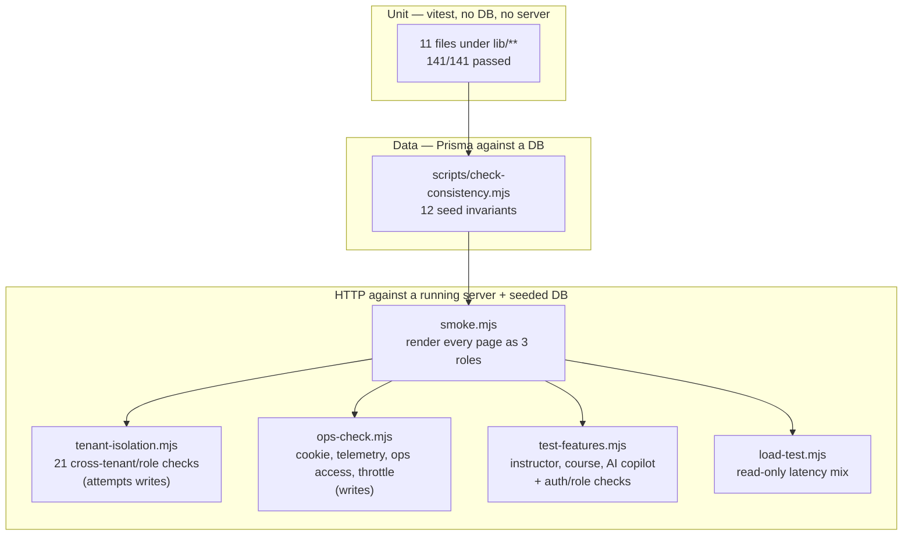

# EDUOS — Test Strategy

Branch `finale-hardening` (uncommitted), written 2026-10-23. Every claim cites code
(`file:line`) or the session's measured results. Unmeasured items are labelled **unverified**.

## Status legend

| Label | Meaning |
|---|---|
| **verified** | Implemented and run this session, result recorded below |
| **implemented-unverified** | Code exists, not run this session |
| **partial** | Runs, but covers only part of what it claims |
| **missing** | No test exists |
| **blocked** | Cannot run without something we do not have |

## Layers



There is **no CI** (no `.github/` directory in the repo) and **no browser e2e suite**. Every
layer is run by hand.

## Inventory

### 1. Unit tests — vitest (`npx vitest run`)

Config `vitest.config.mjs`: `environment: "node"`, `include: ["**/*.test.ts"]`. No database,
no network (one exception: `lib/rag/ip.test.ts` resolves `localhost` through the OS resolver).

| File | Proves | Status |
|---|---|---|
| `lib/analytics.test.ts` | `WEIGHTS` sum to 1, `meanPerf` weighting/rounding/empty handling, `skillLevelFromScore` thresholds 40/60/80/93 | verified |
| `lib/scheduling/engine.test.ts` | `detectConflicts`: instructor, batch, classroom, capacity, working hours, availability, adjacency, multi-conflict; `TIME_RE` accepts `00:00`–`23:59` and rejects `99:99`, `24:00`, `12:60`, `9:30`, `09:30:00`, empty and non-numeric (backs F16) | verified |
| `lib/ai/guard.test.ts` | `numbersIn` extraction and `groundedAgainst`: AI output numbers must appear in the context (tolerance, noise 0–10 ignored) | verified |
| `lib/ai/classify.test.ts` | Command-Center question classifier: comparison, report, skill gaps, ranking, instructor, entity resolution | verified |
| `lib/ai/client.test.ts` | `extractJSON` from fenced/noisy LLM output; `aiEnabled()` honours `AI_ENABLED` and a missing/empty key | verified |
| `lib/auth.test.ts` | `homeFor(role)` routing | verified |
| `lib/session-secret.test.ts` | **F01**: production throws without `AUTH_SECRET`; dev fallback only outside production | verified |
| `lib/courses.test.ts` | **F06**: `courseBatchScope` limits an instructor to own batches, matches nothing without a profile | verified |
| `lib/safe-link.test.ts` | **F13**: `isInAppPath` rejects off-site, scheme, backslash, whitespace, oversize, and dot-segment protocol-relative links | verified |
| `lib/rag/ip.test.ts` | **F09**: `isBlockedAddress` blocks private/loopback/link-local/CGNAT/multicast, IPv4-mapped, NAT64 `64:ff9b::/96` and `64:ff9b:1::/48`, 6to4 `2002::/16`; `safeLookup` rejects a hostname resolving to loopback (DNS-rebinding path) | verified |
| `lib/ai/student-tools.test.ts` | **F14**: `myAttendance` joins attendance to enrollments by batch id (DB mocked) | verified |

Result: baseline `main @ d7ad650` 6 files 80/80; after 11 files **141/141** passed. `tsc --noEmit` clean both times.

### 2. Data invariants — `scripts/check-consistency.mjs` (`npm run check`)

Asserts 12 seed invariants with Prisma: skill level matches score, no empty course/batch,
every enrollment has attendance and results, no score above max, no scored MISSING submission,
no orphans, module progress belongs to the enrolled course, the three demo logins exist
(`scripts/check-consistency.mjs:35-108`). Read-only.

- **Env:** `npm run check` loads the local env file (`package.json` script `node --env-file=.env`).
  To target scratch, export `DATABASE_URL` first, as the runbook does
  (`docs/operations/EDUOS_DEPLOYMENT_RUNBOOK.md`, "Scratch database").
- **Status:** verified (passed on the scratch DB this session).

### 3. Render smoke — `scripts/smoke.mjs` (`npm run smoke -- <baseUrl>`)

Logs in as student, instructor and management, fetches 2 public pages, 24 role pages,
11 role APIs and 16 `[id]` detail routes. Fails on non-200, a redirect to `/login`, an API
without `success: true`, or HTML matching the RSC crash pattern (`scripts/smoke.mjs:30`),
because a crashed Server Component still returns 200. 500 ms pause between requests
(`:65`, `:96`, `:107`, `:131`, `:151`, `:170`), 30 s per-request timeout (`:37`).

- **Env:** read-only on application data. On this branch, logins and every `/api` call it makes
  also write one `OpsEvent` telemetry row (`lib/ops-route.ts:23`, `lib/ops.ts:46`). It is the
  post-deploy check in `scripts/deploy.sh:31`, so it is the one script meant to run against production.
- **Status:** verified. Local production build on scratch: **PASS, 31.25 s**. Production at session
  start: 29 ok / 1 fail in 447 s, second run PASS (before this branch, on `main`).
- **Limits (partial):** checks that pages render, not that numbers are right. HTML responses only,
  no JavaScript runs, so client-side crashes are invisible to it.

### 4. Tenant and role isolation — `scripts/tenant-isolation.mjs`

21 checks across two seeded institutes (`org_bq`, `org_akf`): cross-tenant GET/PATCH/DELETE/POST
denied, lists hold only own-institute ids, management detail page renders 404 with no data,
and inside one institute: student vs roster (F03), instructor vs another roster (F03), batch API for a batch not
taught (related to F15, which was about the page; not F05), course edit not taught (F06), copilot on a foreign batch (F04), student
schedule ignores a foreign `batchId` (F07), student vs another student.

- **Env: scratch only.** It attempts writes that must be refused (`scripts/tenant-isolation.mjs:3-5`).
  Its header also mentions "one write (a module edit)", but the script contains no module request
  (`:52-99`); module edits are untested (see F06 below).
  Needs `admin@alkhidmat.pk`, which only the branch seed creates.
- **Status:** verified, **PASS 21/21**.
- **Gap — confirmed this session:** it does not request `/api/management/overview` or the
  `/management` dashboard. That route serves a module-level cache with no tenant key
  (`lib/management.ts:253-263`). On the scratch server, `admin@alkhidmat.pk` received Bano
  Qabil's overview (240 students, 12 batches, codes PY-12/PY-13/WD-10) right after
  `admin@eduos.pk` loaded it. Reproduced independently during fact-checking the same day on the
  same scratch server: Alkhidmat admin overview `240 students / 12 batches`, while
  `/api/students` for the same session returned 6. The suite passes while this leak is live. Add a check that
  logs in as both admins in sequence and compares `summary.students`.

### 5. Ops and auth hardening — `scripts/ops-check.mjs`

Session cookie `HttpOnly` / `SameSite=Lax` / `Secure` (F11; skip `Secure` with `EXPECT_SECURE=0`,
`:33`), security headers on `/login` (CSP `frame-ancestors 'none'` and `object-src 'none'`,
`X-Frame-Options: DENY`, `nosniff`, HSTS, `Referrer-Policy`, no `X-Powered-By`; `:35-44`),
`x-correlation-id` on API responses, `/api/ops/*` 200 for the platform admin and 404/403
for institute admin and instructor, bad `window` rejected with 400, `/management/system` 404 for an
institute admin and hidden from their nav, login throttle 8×401 then 429 with other accounts
unaffected (F12), telemetry recorded for http/auth/denied, route names are templates not ids,
health reports DB healthy and jobs `not_instrumented`.

- **Env: scratch only.** Throttles a throwaway email and writes telemetry (`:3-4`). The server
  must have `OPS_ADMIN_EMAILS` including `admin@eduos.pk`.
- **Status:** verified, **PASS**.

### 6. Feature tests — `scripts/test-features.mjs`

Instructor management pages and API shapes, course pages and API shapes, AI copilot
(analysis, quiz, assessment, revision, chat, per-student analysis, 4xx on missing batch or bad
kind), unauthenticated redirects/401s, student blocked from management and copilot.

- **Env:** scratch. Not a write test, but the copilot calls hit the LLM when a key is set (cost) and
  the AI cache.
- **Status: implemented-unverified.** Not run this session. With the current invalid key it would
  exercise the fallback path only.

### 7. Load test — `scripts/load-test.mjs`

Read-only weighted mix of 8 endpoints. See `docs/testing/EDUOS_LOAD_TEST_REPORT.md`.
Business data is not changed, but every API call writes an `OpsEvent` telemetry row
(`route()` at `lib/ops-route.ts:23` → `recordEvent`, deferred by `after()` at `lib/ops.ts:46`). Its own header says never point it at production without an agreed window
(`scripts/load-test.mjs:1`). Status: verified (2 local runs).

### 8. Manual verification done this session (not automated)

- AI failure path: with the invalid key, `GET /api/ai/career-path` and `POST /api/ai/ask` returned
  200 `source=fallback reason=provider_auth` (631 ms / 234 ms), 2 `ai` OpsEvents recorded, and
  health showed the AI provider as unavailable. **Real Qwen success path: blocked** (no valid key).
- System Health dashboard rendered and screenshotted at 1440 px and 390 px. Layout fixes were checked
  by eye. No visual-regression test exists.

## How to run (scratch only)

```bash
# DB: see docs/operations/EDUOS_DEPLOYMENT_RUNBOOK.md "Scratch database" (Postgres 17 + pgvector on :54329)
export DATABASE_URL=postgresql://postgres@localhost:54329/eduos
npx prisma db push && npm run db:seed && npm run check

npx tsc --noEmit && npx vitest run

npm run build
OPS_ADMIN_EMAILS=admin@eduos.pk npx next start -p 3200   # production build, local
node scripts/smoke.mjs http://localhost:3200
node scripts/tenant-isolation.mjs http://localhost:3200
EXPECT_SECURE=1 node scripts/ops-check.mjs http://localhost:3200
node scripts/test-features.mjs http://localhost:3200
node scripts/load-test.mjs http://localhost:3200 10 20
```

Against production, run **only** `scripts/smoke.mjs`.

## Finding → regression coverage

| Finding | Covered by | Status |
|---|---|---|
| F01 dev-secret fallback | `lib/session-secret.test.ts` | verified (unit). Vercel `AUTH_SECRET` presence: unverified |
| F02 tenancy cosmetic | `tenant-isolation.mjs` | **partial**: overview cache leak not covered (above) |
| F03 roster read | `tenant-isolation.mjs` | verified |
| F04 copilot ownership | `tenant-isolation.mjs` | verified (ownership). Shared cache key: no automated test |
| F05 assessment/assignment GET IDOR | none specific | **missing** |
| F06 course/module edit | `lib/courses.test.ts`, `tenant-isolation.mjs` (course PUT) | verified. Module route: missing |
| F07 schedule leak | `tenant-isolation.mjs` (student path) | partial: instructor path untested |
| F08 knowledge search unscoped | none | **missing** |
| F09 SSRF | `lib/rag/ip.test.ts` | verified (unit). No end-to-end ingest test |
| F10 chat history cap | none | **missing** |
| F11 cookie Secure | `ops-check.mjs` | verified |
| F12 login throttle | `ops-check.mjs` | verified (throttle). Timing leak: missing |
| F13 notification link | `lib/safe-link.test.ts` | verified |
| F14 myAttendance | `lib/ai/student-tools.test.ts` | verified |
| F15 instructor batch page IDOR | n/a (refuted: the check already existed) | n/a. The batch **API** case is in `tenant-isolation.mjs` |
| F16 schedule time validation | `lib/scheduling/engine.test.ts` (`TIME_RE`) | verified (regex). Route-level: missing |
| Also found: AI "institute" cache keys shared across orgs, raw SQL in `skillStats` / RAG vector search, course detail page rosters, knowledge search for dropped students | none | **missing** (no test file or script request covers these paths) |

## Gaps, in priority order

1. **Overview cache leaks across tenants and no test catches it.** See section 4.
2. **No CI.** Nothing runs on push. A broken commit reaches `main` unless someone runs the suite.
   Minimum: one workflow running `tsc`, `vitest`, `next build`. The HTTP suites need a
   Postgres+pgvector service container and a seed step.
3. **No browser e2e.** Smoke reads HTML. Client-side crashes, hydration errors and broken forms go
   unseen.
4. **No unit test for the tenant extension** (`lib/tenant.ts`). Isolation is proven only end to end.
5. **Missing route tests** for F05, F08, F10, the instructor side of F07, and module edits under F06.
6. **AI success path blocked** until a valid DashScope key exists. Only the fallback is proven.
7. **No visual regression**, no accessibility check, and no repeatable performance budget gate
   (load test numbers are not asserted).
